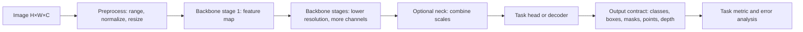

# Изображение, карты признаков и блоки модели

**Уровень:** общее ядро.

**Предпосылки:** [Изображения, аннотации и синхронные преобразования](<../01-data-features/03-modalities/df-images.md>)

**Используют:** [Классификация, CNN и residual learning](<cv-classification.md>), [Vision Transformer: patches, attention и обучение](<cv-vit.md>), [Detection: множества объектов, IoU, AP и архитектуры](<cv-detection.md>), [Semantic segmentation: FCN, U-Net и DeepLab](<cv-semantic.md>), [Instance segmentation: Mask R-CNN и prototype masks](<cv-instance.md>), [Pose: keypoints, heatmaps и группировка](<cv-pose.md>), [Ориентированные рамки и периодичность угла](<cv-obb.md>), [Tracking: Kalman, association и идентичность](<cv-tracking.md>), [Depth: геометрия, масштаб и DPT](<cv-depth.md>), [CLIP, открытый словарь и YOLO-World](<cv-open-vocabulary.md>)

**Учебный вопрос:** Как меняются форма, разрешение и рецептивное поле по пути изображения?

CV-маршрут начинается с локального определения изображения, карты признаков и обучаемого блока. Языковые модели и BERT не входят в его предпосылки.

## Карта вычисления и границы этапов

Читайте схему по направлению стрелок: первый блок задаёт вход, средние — преобразования и их состояние, последний — результат и способ проверки. Сравните формы и смысл каждого перехода с формулами главы. Выход преобразования и доказательство его качества — разные объекты: последняя проверка использует отдельный протокол оценки.

<!-- unit:2d56248bb4de423525 -->

## Изображение как массив и контракт входа

<!-- /unit:2d56248bb4de423525 -->

<!-- unit:9ceb475d060fb87903 -->

Цветное изображение можно представить тензором $X\in\mathbb{R}^{H\times W\times C}$: высота, ширина и каналы. В PyTorch типичный batch имеет NCHW-форму $[B,C,H,W]$, а некоторые библиотеки используют NHWC. Одинаковые числа с переставленными осями означают разные данные: передача NHWC туда, где ожидают NCHW, меняет смысл размеров или вызывает ошибку.

<!-- /unit:9ceb475d060fb87903 -->

<!-- unit:94e8b84b5b8f4eff6c -->

Пример: batch из 8 RGB-картинок $224\times224$ в NCHW имеет форму $[8,3,224,224]$. Число элементов равно $8\cdot3\cdot224\cdot224=1\,204\,224$. При float32 только вход занимает $1\,204\,224\cdot4=4\,816\,896$ байт, около 4.59 MiB. Это не включает активации и параметры модели.

<!-- /unit:94e8b84b5b8f4eff6c -->

<!-- unit:1b4dcefdff0fb15ed4 -->

Пиксельный диапазон и нормализация — часть контракта модели. Если файл хранит uint8 в $[0,255]$, перевод в float и деление на 255 даёт $[0,1]$. Затем поканально могут применить $x'_c=(x_c-\mu_c)/\sigma_c$. Нельзя повторно нормализовать уже нормализованные входы или применять статистики другого checkpoint: это сдвигает распределение входа.

<!-- /unit:1b4dcefdff0fb15ed4 -->

<!-- unit:d126a1e410ad0d42ef -->

Изменение размера требует определить, сохраняются ли пропорции. Прямое растяжение $(H,W)\to(224,224)$ меняет геометрию. Letterbox масштабирует изображение единым коэффициентом и добавляет поля; для координат предсказания потом нужно убрать padding и обратить scale. Crop сохраняет размер, но может удалить объект. Выбор преобразования связан с тем, какие примеры и аннотации считаются допустимыми.

<!-- /unit:d126a1e410ad0d42ef -->

<!-- unit:dd53330ec75f5e7015 -->

## Свёртка и формы feature maps

<!-- /unit:dd53330ec75f5e7015 -->

<!-- unit:53cb3505f10188df17 -->

Свёрточный слой применяет $C_{out}$ фильтров размера $K_h\times K_w$ ко всем пространственным позициям входа. Каждый фильтр смешивает входные каналы и локальное окно. При dilation $D$, stride $S$ и padding $P$ размер выхода по высоте равен

<!-- /unit:53cb3505f10188df17 -->

<!-- unit:52d774d160d70921df -->

$$
H_{out}=\left\lfloor\frac{H+2P-D(K_h-1)-1}{S}+1\right\rfloor,
$$

<!-- /unit:52d774d160d70921df -->

<!-- unit:a9fb2987dfd2325a30 -->

аналогично для ширины. Для входа $[B,3,32,32]$ и Conv2d с 16 фильтрами $3\times3$, stride 1, padding 1 получаем $[B,16,32,32]$. Без padding размер был бы $30\times30$. Если stride равен 2, при padding 1 размер будет $16\times16$.

<!-- /unit:a9fb2987dfd2325a30 -->

<!-- unit:def3c156e46a8095f1 -->

В PyTorch вес такого слоя имеет форму $[C_{out},C_{in},K_h,K_w]$, а bias — $[C_{out}]$. Один выходной элемент — сумма произведений kernel, локального окна и каналов плюс bias. Один фильтр использует $3\cdot3\cdot3=27$ весов; 16 фильтров имеют $16\cdot27+16=448$ параметров.

<!-- /unit:def3c156e46a8095f1 -->

<!-- unit:0f540c781832dc1529 -->

Рецептивное поле говорит, какую область входа может влиять на одну позицию feature map. Для последовательных слоёв удобно вести два числа: размер поля $r$ и расстояние $j$ между соседними позициями на исходном изображении. Изначально $r_0=j_0=1$. Для слоя с kernel $k$, stride $s$, dilation $d$:

<!-- /unit:0f540c781832dc1529 -->

<!-- unit:f459b3e397a294f356 -->

$$
r_{l}=r_{l-1}+(k-1)d\,j_{l-1},\qquad j_l=s\,j_{l-1}.
$$

<!-- /unit:f459b3e397a294f356 -->

<!-- unit:b3da27c17fb8d48f03 -->

Два слоя $3\times3$ со stride 1 дают поле $1\to3\to5$. Если второй слой имеет stride 2, поле всё ещё 5, а соседние выходы разнесены на 2 пикселя исходного изображения. Padding определяет, как граничные позиции дополняются; он не добавляет реальный контекст за границей картинки.

<!-- /unit:b3da27c17fb8d48f03 -->

<!-- unit:dd9052e82d8c6827eb -->

## От backbone к задаче

<!-- /unit:dd9052e82d8c6827eb -->

<!-- unit:b4067f6a9f04d9a715 -->

Backbone преобразует вход в признаки. На каждом stage обычно уменьшается пространственное разрешение и меняется число каналов. Например, $[B,3,224,224]\to[B,64,112,112]\to[B,128,56,56]\to[B,256,28,28]$. Это пример форм, а не универсальный стандарт архитектуры.

<!-- /unit:b4067f6a9f04d9a715 -->

<!-- unit:8e88cdd6d77e07ef46 -->

Если downstream задаче полезны карты разных разрешений, neck объединяет признаки stages. Feature pyramid может передать детектору и высокое пространственное разрешение для маленьких объектов, и более крупные рецептивные поля для контекста. Head преобразует признаки в выход, соответствующий контракту задачи: class logits, координаты boxes, pixel logits, keypoints, depth или image-text scores. Для segmentation decoder часто повышает разрешение и объединяет признаки, но слово decoder в другой архитектуре может обозначать иной блок; важен поток данных и форма результата.

<!-- /unit:8e88cdd6d77e07ef46 -->

<!-- unit:306fa49e9509dda304 -->

Схема общего пути:

<!-- /unit:306fa49e9509dda304 -->

<!-- unit:bf27baaf32523711b3 -->

<!-- /unit:bf27baaf32523711b3 -->

<!-- unit:2c99798003d137ffa1 -->

На практике записывают форму и смысл выхода каждого прямоугольника. Для классификации head может свести пространственные оси pooling-операцией и вернуть $[B,K]$. Детектор возвращает набор кандидатов или queries с scores и координатами; сегментация — logits примерно $[B,K,H',W']$, которые могут быть приведены к размеру входа. Одного названия backbone недостаточно, чтобы восстановить эти интерфейсы.

<!-- /unit:2c99798003d137ffa1 -->

<!-- unit:5af7cc4d3663b1f5f8 -->

## Проверка на маленьком примере

<!-- /unit:5af7cc4d3663b1f5f8 -->

<!-- unit:0a57603796aca77748 -->

Пусть вход $32\times32$ проходит три свёртки: $3\times3$, stride 1, padding 1; затем $3\times3$, stride 2, padding 1; затем $3\times3$, stride 2, padding 1. Пространственные размеры: $32\to16\to8$. Если число выходных каналов равно 8, 16 и 32, формы будут $[B,8,32,32]\to[B,16,16,16]\to[B,32,8,8]$.

<!-- /unit:0a57603796aca77748 -->

<!-- unit:c66cad3d5d1ae18dbb -->

Рецептивное поле последовательно: первый слой $r=3,j=1$; второй $r=5,j=2$; третий $r=9,j=4$. Поэтому соседние клетки последней карты смотрят на участки с центрами, разделёнными четырьмя пикселями; каждая клетка зависит от окна размером $9\times9$ с учётом padding. Глобальный pooling затем может получить один вектор на изображение, но локализация объектов потребует сохранить пространственную структуру или восстановить её в head/decoder.

<!-- /unit:c66cad3d5d1ae18dbb -->

<!-- unit:bc2a11a7e995c09746 -->

## Ограничения и самопроверка

<!-- /unit:bc2a11a7e995c09746 -->

<!-- unit:d79d9d8921c1f105be -->

- Перестановка каналов RGB/BGR, неверный dtype, диапазон или нормализация меняют вход даже при корректной форме.
- Resize, crop и letterbox влияют на геометрию; обратное преобразование координат является частью prediction pipeline.
- Размер рецептивного поля не доказывает, что модель использует каждый пиксель этой области или понимает объект целиком.
- Feature map не является готовым объяснением или семантической маской. Интерпретация требует отдельного метода и проверки.
- Backbone/neck/head — полезные роли в схеме, но конкретные архитектуры могут объединять их или называть иначе.

<!-- /unit:d79d9d8921c1f105be -->

<!-- unit:afcdb52293730e1efd -->

**Вопросы.** 1) Какова форма batch из 4 RGB изображений $64\times48$ в NCHW? 2) Какой выход даёт Conv2d с $k=3,s=2,p=1$ на размере 32? 3) Что нужно сделать с box после letterbox? 4) Почему один class logit не заменяет mask?

<!-- /unit:afcdb52293730e1efd -->

<!-- unit:8a64494ec278b1e5ef -->

**Ответы.** 1) $[4,3,64,48]$. 2) $16$, поскольку $\lfloor(32+2-3)/2+1\rfloor=16$. 3) Вычесть поля padding и разделить координаты на коэффициент масштабирования, с учётом clipping к исходному кадру. 4) Logit классифицирует изображение или класс кандидата, но не задаёт положение метки по пикселям.

<!-- /unit:8a64494ec278b1e5ef -->

<!-- unit:dd14cb54bded0d6761 -->

**Практика.** Для входа $[2,3,256,384]$ выпишите размеры после resize до 224×224 stretch и после aspect-preserving letterbox; укажите, какие координатные преобразования нужны. Затем вручную проследите форму через две свёртки и объясните, какой выход понадобится для классификации, detection и segmentation.

<!-- /unit:dd14cb54bded0d6761 -->

## Результат главы и переход дальше

Ответьте на вопрос: **Как меняются форма, разрешение и рецептивное поле по пути изображения?** Обоснуйте ответ конкретным вычислением из главы, назовите предположение и случай, когда оно нарушается.

Следующие темы: [Классификация, CNN и residual learning](<cv-classification.md>), [Vision Transformer: patches, attention и обучение](<cv-vit.md>), [Detection: множества объектов, IoU, AP и архитектуры](<cv-detection.md>), [Semantic segmentation: FCN, U-Net и DeepLab](<cv-semantic.md>), [Instance segmentation: Mask R-CNN и prototype masks](<cv-instance.md>), [Pose: keypoints, heatmaps и группировка](<cv-pose.md>), [Ориентированные рамки и периодичность угла](<cv-obb.md>), [Tracking: Kalman, association и идентичность](<cv-tracking.md>), [Depth: геометрия, масштаб и DPT](<cv-depth.md>), [CLIP, открытый словарь и YOLO-World](<cv-open-vocabulary.md>).

[Маршрут модуля](<README.md>) · [Происхождение и точные места переноса](<../editorial/coverage.md>)
