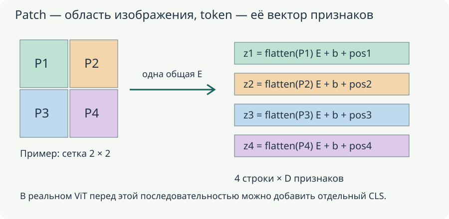
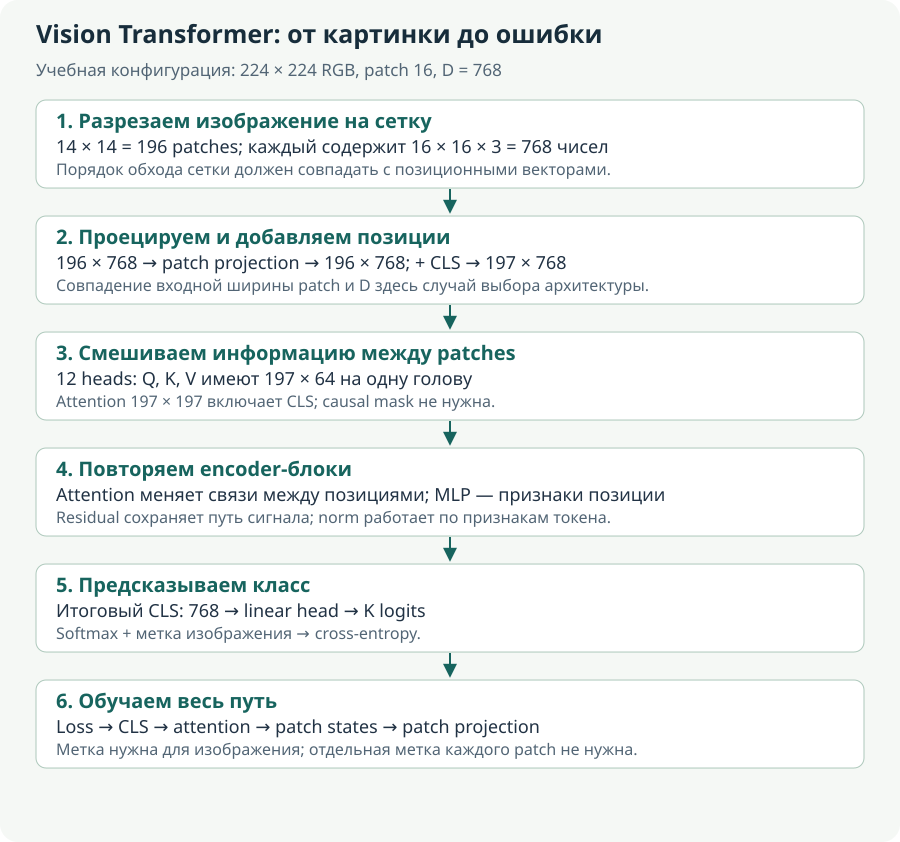

# Vision Transformer: patches, attention и обучение

**Уровень:** основа ветки.

**Предпосылки:** [Изображение, карты признаков и блоки модели](<cv-input.md>), [Классификация, CNN и residual learning](<cv-classification.md>)

**Используют:** [Углубление: Swin и иерархические представления](<cv-hierarchy.md>), [Углубление: SSL, MAE, DeiT и DINOv3](<cv-pretraining.md>)

**Учебный вопрос:** Как patch projection, позиции и attention преобразуют изображение?

Здесь все нужные понятия attention и Transformer вводятся для изображения локально. Чтение языковых моделей не требуется. Patches, позиции, shapes и обучение разобраны по вычислительным шагам; SSL и Swin находятся в отдельных углублениях.


## Карта вычисления и границы этапов


Читайте схему по направлению стрелок: первый блок задаёт вход, средние — преобразования и их состояние, последний — результат и способ проверки. Сравните формы и смысл каждого перехода с формулами главы. Выход преобразования и доказательство его качества — разные объекты: последняя проверка использует отдельный протокол оценки.

<!-- unit:3bd68b1906e145038d -->
<a id="u-3bd68b1906e145038d"></a>

## ViT: изображение становится последовательностью

<!-- /unit:3bd68b1906e145038d -->

<!-- unit:5c3c18e390b4fd76fd -->
<a id="u-5c3c18e390b4fd76fd"></a>

ViT делит изображение на patches, проецирует каждый в D-мерный vector, добавляет position information и обрабатывает Transformer encoder. Для обычного classification attention bidirectional по доступным image tokens. В отличие от decoder-only LLM, causal mask здесь обычно не нужна.

<!-- /unit:5c3c18e390b4fd76fd -->

<!-- unit:1d395dee0b83ef1b12 -->
<a id="u-1d395dee0b83ef1b12"></a>

Пусть B — batch, C — channels, H/W — размеры, P — сторона неперекрывающегося patch. Если размеры делятся на P:

<!-- /unit:1d395dee0b83ef1b12 -->

<!-- unit:9d16bd37431708fa0a -->
<a id="u-9d16bd37431708fa0a"></a>

$$
\begin{gathered}N_h=\frac HP,\quad N_w=\frac WP,\quad N=N_hN_w,\quad K_{\mathrm{patch}}=CP^2,\\X\in\mathbb{R}^{B\times C\times H\times W},\quad X_{\mathrm{patches}}\in\mathbb{R}^{B\times N\times K_{\mathrm{patch}}},\\E\in\mathbb{R}^{K_{\mathrm{patch}}\times D},\quad b\in\mathbb{R}^{D},\qquad Z=X_{\mathrm{patches}}E+b\in\mathbb{R}^{B\times N\times D}.\end{gathered}
$$

<!-- /unit:9d16bd37431708fa0a -->

<!-- unit:e3a41ec94a06b52ab9 -->
<a id="u-e3a41ec94a06b52ab9"></a>

Embedding width D задаётся архитектурой и не обязана равняться CP². Совпадение 768 для RGB patches $16\times 16$ и ViT-Base $D=768$ — частный выбор.

<!-- /unit:e3a41ec94a06b52ab9 -->

<!-- unit:859da61bcbd15c88f7 -->
<a id="u-859da61bcbd15c88f7"></a>

Для H=W=224,$P=16$,$C=3$ получаем сетку $14\times 14$, $N=196$, K_patch=768. Матрица проекции содержит $768\cdot 768+768=590 592$ параметра с bias. Добавление одного learned CLS token даёт длину 197; его итоговое state используют для head. Другой вариант — pooling patch states, так что CLS не обязательная математическая часть всех ViT.

<!-- /unit:859da61bcbd15c88f7 -->

<!-- unit:30932f7a9b98ac50fa -->
<a id="u-30932f7a9b98ac50fa"></a>

Далее, для одного encoder head при row tokens:

<!-- /unit:30932f7a9b98ac50fa -->

<!-- unit:72d6610dbbf62afdef -->
<a id="u-72d6610dbbf62afdef"></a>

$$
Q=ZW_Q,\quad K=ZW_K,\quad V=ZW_V,\qquad S=\operatorname{softmax}_{\mathrm{rows}}\!\left(\frac{QK^\top}{\sqrt{d_k}}\right),\quad O=SV.
$$

<!-- /unit:72d6610dbbf62afdef -->

<!-- unit:41944536321b287f06 -->
<a id="u-41944536321b287f06"></a>

Multi-head outputs объединяются, проецируются, добавляются residual/norm и tokenwise MLP. Векторы patches получают глобальный контекст через attention. Подробный backward этого механизма уже разобран в [основах LLM](<../05-language-models/01-foundations/lm-attention.md>): смена modality не меняет chain rule.

<!-- /unit:41944536321b287f06 -->

<!-- unit:41bb9146bd576bc4b9 -->
<a id="u-41bb9146bd576bc4b9"></a>

### Почему в ViT нужен отдельный CLS и что он получает

<!-- /unit:41bb9146bd576bc4b9 -->

<!-- unit:7219b1b7d7984b84d1 -->
<a id="u-7219b1b7d7984b84d1"></a>

CLS — обучаемый начальный вектор длины D, который добавляется как ещё одна позиция. В начале forward он общий для разных изображений, но после attention его состояние зависит от patches данного изображения. Он может использовать их K/V и в последующих блоках снова уточнять representation. Таким образом, общий параметр CLS и выходной state CLS — разные объекты, как token embedding и contextual state в текстовой модели.

<!-- /unit:7219b1b7d7984b84d1 -->

<!-- unit:dd326e6d37e6bdcccb -->
<a id="u-dd326e6d37e6bdcccb"></a>

Потеря классификации на итоговом CLS возвращает градиент к использованным patch states, далее к patch projection и пикселям вычислительного графа. Не требуется отдельная целевая метка для каждого patch, чтобы они участвовали в обучении. Альтернатива — mean-pooling patch states; выбор агрегатора должен соответствовать обучению checkpoint, а не произвольно меняться только при оценке.

<!-- /unit:dd326e6d37e6bdcccb -->

<!-- unit:a50463e0089b087b36 -->
<a id="u-a50463e0089b087b36"></a>

MLP внутри ViT применяется к каждому токену, включая CLS, одной и той же функцией данного блока. Attention смешивает позиции, MLP преобразует признаки каждой уже контекстной строки. В обычной классификации картинки все patches известны заранее, поэтому разрешить им двусторонний обмен нормально. Causal маска LLM нужна для другой постановки — предсказания неизвестного продолжения, — и не переносится сюда только из-за общего слова Transformer.

<!-- /unit:a50463e0089b087b36 -->

<!-- unit:67fe69b4e18165eba1 -->
<a id="u-67fe69b4e18165eba1"></a>



<!-- /unit:67fe69b4e18165eba1 -->

<!-- unit:c9f5e791eab247ac8e -->
<a id="u-c9f5e791eab247ac8e"></a>

На иллюстрации E общая для всех четырёх областей, а позиционные векторы различны. Цвет обозначает исходное место, а не класс объекта. Проекция не сокращает четыре patches до одного: она меняет число признаков каждой строки.

<!-- /unit:c9f5e791eab247ac8e -->

<!-- unit:d2e623b931174ebb34 -->
<a id="u-d2e623b931174ebb34"></a>

## Полная индексация patch embedding

<!-- /unit:d2e623b931174ebb34 -->

<!-- unit:83a27fd5d9588145c2 -->
<a id="u-83a27fd5d9588145c2"></a>

Зафиксируем порядок flattened patch: сначала c, затем локальные p,q. Для $i\in\{0,\ldots,N_h-1\}$, $j\in\{0,\ldots,N_w-1\}$, $p,q\in\{0,\ldots,P-1\}$:

<!-- /unit:83a27fd5d9588145c2 -->

<!-- unit:7b8eec7ac348f1f0cd -->
<a id="u-7b8eec7ac348f1f0cd"></a>

$$
\begin{aligned}n&=iN_w+j,\qquad k=cP^2+pP+q,\\(X_{\mathrm{patches}})_{b,n,k}&=X_{b,c,iP+p,jP+q},\\Z_{b,n,d}&=\sum_k(X_{\mathrm{patches}})_{b,n,k}E_{k,d}+b_d.\end{aligned}
$$

<!-- /unit:7b8eec7ac348f1f0cd -->

<!-- unit:0a765413c60945583d -->
<a id="u-0a765413c60945583d"></a>

В original export сначала объявлялся HWC, а flatten объяснялся как для CHW. Само отображение может быть задано как угодно, но соответствие memory axes надо фиксировать. Здесь всё согласовано с NCHW.

<!-- /unit:0a765413c60945583d -->

<!-- unit:ce6285687ff176a23f -->
<a id="u-ce6285687ff176a23f"></a>

Линейная проекция всех patches эквивалентна Conv2d с `in_channels=C, out_channels=D, kernel_size=P, stride=P, padding=0`, если:

<!-- /unit:ce6285687ff176a23f -->

<!-- unit:e2e8ec85bcbf2d797b -->
<a id="u-e2e8ec85bcbf2d797b"></a>

$$
(W_{\mathrm{conv}})_{d,c,p,q}=E_{cP^2+pP+q,\,d}.
$$

<!-- /unit:e2e8ec85bcbf2d797b -->

<!-- unit:f81fbca987d7cf753a -->
<a id="u-f81fbca987d7cf753a"></a>

Действительно:

<!-- /unit:f81fbca987d7cf753a -->

<!-- unit:f733755ee6710e4829 -->
<a id="u-f733755ee6710e4829"></a>

$$
\begin{aligned}Y_{b,d,i,j}&=\sum_{c,p,q}(W_{\mathrm{conv}})_{d,c,p,q}X_{b,c,iP+p,jP+q}+b_d\\&=Z_{b,\,iN_w+j,\,d}.\end{aligned}
$$

<!-- /unit:f733755ee6710e4829 -->

<!-- unit:9876938b1a44845eef -->
<a id="u-9876938b1a44845eef"></a>

После conv output $B\times D\times N_{h}\times N_{w}$ нужно flatten spatial и transpose в $B\times N\times D$. В PyTorch `Linear.weight` имеет $D\times K_{\mathrm{patch}}$, то есть хранит Eᵀ нашей формулы. Переставить веса без этого transpose/reshape — ошибка, которая не обязательно обнаружится только по конечным shapes.

<!-- /unit:9876938b1a44845eef -->

<!-- unit:d129541fe4bac43779 -->
<a id="u-d129541fe4bac43779"></a>

### Разделяем четыре индекса, чтобы восстановить математику исходника

<!-- /unit:d129541fe4bac43779 -->

<!-- unit:fff1c7beb7b71bbb8a -->
<a id="u-fff1c7beb7b71bbb8a"></a>

Проследим адрес конкретного элемента patch и все промежуточные индексы. Пусть $C=3$, $H=W=32$, $P=8$. Тогда $N_w=4$. Для patch с i=1,j=2 получаем n=6. Внутри него возьмём c=2,p=3,q=5; flattened индекс k=$2\cdot64+3\cdot8+5=157$. Этому числу соответствует пиксель $X_{b,2,11,21}$, поскольку глобальные координаты равны $(1\cdot8+3,2\cdot8+5)$.

<!-- /unit:fff1c7beb7b71bbb8a -->

<!-- unit:d839875fd1fa294b00 -->
<a id="u-d839875fd1fa294b00"></a>

Одна координата embedding d умножает этот пиксель на $E_{157,d}$ и складывает с аналогичными вкладами остальных 191 элементов patch. Один и тот же E используется у patch n=0, n=6 и всех остальных. Отдельной матрицы «для верхнего левого patch» нет; различие мест сообщит позиционная информация на следующем шаге.

<!-- /unit:d839875fd1fa294b00 -->

<!-- unit:ed53219ce92bc8c62d -->
<a id="u-ed53219ce92bc8c62d"></a>

Для всех patches одной картинки $Z=X_{patches}E+\mathbf1_N b^\top$. Запись с единичным столбцом показывает bias без неявного broadcasting: одна и та же строка $b^\top$ прибавляется N раз. Для batch повторяется та же операция независимо по B; веса не умножаются на размер batch при подсчёте параметров.

<!-- /unit:ed53219ce92bc8c62d -->

<!-- unit:d102dc2fd212614644 -->
<a id="u-d102dc2fd212614644"></a>

### Почему эквивалентности Conv2d недостаточно объявить на словах

<!-- /unit:d102dc2fd212614644 -->

<!-- unit:265f229679554c82a7 -->
<a id="u-265f229679554c82a7"></a>

Возьмём канал d выходной свёртки. Его filter содержит $CP^2$ коэффициентов, каждый для конкретных c,p,q. При stride=P и без padding filter на location i,j видит ровно patch i,j. Каждое слагаемое произведения совпадает с соответствующим членом линейной проекции, если kernel присвоен по приведённому выше индексу k. Bias совпадает тоже. Так устанавливается поэлементное равенство, а не только похожесть форм.

<!-- /unit:265f229679554c82a7 -->

<!-- unit:c510d5d9baa978dd12 -->
<a id="u-c510d5d9baa978dd12"></a>

После conv ось d стоит второй: $B\times D\times N_h\times N_w$. Для Transformer tokens должны стоять перед каналами: spatial оси объединяются в N, после чего происходит transpose в $B\times N\times D$. Операция `reshape` без нужной перестановки может сохранить число элементов и дать желаемую форму, но перемешать содержимое токенов. Проверять нужно реальные значения на нумерованном входе, а не только shape.

<!-- /unit:c510d5d9baa978dd12 -->

<!-- unit:888f95a89b52f25aeb -->
<a id="u-888f95a89b52f25aeb"></a>

В источнике заявлялся HWC, а формула flatten соответствовала CHW. Оба порядка допустимы отдельно. Если выбрать HWC, коэффициент должен следовать индексу $(pP+q)C+c$; тогда и строки E переставляются соответственно. Одинаковая E при разных flatten-порядках задаёт другую функцию. Эта поправка сохраняет все шаги исходного объяснения и устраняет его неоднозначность.

<!-- /unit:888f95a89b52f25aeb -->

<!-- unit:45ce0dc7a6a06b6837 -->
<a id="u-45ce0dc7a6a06b6837"></a>

### Формы реализации без зависимого от версии training API

<!-- /unit:45ce0dc7a6a06b6837 -->

<!-- unit:4c0f7ec9f7ec42d0a7 -->
<a id="u-4c0f7ec9f7ec42d0a7"></a>

Для NCHW входа путь через patches можно описать последовательностью операций:

<!-- /unit:4c0f7ec9f7ec42d0a7 -->

<!-- unit:e7f2d634c24e58e42e -->
<a id="u-e7f2d634c24e58e42e"></a>

```python
# X: B, C, H, W; H и W делятся на P
patches = X.unfold(2, P, P).unfold(3, P, P)
# B, C, N_h, N_w, P, P
patches = patches.permute(0, 2, 3, 1, 4, 5)
# B, N_h, N_w, C, P, P
patches = patches.reshape(B, N_h * N_w, C * P * P)
Z = linear(patches)  # Linear.weight имеет D, C*P*P

# Эквивалентный путь при согласованных весах
Y = conv(X)          # B, D, N_h, N_w; kernel=P, stride=P
Z_conv = Y.flatten(2).transpose(1, 2)
```

<!-- /unit:e7f2d634c24e58e42e -->

<!-- unit:23cc800cd5c3890179 -->
<a id="u-23cc800cd5c3890179"></a>

Это учебное сопоставление forward, а не код полного обучения. Чтобы скопировать веса, в нашей записи нужно $W_{conv}=E^\top$, reshaped в D×C×P×P. Сравнение `Z` и `Z_conv` при одинаковом bias проверяет и соглашение об осях, и корректность извлечения patches.

<!-- /unit:23cc800cd5c3890179 -->

<!-- unit:80f2fa5d99784b6e5c -->
<a id="u-80f2fa5d99784b6e5c"></a>

### Минимальный ручной пример

<!-- /unit:80f2fa5d99784b6e5c -->

<!-- unit:b3825d9bbc7515366d -->
<a id="u-b3825d9bbc7515366d"></a>

Одноканальное $4\times 4$ изображение содержит числа 1…16 по строкам. При $P=2$ первый patch $\left(1,\,2,\,5,\,6\right)$, второй $\left(3,\,4,\,7,\,8\right)$, третий $\left(9,\,10,\,13,\,14\right)$, четвёртый $\left(11,\,12,\,15,\,16\right)$. Возьмём $D=2$, bias=0 и columns E:

<!-- /unit:b3825d9bbc7515366d -->

<!-- unit:4ed54ae0f502cd6fff -->
<a id="u-4ed54ae0f502cd6fff"></a>

$$
E_{:,1}=\begin{bmatrix}1\\1\\1\\1\end{bmatrix},\qquad E_{:,2}=\begin{bmatrix}1\\0\\0\\-1\end{bmatrix}.
$$

<!-- /unit:4ed54ae0f502cd6fff -->

<!-- unit:5b3726646e14c22828 -->
<a id="u-5b3726646e14c22828"></a>

Получим $Z=\begin{bmatrix}14 & -5\\22 & -5\\46 & -5\\54 & -5\end{bmatrix}$. Два conv filters $\begin{bmatrix}1 & 1\\1 & 1\end{bmatrix}$ и $\begin{bmatrix}1 & 0\\0 & -1\end{bmatrix}$ со stride2 дадут те же четыре vectors. Первая координата суммирует patch; вторая сравнивает диагональные pixels. Это пример learned linear filters, а не обязательное значение реальных trained columns.

<!-- /unit:5b3726646e14c22828 -->

<!-- unit:6af34104b599a341b3 -->
<a id="u-6af34104b599a341b3"></a>

Gradient также прозрачен. При $G=\frac{\partial\mathcal{L}}{\partial Z}$ матрично $\frac{\partial\mathcal{L}}{\partial E}=X_{\mathrm{patches}}^\top G$, $\frac{\partial\mathcal{L}}{\partial X_{\mathrm{patches}}}=GE^\top$, а bias gradient суммирует B/N. Входной gradient раскладывается обратно по местам patches. При overlap вклады в одни pixels складываются.

<!-- /unit:6af34104b599a341b3 -->

<!-- unit:75fd69e3751c1ffc97 -->
<a id="u-75fd69e3751c1ffc97"></a>

### Что именно обучается в E и как читать её строки и столбцы

<!-- /unit:75fd69e3751c1ffc97 -->

<!-- unit:65799026e29cc78de9 -->
<a id="u-65799026e29cc78de9"></a>

В соглашении E размера $CP^2\times D$ столбец $E_{:,d}$ — полный linear filter для координаты d. Строка $E_{k,:}$ описывает, как один входной элемент patch влияет на все D координат. В разбираемом примере оба объекта назывались «шаблоном»; различие полезно для проверки shapes: у фильтра одного output должно быть столько коэффициентов, сколько входных элементов, то есть CP².

<!-- /unit:65799026e29cc78de9 -->

<!-- unit:6bd8e73764f1516645 -->
<a id="u-6bd8e73764f1516645"></a>

Проекция с D<CP² не может быть обратимой на всём пространстве pixels: её rank не больше D, часть направлений теряется. При D≥CP² и полном столбцовом/строчном ранге в согласованной ориентации сама линейная часть может сохранять достаточно информации для восстановления, но objective классификации не требует этого. Даже квадратная E не обязана быть невырожденной. Поэтому равенство D=768 и CP²=768 не означает «без потерь» автоматически.

<!-- /unit:6bd8e73764f1516645 -->

<!-- unit:f2826ba855da52add7 -->
<a id="u-f2826ba855da52add7"></a>

Backward по E суммирует вклады всех patches всех B объектов. Для одного output $Z_{b,n,d}$ производная по $E_{k,d}$ равна значению соответствующего pixel-компонента $X_{patches,b,n,k}$. Через loss этот вклад умножается на downstream gradient $G_{b,n,d}$. Поэтому один filter может обучаться на разных местах картинки одновременно. При overlap один пиксель участвует в нескольких patches, и его входные градиенты суммируются; простое присваивание последнего вклада потеряло бы часть производной.

<!-- /unit:f2826ba855da52add7 -->

<!-- unit:e38c158253328dc9f3 -->
<a id="u-e38c158253328dc9f3"></a>

Числа исходного примера для больших ширин также сохраняются: при P=16,C=3,D=1024 projection имеет $768\cdot1024+1024=787456$ параметров. При P=14,C=3,D=1280 — $588\cdot1280+1280=753920$ с bias. Число 752640 из рассматриваемого примера учитывает только матрицу. Нельзя сравнивать его с бюджетом другого варианта, где bias уже включён, без пояснения.

<!-- /unit:e38c158253328dc9f3 -->

<!-- unit:55a1f69d1e6c97935d -->
<a id="u-55a1f69d1e6c97935d"></a>

## Зачем patches, positions и какие ограничения

<!-- /unit:55a1f69d1e6c97935d -->

<!-- unit:443bc9db3298106a82 -->
<a id="u-443bc9db3298106a82"></a>

Если сделать token из каждого pixel $224\times 224$, $N=50$ 176, матрица attention имеет около 2.52 млрд элементов на head. Для $N=196$ — 38 416. Отношение **числа pairwise entries** равно $256^2=65 536$ без CLS. Это не 65 536-кратный выигрыш полного training: остаются projections/MLP, другая ширина и kernels.

<!-- /unit:443bc9db3298106a82 -->

<!-- unit:5709d38647e4558d6e -->
<a id="u-5709d38647e4558d6e"></a>

Уменьшение P увеличивает N и сохраняет более мелкую spatial структуру, но повышает attention cost. При doubling обеих сторон изображения N растёт вчетверо, pairwise entries — в 16 раз. Поэтому resolution влияет иначе, чем только число parameters.

<!-- /unit:5709d38647e4558d6e -->

<!-- unit:62b46142ff0d9b41c0 -->
<a id="u-62b46142ff0d9b41c0"></a>

Одинаковая linear projection применяется к каждому patch. Если переставить patches, выходные vectors переставятся так же: это **equivariance**, не invariance. Последовательность сама помнит порядок индексов в массиве, но без position information стандартный Transformer encoder не получает привилегированной геометрии этой сетки. Learned absolute/relative position schemes добавляют spatial relations; при новом resolution может требоваться корректная interpolation/иная схема.

<!-- /unit:62b46142ff0d9b41c0 -->

<!-- unit:89cebb67de2be57161 -->
<a id="u-89cebb67de2be57161"></a>

Из linear embedding не следует, что semantic patches автоматически близки. Это свойство зависит от обучения всех последующих layers/objective. CNN имеет сильные locality/weight sharing priors; ViT получает часть locality через patches, но глобальное смешивание attention устроено иначе. Больше данных/pretraining часто помогает ViT, однако «ViT всегда требует гигантский dataset» слишком категорично: data-efficient training и transfer меняют условия. [ViT](https://arxiv.org/abs/2010.11929).

<!-- /unit:89cebb67de2be57161 -->

<!-- unit:cdb71743452819dfe3 -->
<a id="u-cdb71743452819dfe3"></a>

### Перестановка patches: точное свойство и предел интуиции

<!-- /unit:cdb71743452819dfe3 -->

<!-- unit:61540072fde32c63a7 -->
<a id="u-61540072fde32c63a7"></a>

Пусть Π переставляет N строк $X_{patches}$. Тогда shared linear projection даёт

<!-- /unit:61540072fde32c63a7 -->

<!-- unit:134d797fc17b91f85f -->
<a id="u-134d797fc17b91f85f"></a>

$$
(\Pi X_{patches})E+\mathbf1 b^\top=\Pi(X_{patches}E+\mathbf1 b^\top).
$$

<!-- /unit:134d797fc17b91f85f -->

<!-- unit:4a3a086050a2649fe2 -->
<a id="u-4a3a086050a2649fe2"></a>

Output меняется той же перестановкой. Это equivariance. Если затем усреднить строки без позиционной информации, получится одинаковое среднее — уже инвариантность конкретного агрегированного результата. Эти два утверждения нельзя смешивать.

<!-- /unit:4a3a086050a2649fe2 -->

<!-- unit:661adef1521c90bf21 -->
<a id="u-661adef1521c90bf21"></a>

Представим два изображения из одинаковых patches: небо сверху и трава снизу, затем наоборот. При отсутствии position information encoder с глобальным permutation-equivariant attention не получает привилегированной привязки patch к ячейке исходной сетки; pooling/CLS может не различить такую перестановку в идеализированных условиях. Фиксированная позиционная сетка, прибавленная к embeddings, нарушает эту симметрию: один patch получает другое сочетание content и location.

<!-- /unit:661adef1521c90bf21 -->

<!-- unit:3ed3953599ee070752 -->
<a id="u-3ed3953599ee070752"></a>

Если вместе переставить и patches, и их позиционные векторы, соответствие снова будет сохранено. Поэтому важен именно способ закрепления positional information за местами. При смене resolution число grid-позиций меняется. Для learned absolute embeddings иногда интерполируют spatial grid, обрабатывая CLS отдельно; это техника согласования формы, а не гарантия сохранения качества на любом размере.

<!-- /unit:3ed3953599ee070752 -->

<!-- unit:cfa0368c43273a9d9d -->
<a id="u-cfa0368c43273a9d9d"></a>

### Когда менять patch size, а когда архитектуру

<!-- /unit:cfa0368c43273a9d9d -->

<!-- unit:0948e9e8ff632e7f4b -->
<a id="u-0948e9e8ff632e7f4b"></a>

При 224×224 переход P=16→P=8 увеличивает N с 196 до 784, то есть вчетверо, а число pairwise entries с 38416 до 614656, то есть в шестнадцать раз. При P=14 N=256 и 65536 entries, примерно в 1.706 раза больше, чем при P=16. Это нагляднее формулировки «патч немного меньше»: небольшое изменение стороны может заметно увеличить attention.

<!-- /unit:0948e9e8ff632e7f4b -->

<!-- unit:71d5a22c358c040e2f -->
<a id="u-71d5a22c358c040e2f"></a>

При этом размер матрицы projection при фиксированном D уменьшается вместе с P². Значит, «меньше параметров patch embedding» может сочетаться с «намного больше вычислений attention». Общие FLOPs включают и Q/K/V projections, и MLP по всем N, поэтому ни parameter count, ни N² отдельно не описывают полную скорость.

<!-- /unit:71d5a22c358c040e2f -->

<!-- unit:64df10d686a8db6dfe -->
<a id="u-64df10d686a8db6dfe"></a>

Перекрывающиеся patches используют stride S<P; без padding число позиций по высоте равно $\lfloor(H-P)/S\rfloor+1$. Не следует продолжать формулу N=HW/P² для этого случая. Overlap даёт более плотное покрытие и новые связи на входе, одновременно увеличивая N. Conv stem добавляет несколько локальных нелинейных преобразований до token sequence. Иерархическая схема может уменьшать spatial grid по стадиям, а оконное внимание ограничивает взаимодействия; это разные способы контролировать стоимость и локальность.

<!-- /unit:64df10d686a8db6dfe -->

<!-- unit:5fa2c179cd70acf662 -->
<a id="u-5fa2c179cd70acf662"></a>

CNN и ViT поэтому нельзя ранжировать только по словам «маленький» и «большой dataset». Pretraining, аугментации, разрешение, teacher signals и compute меняют условия. Содержательный вывод из разбираемого примера сохраняется: CNN даёт более сильную встроенную локальную структуру, ViT с глобальным attention позволяет прямой обмен между удалёнными patches. Выбор проверяется в сопоставимом протоколе. Архитектурная основа patch sequence — [оригинальный ViT](https://arxiv.org/abs/2010.11929).

<!-- /unit:5fa2c179cd70acf662 -->

<!-- unit:d33c22ed7705454c05 -->
<a id="u-d33c22ed7705454c05"></a>

## Полное обучение ViT: от метки картинки до patch projection

<!-- /unit:d33c22ed7705454c05 -->

<!-- unit:9d53b67bfccdcd5444 -->
<a id="u-9d53b67bfccdcd5444"></a>



<!-- /unit:9d53b67bfccdcd5444 -->

<!-- unit:96e5541c6c5fbea7ab -->
<a id="u-96e5541c6c5fbea7ab"></a>

На схеме специально показаны обе оси: число токенов 197 и ширина признаков 768. Attention смешивает токены вдоль первой оси, а MLP преобразует координаты вдоль второй. Равные численные размеры patch vector и hidden state в этом примере не делают две операции одинаковыми. Схема и следующий разбор — разбор механизмов; учебные числа не являются отчётом о тренировке модели.

<!-- /unit:96e5541c6c5fbea7ab -->

<!-- unit:06b7bad3f65777af9e -->
<a id="u-06b7bad3f65777af9e"></a>

### Почему одной метки достаточно для всех patches

<!-- /unit:06b7bad3f65777af9e -->

<!-- unit:97fb99885a13bea8a9 -->
<a id="u-97fb99885a13bea8a9"></a>

Пусть изображение принадлежит классу «кошка», а head выдаёт три logits для классов «кошка», «собака», «автомобиль». Из выходного CLS получаем $z=h_{\rm CLS}W+b$. При вероятностях $(0.6,0.3,0.1)$ loss равна $-\log0.6\approx0.510826$, градиент по logits — $(-0.4,0.3,0.1)$. Этот вектор проходит через head к итоговому CLS, затем через все encoder-блоки.

<!-- /unit:97fb99885a13bea8a9 -->

<!-- unit:a043430130a771f9d9 -->
<a id="u-a043430130a771f9d9"></a>

В attention CLS содержит взвешенную смесь V других позиций. Поэтому градиент приходит к patch values, к keys, повлиявшим на веса, и к query CLS. Через ранние слои он достигает самой patch projection. Если один и тот же параметр E использовался для всех 196 patches, его итоговый градиент суммирует вклады всех этих применений, всех изображений batch и всех путей в графе. Не нужно назначать каждому patch класс «кошка»; такая искусственная разметка вообще неверна для patches, содержащих только фон.

<!-- /unit:a043430130a771f9d9 -->

<!-- unit:ddf18197fa3dd8a8f1 -->
<a id="u-ddf18197fa3dd8a8f1"></a>

Для проекции $Z=PE+b$, где строки P — распрямлённые patches, при градиенте $G=\partial\mathcal L/\partial Z$ имеем

<!-- /unit:ddf18197fa3dd8a8f1 -->

<!-- unit:0838a9f30780ad7a2b -->
<a id="u-0838a9f30780ad7a2b"></a>

$$
\frac{\partial\mathcal L}{\partial E}=P^\top G,\qquad
\frac{\partial\mathcal L}{\partial P}=GE^\top,\qquad
\frac{\partial\mathcal L}{\partial b}=\sum_n G_n.
$$

<!-- /unit:0838a9f30780ad7a2b -->

<!-- unit:ac1d42a2d57dc4248c -->
<a id="u-ac1d42a2d57dc4248c"></a>

Сумма дополнительно охватывает batch. Первое равенство показывает обучение patch projection; второе — как сигнал можно вернуть к пикселям, например для анализа чувствительности. Обычное supervised обучение обновляет E и другие параметры, а не заменяет исходные пиксели train dataset шагом optimizer. Наличие производной по входу не означает, что вход — обучаемый параметр.

<!-- /unit:ac1d42a2d57dc4248c -->

<!-- unit:fcaa7ef519b147b356 -->
<a id="u-fcaa7ef519b147b356"></a>

### Чему учатся CLS и position embeddings

<!-- /unit:fcaa7ef519b147b356 -->

<!-- unit:88c0de7283f7a4dc7f -->
<a id="u-88c0de7283f7a4dc7f"></a>

Начальный CLS — один параметр модели, повторённый для изображений batch. Его начальный вектор одинаков, но после первого attention результаты уже зависят от конкретных patches. Производные к исходному CLS суммируются по примерам. Этот параметр учится формировать полезный запрос и участвовать в накоплении информации, но он не содержит заранее готового класса текущей картинки.

<!-- /unit:88c0de7283f7a4dc7f -->

<!-- unit:ea5ca08d34e8c86e85 -->
<a id="u-ea5ca08d34e8c86e85"></a>

Если $Z_0=[c;PE+b]+E_{\rm pos}$, то сложение даёт прямой градиент к position embeddings. Позиция может менять дальнейшие Q/K/V и тем самым влиять на маршруты внимания. В стандартном ViT позиционные векторы не являются неподвижными координатами пикселей: это обучаемые признаки индексов сетки. При изменении разрешения число patches меняется, поэтому таблицу нельзя просто прибавить без согласования размеров. Для learned absolute embeddings часто отдельно интерполируют пространственную сетку, сохраняя специальный CLS-вектор. Изменение порядка обхода сетки без перестановки соответствующих positions меняет смысл входа.

<!-- /unit:ea5ca08d34e8c86e85 -->

<!-- unit:56fae7ff407478c057 -->
<a id="u-56fae7ff407478c057"></a>

Внутри одного слоя все токены используют общие WQ/WK/WV и MLP. Это не набор отдельных весов для левого верхнего и правого нижнего patches. Различия возникают из содержимого токенов и position information. Между слоями параметры обычно разные. После глобального attention токен исходного patch уже может содержать сведения о всей картинке; его пространственный индекс сохраняется, но receptive field не ограничен исходным квадратом 16×16.

<!-- /unit:56fae7ff407478c057 -->

<!-- unit:d825e6a481f0a993dd -->
<a id="u-d825e6a481f0a993dd"></a>

### Предобучение, linear probe и полный fine-tuning

<!-- /unit:d825e6a481f0a993dd -->

<!-- unit:880890cd75d2b8d8af -->
<a id="u-880890cd75d2b8d8af"></a>

При supervised pretraining обновляют backbone и classifier на большом размеченном наборе. Затем при переносе на другой набор классов обычно заменяют head, потому что размер и смысл выходов изменились. Это не требует уничтожать ранее выученную patch projection: она уже преобразует локальное изображение в полезные признаки. Но пригодность представления проверяют на новых данных, а не выводят из самого наличия checkpoint. Роль масштабного предобучения в исходном ViT описана в [оригинальной работе](https://arxiv.org/abs/2010.11929).

<!-- /unit:880890cd75d2b8d8af -->

<!-- unit:9933ecd6765a2d43b7 -->
<a id="u-9933ecd6765a2d43b7"></a>

Linear probe замораживает backbone и обучает линейную голову. Градиенты для головы нужны, для весов backbone — нет. Полный fine-tuning позволяет менять также attention, MLP, positions и patch projection. Частичное размораживание занимает промежуточное положение. Сравнение этих режимов показывает, достаточно ли уже готовых признаков или задаче полезна адаптация самого представления. Оно не доказывает, что один режим всегда лучше при любом размере данных.

<!-- /unit:9933ecd6765a2d43b7 -->

<!-- unit:178cb8ad5aa3126c0b -->
<a id="u-178cb8ad5aa3126c0b"></a>

В отличие от текстового next-token обучения, обычная классификация ViT имеет одну целевую метку на изображение и не сдвигает последовательность patches на один шаг. Все patches уже наблюдаемы. Применить causal mask только потому, что используется Transformer, означало бы изменить граф обмена информацией без требования задачи. Авторегрессионные модели изображений и masked image modeling существуют, но их цели и маски задаются отдельно.

<!-- /unit:178cb8ad5aa3126c0b -->

<!-- unit:26754d7d3c782a5626 -->
<a id="u-26754d7d3c782a5626"></a>

### Что особенно важно в тренировочном режиме

<!-- /unit:26754d7d3c782a5626 -->

<!-- unit:5e186459ba2441ac8b -->
<a id="u-5e186459ba2441ac8b"></a>

Сначала изображение приводят к формату и нормировке выбранного backbone. Случайные crop и flip меняют train input, сохраняя метку только при допустимости такой инвариантности для задачи. Например, зеркальное отражение может менять смысл символа или медицинского снимка; увеличение числа аугментаций само по себе не гарантирует полезных данных. Train и validation не должны случайно содержать почти одинаковые кадры одного объекта или видео, если нужна оценка переноса на новые объекты.

<!-- /unit:5e186459ba2441ac8b -->

<!-- unit:a03b1cdc158ab1f3d2 -->
<a id="u-a03b1cdc158ab1f3d2"></a>

Mixup смешивает два изображения и их целевые распределения: $\tilde x=\lambda x_a+(1-\lambda)x_b$, $\tilde y=\lambda y_a+(1-\lambda)y_b$. При $\lambda=0.7$ и разных классах цель содержит массы 0.7 и 0.3, а cross-entropy использует оба класса. CutMix вставляет область другого изображения; коэффициент метки связывают с фактически вставленной площадью, которая может отличаться от предварительно выбранной после обрезания прямоугольника границами. Эти процедуры изменяют обучающую задачу и требуют поддержки мягких целей.

<!-- /unit:a03b1cdc158ab1f3d2 -->

<!-- unit:58a007fc4dfe9d63e6 -->
<a id="u-58a007fc4dfe9d63e6"></a>

Оптимизация проходит через тот же chain rule, что в NLP. На каждом шаге получают logits, вычисляют loss, возвращают производные и обновляют выбранные параметры. Learning rate, weight decay, warmup, dropout и stochastic depth управляют разными аспектами обучения; они не заменяют друг друга. Stochastic depth случайно отключает residual-ветви при обучении с выбранной схемой масштабирования, а не удаляет patches из входа. При validation случайные обучающие преобразования выключают или используют явно оговорённую процедуру оценки.

<!-- /unit:58a007fc4dfe9d63e6 -->

<!-- unit:4d8bc635b95207d5b9 -->
<a id="u-4d8bc635b95207d5b9"></a>

### Как читать вычислительную цену картинки

<!-- /unit:4d8bc635b95207d5b9 -->

<!-- unit:399a5e9af1e82b986a -->
<a id="u-399a5e9af1e82b986a"></a>

Для сетки 14×14 с CLS длина равна 197; одна голова имеет 38 809 attention scores. При 448×448 и том же patch 16 сетка становится 28×28, длина — 785, scores — 616 225. Отношение приблизительно 15.88: удвоение обеих сторон увеличило число patches вчетверо, а число пар почти в шестнадцать раз. При этом линейные проекции и tokenwise MLP по числу токенов выросли примерно в четыре раза. Поэтому нельзя назначать всей модели один квадратичный коэффициент без учёта составляющих.

<!-- /unit:399a5e9af1e82b986a -->

<!-- unit:1aca54deca86ba04f9 -->
<a id="u-1aca54deca86ba04f9"></a>

Уменьшение patch size даёт более мелкую пространственную сетку, но также увеличивает длину. Полезность мелких деталей зависит от задачи, качества предобучения и вычислительного бюджета. Для segmentation или depth нужен выход по пространственным позициям: можно взять patch states, вернуть им форму сетки и применить decoder для восстановления разрешения. Один CLS для всей картинки сам по себе не является картой маски. Иерархические и оконные Transformers меняют этот компромисс; их механизмы следует рассматривать отдельно от простой глобальной схемы ViT.

<!-- /unit:1aca54deca86ba04f9 -->

<!-- unit:4b4a04b68ce07f8752 -->
<a id="u-4b4a04b68ce07f8752"></a>

<!-- transformer-swin-mae-mechanisms-v1 -->

<!-- /unit:4b4a04b68ce07f8752 -->

## Архитектуры: подробные схемы

### Vision Transformer


Patch projection превращает развёрнутый P×P×C patch в D координат. Positions сохраняют различие мест. Encoder обменивается информацией между patches; pooling/head создаёт классификационный выход, а не маску изображения.

<!-- unit:3fbec16868244d2b7d -->
<a id="u-3fbec16868244d2b7d"></a>

## Самопроверка и практика

<!-- /unit:3fbec16868244d2b7d -->

<!-- unit:8db7d2df22a0e13129 -->
<a id="u-8db7d2df22a0e13129"></a>

1. Почему D не обязательно CP²? **Ответ:** E — произвольная обучаемая rectangular projection.
2. Сколько tokens с CLS у изображения $224\times224$ при размере patch $16\times16$? **Ответ:** 197.
3. Почему patch embedding не permutation-invariant? **Ответ:** перестановка входных patches переставляет outputs, а не оставляет всю последовательность прежней.
4. Что оптимизировать при замороженном backbone? **Ответ:** только выбранную head и прочие явно разрешённые параметры. Веса backbone не обновляются; сами features могут различаться при изменении входа, аугментаций или активного dropout.

<!-- /unit:8db7d2df22a0e13129 -->

<!-- unit:c7eb369e70ee466e02 -->
<a id="u-c7eb369e70ee466e02"></a>

**Практика:** пересчитать $4\times 4$ пример и conv correspondence. Затем при $B=2$,H=W=32,$C=3$,$P=8$,$D=24$ выписать $patches:2\times 16\times 192$, $E:192\times 24$, $Z:2\times 16\times 24$, budget $192\cdot 24+24=4632$. Для реальных данных сравнить frozen+kNN, frozen+linear и одну partial-tuning конфигурацию; анализировать false positives/negatives по источникам, масштабу и backgrounds.

<!-- /unit:c7eb369e70ee466e02 -->

<!-- unit:c6404470b08761f0cc -->
<a id="u-c6404470b08761f0cc"></a>

<!-- latex-display-v1 -->

<!-- /unit:c6404470b08761f0cc -->

<!-- unit:961443de78d18bcd6b -->
<a id="u-961443de78d18bcd6b"></a>

<!-- source-depth-S7-A -->

<!-- /unit:961443de78d18bcd6b -->

## Результат главы и переход дальше

Ответьте на вопрос: **Как patch projection, позиции и attention преобразуют изображение?** Обоснуйте ответ конкретным вычислением из главы, назовите предположение и случай, когда оно нарушается.

Следующие темы: [Углубление: Swin и иерархические представления](<cv-hierarchy.md>), [Углубление: SSL, MAE, DeiT и DINOv3](<cv-pretraining.md>).

[Маршрут модуля](<README.md>) · [Происхождение и точные места переноса](<../editorial/coverage.md>)
