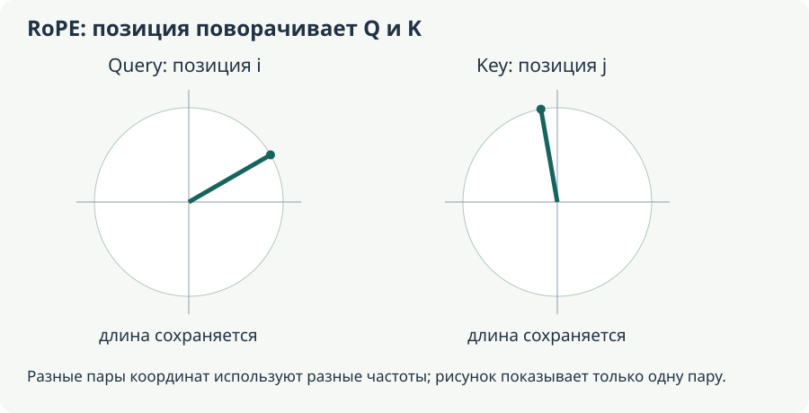

# Позиции, causal mask и padding

**Уровень:** общее ядро.

**Предпосылки:** [Embeddings и контекстные состояния](<lm-states.md>), [Attention, Q/K/V и несколько голов](<lm-attention.md>)

**Используют:** [Transformer-блок: residual, normalization и MLP](<lm-transformer.md>)

**Учебный вопрос:** Как независимо задать порядок токенов и доступ к информации?

## Порядок и доступ — разные правила

Без позиционной информации self-attention по содержимому не получает обычный порядок слов как самостоятельный признак. Позиционное представление сообщает различие позиций; маска задаёт, какие связи разрешены. Каузальная маска (causal mask) разрешает позиции i читать только j≤i. Маска заполнителей (padding mask) исключает искусственные позиции выравнивания, независимо от их индекса.

Для трёх настоящих позиций строки разрешённых causal связей равны `[1,0,0]`, `[1,1,0]`, `[1,1,1]`. Во входе `[A,B,PAD]` третья key-позиция дополнительно исключается. Обнулить её value недостаточно: probability mass могла бы остаться на запрещённом источнике. Ограничение накладывают перед нормировкой scores.

Абсолютные позиции, относительные смещения и RoPE меняют представление порядка разными способами. Они не заменяют causal правило. Кэширование использует согласованные position IDs; полный учёт cache вынесен в инференс, а специализированные производные — в необязательный backward-разбор.

## Карта вычисления и границы этапов

Читайте схему по направлению стрелок: первый блок задаёт вход, средние — преобразования и их состояние, последний — результат и способ проверки. Сравните формы и смысл каждого перехода с формулами главы. Выход преобразования и доказательство его качества — разные объекты: последняя проверка использует отдельный протокол оценки.

<!-- unit:b501170752326f903f -->

## Откуда берётся порядок

<!-- /unit:b501170752326f903f -->

<!-- unit:3c866b58e7711385af -->

Сам по себе одинаковый набор token embeddings не кодирует порядок слов. В простом варианте к embedding прибавляют вектор позиции: $X_{t}=E_{id_{t}}+P_{t}$. Тогда у токена «кот» на первой и пятой позиции будут разные входы блока. Позиции могут быть обучаемыми или заданными формулой. Другие архитектуры вводят относительную позицию в attention: например, RoPE преобразует Q/K в зависимости от позиции; это не просто дополнительная строка P.

<!-- /unit:3c866b58e7711385af -->

<!-- unit:0588656afbc3adad8b -->

Важно различать позиционную информацию и causal mask. Первая сообщает, где находится токен. Вторая запрещает доступ к будущим позициям. Без позиции модель может не различать некоторые перестановки; без causal mask при next-token training модель сможет подсматривать ответ. Эти механизмы решают разные задачи.

<!-- /unit:0588656afbc3adad8b -->

<!-- unit:826c27b4491f13baa4 -->

Padding нужен для объединения разной длины в тензор. Если тексты имеют длины 3 и 5, короткий дополняют до 5, но добавленные позиции не должны считаться реальными словами. Attention mask и loss mask могут быть разными: одна управляет доступными связями, другая — тем, какие targets входят в среднюю ошибку.

<!-- /unit:826c27b4491f13baa4 -->

<!-- unit:88f4aef53accd5a532 -->

### Позиция, доступ к контексту и несколько разных масок

<!-- /unit:88f4aef53accd5a532 -->

<!-- unit:da4386c1ef1f366ded -->

Пусть две последовательности после подготовки имеют вид `[BOS, кот, EOS, PAD]` и `[BOS, кот, спит, EOS]`. Их действительные длины — 3 и 4. Padding mask сообщает, что последняя позиция первого объекта искусственная. Causal mask для обеих последовательностей разрешает строке t видеть только столбцы $j\le t$. Loss mask относится уже к целям: при сдвинутом обучении первая последовательность содержит две полезные пары `BOS→кот` и `кот→EOS`, а пара `EOS→PAD` игнорируется.

<!-- /unit:da4386c1ef1f366ded -->

<!-- unit:7202a4cad8bc5165ee -->

Это три отдельных решения. Можно разрешить assistant-токену видеть весь предыдущий пользовательский вопрос и при этом не считать loss на токенах вопроса. Можно исключить PAD из источников attention и случайно оставить его в targets; тогда модель всё равно будет обучаться предсказывать заполнитель. Проверка одной маски не подтверждает правильность остальных.

<!-- /unit:7202a4cad8bc5165ee -->

<!-- unit:21310d3742f7af0267 -->

В варианте с аддитивной позицией embedding токена и позиционный вектор имеют одну ширину D. Их сумма оставляет форму $B\times L\times D$: позиция добавляет информацию в признаки, а не новую ось длины. Если модель с такими позициями получила последовательность с переставленными словами, изменится сочетание «строка E + строка P».

<!-- /unit:21310d3742f7af0267 -->

<!-- unit:11318b0023d2056f6f -->

RoPE вводит позицию иначе. Для одной двумерной пары координат зададим вращение

<!-- /unit:11318b0023d2056f6f -->

<!-- unit:8a8a2cddafdb97ca06 -->

$$
R(\theta)=\begin{bmatrix}\cos\theta&-\sin\theta\\\sin\theta&\cos\theta\end{bmatrix}.
$$

<!-- /unit:8a8a2cddafdb97ca06 -->

<!-- unit:31a927430b8e410149 -->

У query на позиции t и key на позиции j после вращений скалярное произведение равно

<!-- /unit:31a927430b8e410149 -->

<!-- unit:80dca5382e737a058b -->

$$
(R(t\theta)q)^\top(R(j\theta)k)=q^\top R((j-t)\theta)k.
$$

<!-- /unit:80dca5382e737a058b -->

<!-- unit:b04ef7cc9d53aad8c2 -->

Внутри этой пары появляется относительное смещение $j-t$. В полной модели используют несколько пар с частотами; это пояснение принципа, а не полная спецификация конкретного checkpoint. Causal mask всё ещё нужна: вращение не запрещает читать будущий токен. Само наличие относительного смещения также не гарантирует качество за пределами обученной длины. Механизм вращения описан в [RoFormer](https://arxiv.org/abs/2104.09864).

<!-- /unit:b04ef7cc9d53aad8c2 -->

<!-- unit:b077096aa166007577 -->

## Зачем нужны causal и padding masks

<!-- /unit:b077096aa166007577 -->

<!-- unit:444500039bb0ad975a -->

Пусть в prompt три токена. Для causal self-attention допустимость связей query-строка → key-столбец:

<!-- /unit:444500039bb0ad975a -->

<!-- unit:f57b91d62151d2ee55 -->

$$
A_{\mathrm{allowed}}=\begin{bmatrix}1&0&0\\1&1&0\\1&1&1\end{bmatrix},\qquad\text{строка — query, столбец — key}.
$$

<!-- /unit:f57b91d62151d2ee55 -->

<!-- unit:33ac0ec8fc15eb1b45 -->

Эта маска действует и на prompt при prefill. Ошибка из чатов, которую важно не переносить: prompt якобы свободно bidirectional, а causal начинается только после него. В обычной decoder-only схеме все позиции следуют causal правилу. Специальные prefix-LM objectives возможны, но это другая конфигурация.

<!-- /unit:33ac0ec8fc15eb1b45 -->

<!-- unit:a6990b43489862758c -->

Запрещённым scores добавляют $-\infty$ перед softmax, чтобы их вероятность стала нулевой. Просто обнулить score недостаточно: $\exp\left(0\right)=1$, поэтому «запрещённый» элемент всё ещё получил бы вес. На практике kernels используют эквивалентные численные операции и свои соглашения о boolean masks.

<!-- /unit:a6990b43489862758c -->

<!-- unit:84f468c59e47be3f2c -->

Padding mask исключает искусственные заполнители. Например, в batch `[кот, спит, PAD]` последний токен не должен стать реальным источником контекста. Пересечение padding и causal masks определяет допустимые key positions. Для padding query outputs часто просто игнорируют; внимание к полностью замаскированной строке требует аккуратной реализации, иначе возможны NaN.

<!-- /unit:84f468c59e47be3f2c -->

<!-- unit:46e6e96f291a92f4cd -->

### Почему causal правило сохраняется через весь стек

<!-- /unit:46e6e96f291a92f4cd -->

<!-- unit:6d7f2dd459b76625f6 -->

В первом блоке состояние позиции t зависит только от входов $1,\ldots,t$. Предположим, это верно после k блоков. В следующем attention query t обращается лишь к состояниям j≤t, каждое из которых само зависит только от входов до j. MLP и norm работают по одной позиции, residual складывает разрешённые состояния. Следовательно, после блока k+1 будущее тоже не появится. Это индуктивное объяснение causal свойства всей сети.

<!-- /unit:6d7f2dd459b76625f6 -->

<!-- unit:a82de68487dc0a30e3 -->

Если же случайно разрешить будущий токен хотя бы в одном attention-блоке, последующие корректные маски не отменят уже перенесённую информацию. Состояние t может содержать target, и обучение получит скрытую утечку. Поэтому правильность final mask не компенсирует ошибку одного раннего слоя.

<!-- /unit:a82de68487dc0a30e3 -->

<!-- unit:c402367ad996fc157b -->

На трёх позициях с одинаковыми разрешёнными scores softmax строк равен $[1,0,0]$, $[1/2,1/2,0]$, $[1/3,1/3,1/3]$. Если вместо −∞ поставить запрещённым scores нули, а остальные тоже равны нулю, каждая строка станет $[1/3,1/3,1/3]$. Первая позиция получит два будущих источника. Этот числовой пример показывает ошибку без терминов: нулевой score не означает нулевую вероятность.

<!-- /unit:c402367ad996fc157b -->

<!-- unit:b26d588c799d16b3df -->

Padding на левой стороне требует дополнительного внимания. У `[PAD, PAD, кот, спит]` позиция «кот» не должна читать первые два key, хотя по causal правилу они расположены раньше. Значит, доступ определяется пересечением правил, а реальные position IDs и выбор последнего настоящего токена должны соответствовать принятой схеме модели. У padding query может вообще не остаться key; её output нельзя бездумно включать в loss.

<!-- /unit:b26d588c799d16b3df -->

<!-- unit:c673471819c5957023 -->

## Порядок токенов: маска, абсолютные позиции и RoPE

<!-- /unit:c673471819c5957023 -->

<!-- unit:04ee649dd4f4da4e6c -->

<!-- /unit:04ee649dd4f4da4e6c -->

<!-- unit:793be99676c30ad5f1 -->

### Что сообщает маска, а чего она не сообщает

<!-- /unit:793be99676c30ad5f1 -->

<!-- unit:be12c85d3a33e87f34 -->

В изображённой causal матрице query 3 может обращаться к keys 1, 2, 3, а query 1 — только к key 1. Зелёная клетка не означает высокий вес: она означает, что связь допускается. Если scores трёх доступных ключей равны $(0,\log2,\log3)$, softmax даёт $(1/6,2/6,3/6)$. Четвёртый ключ после правильной causal маски получает ровно нулевой вес в математической модели, независимо от своего исходного score.

<!-- /unit:be12c85d3a33e87f34 -->

<!-- unit:df3f06b3bd3ee43c05 -->

В bidirectional схеме все четыре позиции доступны каждой query. Это нормально, когда весь вход наблюдаем: например, encoder классифицирует уже полученное предложение или ViT — уже полученное изображение. Для next-token задачи доступ к будущему правильному ответу нарушил бы условие предсказания. Таким образом, выбор маски следует из задачи, а не из самого наличия attention.

<!-- /unit:df3f06b3bd3ee43c05 -->

<!-- unit:490b4f9294cd9746a0 -->

Causal mask уже нарушает полную симметрию перестановки: первая и последняя позиции имеют разные наборы доступных источников. Поэтому фраза «без positional embeddings causal модель совершенно не знает порядок» слишком сильная. Но одна треугольная доступность не равнозначна явному представлению расстояний, соседства и относительных смещений. Например, без позиционных признаков attention query видит набор доступных K/V и не получает отдельной координаты «этот ключ ровно на три шага левее». Сложные эффекты границ и глубины могут частично сообщать порядок; это не причина считать mask полноценной заменой позиционного механизма.

<!-- /unit:490b4f9294cd9746a0 -->

<!-- unit:a551e89aea4b509efa -->

В S2, строка 1335, смешаны два разных способа ввода позиции: к embedding действительно можно **прибавить** позиционный вектор, но стандартный RoPE **поворачивает Q и K**. Следующие подпункты разделяют эти операции. Также слова «голова учится грамматике» из разбираемого примера — возможная интерпретация после анализа конкретной модели, а не обязательная заранее назначенная специализация каждой головы.

<!-- /unit:a551e89aea4b509efa -->

<!-- unit:80bf030ca23d16c69c -->

### Абсолютный позиционный вектор меняет вход проекций

<!-- /unit:80bf030ca23d16c69c -->

<!-- unit:493829b0bf1a551b18 -->

Пусть строка содержимого токена — $e_t$, его позиционный вектор — $p_t$. При аддитивном способе блок получает $x_t=e_t+p_t$. После этого $q_t=(e_t+p_t)W_Q$ и $k_t=(e_t+p_t)W_K$. Даже при одинаковом ID в двух местах Q/K могут различаться из-за разных $p_t$. При этом модель не получает два раздельных массива «содержание» и «место» в каждой операции: в данном варианте они уже сложены.

<!-- /unit:493829b0bf1a551b18 -->

<!-- unit:8f66a6781ae1eb0b84 -->

Возьмём двумерный учебный пример: у двух одинаковых токенов $e=(1,0)$, позиции $p_0=(0,0)$ и $p_1=(0,1)$, а $W_Q=W_K=I$. Тогда получаются $(1,0)$ и $(1,1)$. Ненормированные dot products равны 1 для первой пары токенов и 2 для второй позиции с самой собой. Пример показывает механизм влияния суммы на matching; он не является удачным готовым кодированием естественного языка.

<!-- /unit:8f66a6781ae1eb0b84 -->

<!-- unit:3c268b02be8e38a7be -->

Обучаемая таблица positions имеет отдельный вектор для каждого поддержанного индекса. Синусоидальное кодирование вычисляется по формуле, а не ищется в обучаемой таблице. В исходной схеме Transformer пары координат задаются так:

<!-- /unit:3c268b02be8e38a7be -->

<!-- unit:5b9abf92d9b653df78 -->

$$
p_{t,2r}=\sin\!\left(\frac{t}{10000^{2r/D}}\right),\qquad
p_{t,2r+1}=\cos\!\left(\frac{t}{10000^{2r/D}}\right).
$$

<!-- /unit:5b9abf92d9b653df78 -->

<!-- unit:c6375082682132a485 -->

Разные частоты дают несколько масштабов изменения вдоль последовательности. При $D=4$ и $t=1$ получается приблизительно $(0.841471,0.540302,0.010000,0.999950)$. При t=0 это $(0,1,0,1)$. Числа синуса можно вычислить и для большего t, но сама возможность вычисления не доказывает качество модели на длинах, которых не было в обучении.

<!-- /unit:c6375082682132a485 -->

<!-- unit:040f07de7d09e20a27 -->

### RoPE: вывод относительного угла

<!-- /unit:040f07de7d09e20a27 -->

<!-- unit:c67bcd14aa94dc2b60 -->

<!-- /unit:c67bcd14aa94dc2b60 -->

<!-- unit:874560f06ee6ba55fb -->

Рассмотрим одну пару координат как столбец. Матрица вращения имеет вид

<!-- /unit:874560f06ee6ba55fb -->

<!-- unit:65b69af92835b81f3e -->

$$
R(\phi)=\begin{bmatrix}\cos\phi&-\sin\phi\\\sin\phi&\cos\phi\end{bmatrix}.
$$

<!-- /unit:65b69af92835b81f3e -->

<!-- unit:5c370b8b6043881e14 -->

Для этой пары применим $\tilde q_i=R(i\theta)q_i$ и $\tilde k_j=R(j\theta)k_j$. Используя $R(a)^\top=R(-a)$ и $R(a)R(b)=R(a+b)$, получаем

<!-- /unit:5c370b8b6043881e14 -->

<!-- unit:43405408de630eea87 -->

$$
\tilde q_i^\top\tilde k_j=q_i^\top R((j-i)\theta)k_j.
$$

<!-- /unit:43405408de630eea87 -->

<!-- unit:23db991fe18a37fd12 -->

Это ключ к механизму: абсолютные номера i и j входят в позиционную часть dot product через разность. Само содержимое $q_i,k_j$ по-прежнему зависит от токенов и слоёв. Полученный score не является функцией только расстояния между позициями. В реальной голове несколько пар вращаются со своими частотами, а их вклады складываются. Конкретная раскладка пар координат должна совпадать с реализацией checkpoint. Основной принцип описан в [RoFormer](https://arxiv.org/abs/2104.09864).

<!-- /unit:23db991fe18a37fd12 -->

<!-- unit:3ee0be9bb0f5ce8799 -->

Для ручной проверки возьмём $q=(1,0)^\top$, $k=(1,0)^\top$, $\theta=\pi/2$. При i=j=0 dot product равен 1; при i=0,j=1 — 0; при i=0,j=2 — −1. Если одновременно сдвинуть обе позиции на один шаг, пары (0,1) и (1,2) обе дают 0. При этом длины обоих векторов сохраняются: $R^\top R=I$. Изменение matching возникает из относительного поворота, а не из увеличения нормы.

<!-- /unit:3ee0be9bb0f5ce8799 -->

<!-- unit:f461a1ab39d2d95a02 -->

Уже на этом примере виден предел фразы «близкие токены всегда сильнее»: при одной частоте углы периодичны. На расстоянии 4 в выбранном примере dot product снова равен 1. Несколько частот, содержательные Q/K и обучение создают более сложную картину, но RoPE сам по себе не задаёт строгого монотонного затухания с расстоянием.

<!-- /unit:f461a1ab39d2d95a02 -->

<!-- unit:2c97ec52f808198be2 -->

В стандартной схеме RoPE применяется к Q/K после проекций; V не обязан вращаться. Поэтому итоговая смесь $\sum_j a_{ij}v_j$ меняется через веса attention, хотя значения V непосредственно не получили эти повороты. Реализации с другими правилами следует называть отдельно. Нельзя реализовать RoPE прибавлением $p_t$ к embedding и считать, что получена та же модель.

<!-- /unit:2c97ec52f808198be2 -->

## Самостоятельная практика

**Практика:** Постройте causal mask длины 4 и добавьте два PAD справа. Перечислите разрешённые key positions для каждой настоящей query. Затем перенесите padding влево и отдельно объясните mask, position IDs и выбор последней настоящей позиции.

## Результат главы и переход дальше

Ответьте на вопрос: **Как независимо задать порядок токенов и доступ к информации?** Обоснуйте ответ конкретным вычислением из главы, назовите предположение и случай, когда оно нарушается.

Следующие темы: [Transformer-блок: residual, normalization и MLP](<lm-transformer.md>).

[Маршрут модуля](<../README.md>) · [Происхождение и точные места переноса](<../../editorial/coverage.md>)
