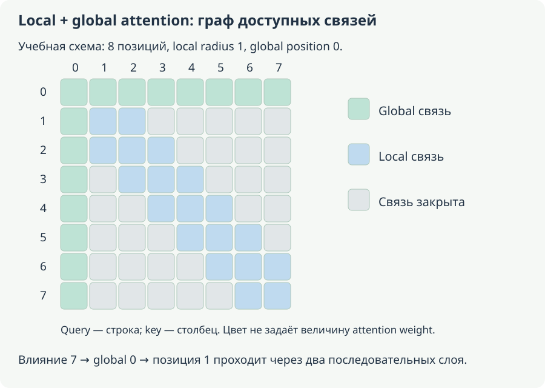
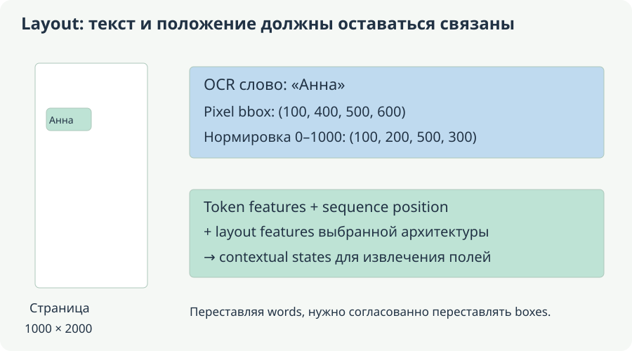

# Языки, длинные документы, домены и layout

**Уровень:** основа ветки.

**Предпосылки:** [Encoder, tokenizer, attention и pooling](<bert-interface.md>), [Данные, task heads, fine-tuning и DAPT](<bert-adaptation.md>)

**Используют:** Выбранная прикладная задача и итоговая проверка результата.

**Учебный вопрос:** Какие части контракта меняются при переносе на новый язык или тип документа?

## Карта вычисления и границы этапов

Читайте схему по направлению стрелок: первый блок задаёт вход, средние — преобразования и их состояние, последний — результат и способ проверки. Сравните формы и смысл каждого перехода с формулами главы. Выход преобразования и доказательство его качества — разные объекты: последняя проверка использует отдельный протокол оценки.

<!-- unit:8cf76cbe2438b9f37d -->

## Русский и multilingual transfer

<!-- /unit:8cf76cbe2438b9f37d -->

<!-- unit:b1f2d912694673182d -->

Morphology, casing, ё/е, омографы, transliteration и code switching меняют tokenization и entity boundaries. Token inflation — отношение token counts одного tokenizer к другому на одних texts — помогает оценить context/cost, но не является direct quality metric. Для 120 против 80 tokens ratio 1.5; это не «на 50% хуже semantics».

<!-- /unit:b1f2d912694673182d -->

<!-- unit:512a06c48c9ef95061 -->

Сравнивают task-appropriate Russian checkpoint, mBERT/XLM-R и modern multilingual candidate при same ontology/data. [RuBERT model card](https://huggingface.co/ai-forever/ruBert-base) описывает конкретный checkpoint, но не гарантирует готовый NER/retriever head. Monolingual capacity и multilingual transfer имеют разные trade-offs; число языков pretraining не равно качеству каждого.

<!-- /unit:512a06c48c9ef95061 -->

<!-- unit:b19a44104ab2291f76 -->

Cross-lingual retrieval отдельно задаёт language query и document. English-only fine-tuning с test на русском, translated supervision и multilingual task training — разные protocols. Translation-equivalent texts в разных splits дают leakage даже при разных surface forms. Перевод negation, имен и gender может менять labels; human audit нужен на relevant slices.

<!-- /unit:b19a44104ab2291f76 -->

<!-- unit:77338d928f1b8b4e53 -->

Report показывает each-language quality, code-switch, rare entities, calibration и fragmentation. Средний multilingual score способен скрыть плохое качество нужного языка. Если выбирать checkpoint по target Russian validation, это task adaptation selection, а не truly untouched zero-shot benchmark.

<!-- /unit:77338d928f1b8b4e53 -->

<!-- unit:6dcdc6585d8bc7ae7c -->

<!-- source-depth-bert-Ж -->

<!-- /unit:6dcdc6585d8bc7ae7c -->

<!-- unit:6de3443c91c8e059ee -->

### Язык влияет на вход, supervision и оценку разными путями

<!-- /unit:6de3443c91c8e059ee -->

<!-- unit:0abd3c42e096fcfba1 -->

Русский текст может распадаться на большее число subwords из-за словаря, морфологии или редких имён. Это увеличивает длину и расходует context budget. Но модель с более дробной токенизацией всё ещё может иметь полезные representations; число pieces не является самостоятельной метрикой понимания. Если один tokenizer даёт 120 tokens, другой 80, ratio=1.5 говорит о длине именно этих входов, а не о падении качества на 50%.

<!-- /unit:0abd3c42e096fcfba1 -->

<!-- unit:ab652ae62c8eb76ff4 -->

Если одинаковая по содержанию версия текста занимает 400 tokens на одном языке и 600 на другом, при доступных 510 content positions вторая версия будет обрезана. Плохое качество может быть связано с потерянным evidence, а не только с multilingual representation. Поэтому отдельно измеряют fragmentation, долю truncation и качество на текстах, которые обе модели видели целиком.

<!-- /unit:ab652ae62c8eb76ff4 -->

<!-- unit:4981390caf0dccc735 -->

Нормализация меняет смысл в зависимости от задачи. Замена ё/е может быть допустима для темы письма, но важна для точного имени. Внешне похожие латинские и кириллические символы способны означать разные IDs в коде товара. Транслитерация может облегчить поиск alias и одновременно испортить точный span. Правило выбирается по target, а не как универсальная «очистка русского текста».

<!-- /unit:4981390caf0dccc735 -->

<!-- unit:6d4b115c7682d36b4d -->

### Multilingual average зависит от состава evaluation

<!-- /unit:6d4b115c7682d36b4d -->

<!-- unit:f5fa113f9c6ab83b6e -->

Пусть в тесте 900 English examples с accuracy 0.95 и 100 Russian с accuracy 0.60. Средняя по всем примерам accuracy равна 0.915. Среднее двух language accuracies — 0.775. Это два разных знаменателя, и первое число скрывает слабое качество на русском. Речь здесь об accuracy, а не о macro-F1 по классам.

<!-- /unit:f5fa113f9c6ab83b6e -->

<!-- unit:93bec770d523d347a7 -->

Для cross-lingual retrieval нужны пары направлений: например, русский query → English documents и наоборот. Успешный поиск внутри одного языка не доказывает alignment разных языков. Переведённые тексты должны сохранять labels, имена, отрицания и числовые условия; дубликаты переводов группируют до split. Смена языка не создаёт новый независимый источник, если содержание осталось тем же.

<!-- /unit:93bec770d523d347a7 -->

<!-- unit:4c1352789adc8fd691 -->

## Длинный document не равен набору одинаково размеченных chunks

<!-- /unit:4c1352789adc8fd691 -->

<!-- unit:b2a91d5ff2d8b3c37e -->

Truncation проста, но удаляет evidence. Sliding windows сохраняют coverage за extra compute; hierarchical encoder сначала кодирует chunks, затем агрегирует их vectors. Если document label «есть нарушение» определяется двумя из восьми chunks, присвоение positive всем восьми создаёт weak/noisy labels.

<!-- /unit:b2a91d5ff2d8b3c37e -->

<!-- unit:16a7c73cb43635d069 -->

Mean aggregation размывает редкий signal, max чувствителен к одному false alarm, learned attention требует supervision и может использовать shortcuts. Для chunk scores $(0,0,0,0,0,0,1,1)$ mean 0.25, max 1; значение label не определяется одной formula без task assumptions. Для evidence extraction важно вернуть source offsets, а не только pooled decision.

<!-- /unit:16a7c73cb43635d069 -->

<!-- unit:a47c306e20d6a93963 -->

Sparse/global attention, например [Longformer](https://arxiv.org/abs/2004.05150), меняет interaction pattern, позволяя selected global tokens и local windows. Для window width $w$ local attention work порядка $Lw$ плюс global interactions, в отличие от full $L^2$. Но ограниченная connectivity требует layers/global routes для distant dependencies. ModernBERT сочетает local/global blocks по своей architecture.

<!-- /unit:a47c306e20d6a93963 -->

<!-- unit:92310ef2e258e951d7 -->

Learned positions классического BERT имеют training length/config. Изменить число в config без обучения новых rows и проверки checkpoint недостаточно. RoPE/native context тоже не гарантирует retrieval distant evidence. Сравнение truncation/hierarchy/native-long-context использует full documents, length/evidence-position slices, same task и total cost.

<!-- /unit:92310ef2e258e951d7 -->

<!-- unit:4fc19b013251443db0 -->

Ответ на границе windows может быть разделён так, что ни одно окно его не видит целиком. Overlap решает это только для spans ограниченной длины при нужном chunk policy; document-level multi-hop evidence может быть разнесено гораздо дальше. Нужно проверять actual information coverage.

<!-- /unit:4fc19b013251443db0 -->

<!-- unit:7f8448703017d30e85 -->

### Три способа чтения длинного документа решают разные задачи

<!-- /unit:7f8448703017d30e85 -->

<!-- unit:6ea541d5c6109105bc -->

Truncation передаёт только выбранный кусок; утерянные tokens недоступны всему последующему stack. Sliding windows передают несколько перекрывающихся кусков и объединяют результаты. Hierarchical model сначала строит chunk representations, затем обрабатывает их последовательность отдельным агрегатором. В последнем случае взаимодействие между исходными tokens разных chunks проходит через bottleneck их chunk vectors.

<!-- /unit:6ea541d5c6109105bc -->

<!-- unit:fa6e1d0d755633a270 -->

Если document label означает «хотя бы один фрагмент содержит нужное событие», присвоение positive всем chunks создаёт ложные token/chunk targets. Можно обучать document-level aggregation, не выдавая неизвестные chunk labels за разметку. Но тогда важны shortcuts: модель может обнаружить тип источника вместо события. Для доказуемого evidence нужны соответствующие labels или отдельная проверка извлечённых фрагментов.

<!-- /unit:fa6e1d0d755633a270 -->

<!-- unit:9e4725f0effc1dea1d -->

Mean в исходном примере даёт 0.25, max — 1. Ни одно из этих чисел нельзя автоматически назвать вероятностью document label. Если chunk probabilities действительно относятся к независимым событиям «в этом chunk есть evidence», можно получить noisy-OR $1-\prod_k(1-p_k)$. Для двух независимых p=0.1 это 0.19. Если оба overlapping chunks описывают одно и то же событие, независимость нарушена: повторение одного evidence не должно само по себе повышать уверенность до 0.19.

<!-- /unit:9e4725f0effc1dea1d -->

<!-- unit:7329b5caa9cb0326b5 -->

### Когда overlap гарантирует, что span не будет разрезан

<!-- /unit:7329b5caa9cb0326b5 -->

<!-- unit:3c319c01659f9fde0a -->

Пусть каждое окно содержит C content tokens, шаг между началами S, overlap O=C−S. Indices целочисленные, первое окно начинается с 0, хвост документа тоже покрыт. Для гарантии покрытия любого непрерывного span длины не больше A достаточно $O\ge A-1$.

<!-- /unit:3c319c01659f9fde0a -->

<!-- unit:761d3e92dc7487b684 -->

Почему? Возьмём последнее начало окна kS, не превосходящее начало ответа a. Тогда $a-kS\le S-1$. Последняя позиция ответа не дальше $a+A-1\le kS+S+A-2$. Она помещается в окно до $kS+C-1$, если $S+A-1\le C$, то есть O≥A−1. Это вывод про покрытие **одним** окном, а не утверждение, что модель правильно извлечёт ответ.

<!-- /unit:761d3e92dc7487b684 -->

<!-- unit:14bd7d6293e1aa3bc4 -->

При C=8, O=2, S=6 любой span длины до 3 покрыт. Для длины 4 уже возможна ошибка: span [5,9) не входит ни в первое окно [0,8), ни во второе [6,14). Если часть model budget занята вопросом и special tokens, C нужно считать после их вычитания. Нерегулярные границы chunks и удаление отдельных фрагментов требуют нового анализа покрытия.

<!-- /unit:14bd7d6293e1aa3bc4 -->

<!-- unit:cb0bd2ba079dbdc342 -->

Multi-hop evidence может быть разнесено между несколькими далёкими разделами. Гарантия для короткого span не делает такое evidence доступным совместно. Для него нужны другая aggregation, retrieval нескольких частей или long-context architecture, и отдельные тесты на расположение evidence.

<!-- /unit:cb0bd2ba079dbdc342 -->

<!-- unit:4822d30051f41da222 -->

<!-- /unit:4822d30051f41da222 -->

<!-- unit:de93f2d17dc14b6953 -->

Local и global связи показывают доступность контекста по слоям, а не фиксированную силу внимания.

<!-- /unit:de93f2d17dc14b6953 -->

<!-- unit:244e1a3f4b6f9e1663 -->

### Local и global attention: доступность по слоям

<!-- /unit:244e1a3f4b6f9e1663 -->

<!-- unit:82f9d763e7d4e08efb -->

У local attention с радиусом r одна позиция читает максимум 2r+1 соседей в одном слое. После K таких слоёв влияние может распространиться на расстояние Kr, если нет дополнительных связей. Например, r=2, K=3 дают максимум 13 позиций в полном внутреннем receptive field. Norm и MLP сами не добавляют межпозиционные рёбра.

<!-- /unit:82f9d763e7d4e08efb -->

<!-- unit:8928f0abc3dc1d8bf6 -->

Global position добавляет дальние маршруты. В упрощённой схеме global query читает все позиции, а остальные queries могут читать global key. Информация a→global→b проходит два attention слоя: выходы одного слоя вычисляются из состояний предыдущего, поэтому b не читает уже обновлённый global output того же слоя. Если task head читает сам global token, для сбора информации ему может хватить одного такого слоя. Механизм local/global attention — основа [Longformer](https://arxiv.org/abs/2004.05150).

<!-- /unit:8928f0abc3dc1d8bf6 -->

<!-- unit:51afeaf72261758244 -->

При длине L, local width w и g global positions число разрешённых пар имеет порядок Lw+Lg вместо L² при фиксированных w,g. Для L=1000,w=33,g=2 верхняя грубая сумма local и двусторонних global связей — 33000+4000=37000 против миллиона dense pairs; пересечения и границы могут уменьшить это число. Стоимость проекций и MLP при этом не исчезла. Важны и граф связей, и поддержка эффективного kernel.

<!-- /unit:51afeaf72261758244 -->

<!-- unit:0cbfdc6a710c162edd -->

## Domain encoders: наука, специальные тексты и код

<!-- /unit:0cbfdc6a710c162edd -->

<!-- unit:094db40c68a724dbb8 -->

[SciBERT](https://aclanthology.org/D19-1371/) исследует scientific text representations, [CodeBERT](https://arxiv.org/abs/2002.08155) — natural/programming language. Domain pretraining меняет data/terminology/objective; название не доказывает correctness любой medical/legal/financial application.

<!-- /unit:094db40c68a724dbb8 -->

<!-- unit:0da6c3d60855625b59 -->

Сначала определяется task: entity/relation extraction, classification, matching или search. Domain shift features отличается от изменения annotation policy: прежний label «положительный» может иметь другую definition. Generic task-trained checkpoint может превзойти domain MLM, которому ещё не обучили task geometry/head.

<!-- /unit:0da6c3d60855625b59 -->

<!-- unit:d813bb87fcda98bb9d -->

Сравнение generic task model, domain checkpoint и DAPT проводится с comparable tuning budget и general-domain regression. Кодовые tasks split по repositories/time/clone families: почти одинаковые функции в train/test делают score завышенным. Lexical token similarity не доказывает functional equivalence; нужен task oracle или execution tests, если именно equivalence является целью.

<!-- /unit:d813bb87fcda98bb9d -->

<!-- unit:befc7a0867de749a39 -->

### Что именно меняется при переходе в домен

<!-- /unit:befc7a0867de749a39 -->

<!-- unit:fa064f60f938b4a318 -->

В специализированных текстах могут измениться термины, структура предложений, частоты классов и само правило разметки. Если новый источник пишет «отклонено» там, где прежний писал «не подтверждено», это lexical/domain shift. Если новая инструкция иначе определяет positive label, меняется supervision. Смешение этих причин мешает выбрать полезное вмешательство.

<!-- /unit:fa064f60f938b4a318 -->

<!-- unit:d6eda80dd12c72fe3f -->

Domain MLM encoder ещё не обязан иметь sentence retrieval geometry или NER head. Он учился выбранному pretraining objective, а прикладная задача требует своей supervision. Поэтому сравнивают не только названия checkpoints, но и полный путь domain/generic encoder → одинаковый task training → независимый test. DAPT полезно оценивать вместе с regression на прежних источниках, а не только по MLM loss нового корпуса.

<!-- /unit:d6eda80dd12c72fe3f -->

<!-- unit:30851b195a94602e30 -->

В коде почти одинаковые функции могут различаться идентификаторами и форматированием, а близкий по tokens код — поведением на граничном input. Для semantic search такие near-clones могут быть полезны; для доказательства эквивалентности нужны другие oracle. Split по repository, времени и clone family предотвращает ситуацию, когда тест измеряет узнавание почти той же функции. Случайное разбиение строк кода особенно легко нарушает независимость.

<!-- /unit:30851b195a94602e30 -->

<!-- unit:efc22c66c2199a70fe -->

## Aspect sentiment, linking и structured understanding

<!-- /unit:efc22c66c2199a70fe -->

<!-- unit:b65b490003c56e7cd9 -->

«Экран отличный, батарея слабая» содержит два аспекта с противоположной polarity. Один overall sentiment label теряет структуру. Можно извлекать aspect spans и классифицировать polarity в их context либо jointly предсказывать pairs. Implicit aspects требуют separate policy: отсутствие explicit span не всегда означает отсутствие opinion.

<!-- /unit:b65b490003c56e7cd9 -->

<!-- unit:94d6aa413eba8a20be -->

Entity linking: mention detection → candidate retrieval → context disambiguation → entity ID или NIL. «Мир» может быть организацией, картой/брендом или обычным словом; surface form не определяет ID. Candidate recall ограничивает disambiguator, а ошибки mention boundaries добавляют upstream losses.

<!-- /unit:94d6aa413eba8a20be -->

<!-- unit:0789b3ca08f8add30f -->

Оценка gold mentions показывает conditional quality, predicted mentions — всей системы. Нужны seen/unseen entities, alias shift и NIL cases. Entity typing, relation classification и intent+slots имеют свои schemas и metrics. Returned artifact сохраняет offsets/IDs/evidence; general sentiment classifier не заменяет aspect-conditioned extraction.

<!-- /unit:0789b3ca08f8add30f -->

<!-- unit:cec12f3a2b800c1712 -->

### Один текст может требовать нескольких структурированных ответов

<!-- /unit:cec12f3a2b800c1712 -->

<!-- unit:c47e00e3758c8893a9 -->

Для «Экран отличный, батарея слабая» два ответа — (экран, positive) и (батарея, negative). Overall sentiment может быть mixed или зависеть от guideline, но он теряет привязку оценок к аспектам. Если aspect spans уже даны, classifier решает условную polarity задачу; если их надо найти, добавляется extraction. Нельзя сравнивать эти режимы как одну и ту же сложность.

<!-- /unit:c47e00e3758c8893a9 -->

<!-- unit:104f60d6792b9d1ba0 -->

Entity linking тоже отделяет поиск от решения. Пусть mention detector нашёл правильный span «Мир», а candidate stage вернул только финансовый бренд и организацию, хотя в данном тексте подразумевался иной entity. Disambiguator не сможет выбрать отсутствующий ID. NIL означает, что подходящего entity нет в допустимой knowledge base, а не просто низкую уверенность любой головы.

<!-- /unit:104f60d6792b9d1ba0 -->

<!-- unit:0bc5501442bb8b70d2 -->

Gold-mention evaluation исключает ошибки детектора. End-to-end учитывает и boundaries, и retrieval candidates, и выбранный ID. Если выдавать только последнее число без условий, можно принять улучшение mention detector за улучшение disambiguation. Схема ответа хранит original offsets, ID/version knowledge base и evidence; одинаковая surface string не заменяет эту связь.

<!-- /unit:0bc5501442bb8b70d2 -->

<!-- unit:4808a109ee509375e8 -->

## OCR, layout и таблицы

<!-- /unit:4808a109ee509375e8 -->

<!-- unit:1901748119b197f927 -->

Два бланка могут содержать один bag OCR words «Имя Анна Город Москва», но разное spatial association fields. Plain serialized text может потерять соответствие key/value. [LayoutLM](https://arxiv.org/abs/1912.13318) соединяет text и layout signals; новые variants могут добавлять visual components по своей architecture. Text-only BERT не получает изображение лишь потому, что tokens пришли из OCR.

<!-- /unit:1901748119b197f927 -->

<!-- unit:01c2cae80404544a87 -->

Для table важны row/column relations, cell coordinates, headers и numerical operations. Serialization — baseline с определённым order, а не universal preservation структуры. Если задача требует сравнить суммы, encoder label head не гарантирует точную арифметику без data/objective/oracle.

<!-- /unit:01c2cae80404544a87 -->

<!-- unit:0fa4a3ed3d63c43af7 -->

Разделяют OCR recognition error, layout association, span extraction и final field correctness. Пропущенное OCR слово downstream head не обязан восстановить из пустоты. Сравнение OCR+text и layout-aware pipeline должно использовать same documents и учитывать цену preprocessing/annotations.

<!-- /unit:0fa4a3ed3d63c43af7 -->

<!-- unit:b683b3928388632b76 -->

<!-- /unit:b683b3928388632b76 -->

<!-- unit:afcd3bdf696b013d9f -->

Текст и пространственные признаки должны сохранять соответствие одному исходному слову; схема fusion зависит от модели.

<!-- /unit:afcd3bdf696b013d9f -->

<!-- unit:399602db85cdde8f8b -->

### Что даёт двумерная позиция сверх строки OCR

<!-- /unit:399602db85cdde8f8b -->

<!-- unit:32dd054f78654815d1 -->

OCR может вернуть слова и bounding boxes. Если preprocessing оставил только bag of words, два бланка с теми же словами способны потерять соответствие «поле — значение». Последовательный порядок чтения сохраняет часть структуры, но не гарантирует сохранения колонок, таблиц и пространственных групп. Layout-aware model получает дополнительные признаки расположения, а конкретная fusion зависит от архитектуры. Общая идея показана в [LayoutLM](https://arxiv.org/abs/1912.13318).

<!-- /unit:32dd054f78654815d1 -->

<!-- unit:cdd2b1ef7f01e6efaa -->

Для учебного bbox в пикселях (100,400,500,600) на странице ширины 1000 и высоты 2000 переход к координатам 0–1000 по каждой оси даёт (100,200,500,300). Горизонталь и вертикаль масштабируются по своим размерам. Это объявленная схема нормировки, не универсальный формат всех models. Нужны согласованные начало координат, размеры страницы, page IDs и порядок x0≤x1,y0≤y1.

<!-- /unit:cdd2b1ef7f01e6efaa -->

<!-- unit:a67388c41e13fe3f14 -->

Если слово разбилось на несколько subwords, каждому нужно согласованное соответствие bbox/word ID. Изменение порядка OCR words без перестановки boxes нарушает пары признаков при правильных shapes. Для нескольких страниц один и тот же bbox не означает одно место: нужен контекст страницы или предусмотренная архитектурой обработка.

<!-- /unit:a67388c41e13fe3f14 -->

<!-- unit:7e2176f8f065b52e2d -->

Таблица добавляет отношения rows/columns и headers. Последовательность «товар A 2 10 товар B 3 7» не сообщает сама по себе, где количество, где цена и какой итог требуется. Serialization должна явно сохранять выбранную структуру. Если задача требует точного умножения и суммирования, наличие contextual vectors не заменяет проверку вычисления или предназначенный для этого компонент.

<!-- /unit:7e2176f8f065b52e2d -->

<!-- unit:f7a72de952867e9f32 -->

### Где искать ошибку документа

<!-- /unit:f7a72de952867e9f32 -->

<!-- unit:7832a5fe1036c5a841 -->

Если OCR распознал 100 как 700, правильное извлечение распознанного span ещё не даёт правильное поле исходного изображения. Если текст распознан верно, но значение привязано к соседнему header, ошибка в layout association. Если span и field верны, но postprocessing неверно интерпретировал единицы, ошибка уже после encoder. Раздельная оценка этих этапов показывает, что нужно исправлять.

<!-- /unit:7832a5fe1036c5a841 -->

<!-- unit:abd1347328df228674 -->

Сравнивая text-only и layout-aware модель, фиксируют те же страницы, OCR policy и supervision. Дополнительные boxes, pixels и labels — дополнительная информация и стоимость, а не бесплатное преимущество другого encoder. Итоговая метрика оценивает нужные поля на исходных документах, а не только token-level accuracy OCR-последовательности.

<!-- /unit:abd1347328df228674 -->

<!-- unit:4796aa3cebaa456cab -->

## Контроль и практика

<!-- /unit:4796aa3cebaa456cab -->

<!-- unit:6dd45683b1fc2d776e -->

1. Доказывает ли language coverage качественный Russian NER? **Ответ:** нет; нужен task/language evaluation и alignment.
2. Почему positive document не даёт positive label каждому chunk? **Ответ:** evidence может находиться только в части document.
3. Чем gold-mention linking отличается от end-to-end? **Ответ:** gold исключает ошибки mention detector и потому измеряет условную задачу.
4. Чего нет у text-only OCR sequence? **Ответ:** она может потерять 2D structure и visual evidence, если их явно не передали.

<!-- /unit:6dd45683b1fc2d776e -->

<!-- unit:49a25c3f49ba28503b -->

5. Какой overlap гарантирует покрытие span длины до A при регулярных окнах? **Ответ:** O≥A−1 при объявленных целочисленных границах и покрытом хвосте; это не гарантия правильного QA и не покрытие multi-hop evidence.
6. Почему local→global→local обычно требует двух слоёв? **Ответ:** queries одного слоя читают states предыдущего слоя, а не уже обновлённый global output того же слоя.
7. Равен ли больший token count худшему пониманию? **Ответ:** нет. Он меняет length/cost и вероятность truncation; качество проверяется по task labels.
8. Почему bbox нужно нормировать отдельно по ширине и высоте? **Ответ:** это разные оси страницы; деление обеих на одну длину исказит геометрию прямоугольной страницы.

<!-- /unit:49a25c3f49ba28503b -->

<!-- unit:9445d7680ce035ca90 -->

**Практика:** измерьте token counts одной multilingual фразы, разметьте aspect spans и NIL linking case. Для восьми chunks выберите aggregation и test evidence positions. Нарисуйте две формы с одинаковыми словами, но разными layouts; определите недостающие признаки. Обоснуйте shortlist для русского NER и multilingual long retrieval без выбора по одному leaderboard.

<!-- /unit:9445d7680ce035ca90 -->

## Проектная практика ветки

<!-- unit:9ed65ac48814aaa902 -->

### P5. Малый бюджет разметки и domain shift — углубление

<!-- /unit:9ed65ac48814aaa902 -->

<!-- unit:6846fa0659b726cd97 -->

Несколько few-shot samples → frozen embeddings/SetFit/task tuning → target-domain shift. При наличии corpus сравнить DAPT; total compute отдельно. Итог: learning curves по числу human labels, variance, ошибки new/rare labels и следующий annotation batch.

<!-- /unit:6846fa0659b726cd97 -->

## Результат главы и переход дальше

Ответьте на вопрос: **Какие части контракта меняются при переносе на новый язык или тип документа?** Обоснуйте ответ конкретным вычислением из главы, назовите предположение и случай, когда оно нарушается.

[Маршрут модуля](<../README.md>) · [Происхождение и точные места переноса](<../../editorial/coverage.md>)
