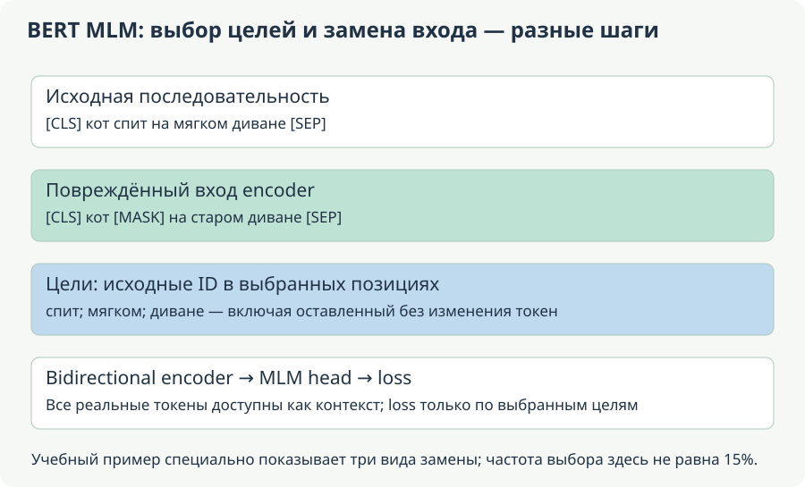

# MLM, альтернативные objectives и семейства encoder

**Уровень:** основа ветки.

**Предпосылки:** [Encoder, tokenizer, attention и pooling](<bert-interface.md>)

**Используют:** [Данные, task heads, fine-tuning и DAPT](<bert-adaptation.md>)

**Учебный вопрос:** Какие позиции дают loss и как цель обучения меняет представления?

## Карта вычисления и границы этапов

Читайте схему по направлению стрелок: первый блок задаёт вход, средние — преобразования и их состояние, последний — результат и способ проверки. Сравните формы и смысл каждого перехода с формулами главы. Выход преобразования и доказательство его качества — разные объекты: последняя проверка использует отдельный протокол оценки.

<!-- unit:16c3851663d5b7f700 -->

## MLM: labels выбраны отдельно от corruption

<!-- /unit:16c3851663d5b7f700 -->

<!-- unit:f31fc1660aa3c7c597 -->

В masked language modeling выбирается set target positions $\mathcal M$. Input повреждается, encoder получает $\widetilde x$, а target остаётся исходный token $x_t$:

<!-- /unit:f31fc1660aa3c7c597 -->

<!-- unit:3f0dcb696c78dc54ac -->

$$
L_{\mathrm{MLM}}=-\frac1{|\mathcal M|}
\sum_{t\in\mathcal M}\log p_\theta(x_t\mid\widetilde x).
$$

<!-- /unit:3f0dcb696c78dc54ac -->

<!-- unit:cd0b49375bfcacb39a -->

Исторический BERT выбирал 15% positions; среди выбранных 80% заменял MASK, 10% случайным token, 10% оставлял unchanged. Последние тоже дают loss: selection mask и actual replacement не одно и то же. На невыбранных positions labels обычно ignored. Attention mask отвечает за context validity, а не за set MLM targets. [Исходный BERT](https://aclanthology.org/N19-1423/).

<!-- /unit:cd0b49375bfcacb39a -->

<!-- unit:41e734c2fbf912c27c -->

MLM head преобразует token states, затем проецирует в vocabulary; классический recipe включает transform/nonlinearity/LN перед projection и может использовать shared input/output embeddings. Logits shape $B\times L\times V$; реализация может вычислять только selected positions для экономии. Tying не отменяет gradient из output path.

<!-- /unit:41e734c2fbf912c27c -->

<!-- unit:a2efbac37e02050637 -->

<!-- source-depth-bert-Б -->

<!-- /unit:a2efbac37e02050637 -->

<!-- unit:728c085b362025c53f -->

### Один batch: что именно испорчено и за что начисляется ошибка

<!-- /unit:728c085b362025c53f -->

<!-- unit:4920e964da80a5e207 -->

<!-- /unit:4920e964da80a5e207 -->

<!-- unit:f1e9e96e54255e3359 -->

Возьмём условную токенизацию `[CLS] кот спит на мягком диване [SEP]`. Реальный WordPiece может дробить слова, поэтому здесь заранее считаем каждое слово отдельным ID. Индексы: CLS=0, «кот»=1, «спит»=2, «на»=3, «мягком»=4, «диване»=5, SEP=6. Выберем цели на позициях 2, 4, 5. Позицию 2 заменим MASK, позицию 4 — случайным словом «старом», позицию 5 оставим прежней. Три разных действия выбраны специально для иллюстрации; доля выбранных позиций в этом маленьком примере не равна историческим 15%.

<!-- /unit:f1e9e96e54255e3359 -->

<!-- unit:784de0f242d37871d2 -->

Вход encoder теперь: `[CLS] кот [MASK] на старом диване [SEP]`. Целевые labels: `[ignore, ignore, спит, ignore, мягком, диване, ignore]`. Предсказывать на позиции 4 нужно **«мягком»**, хотя вход содержит «старом». На позиции 5 нужно предсказывать «диване», хотя оно не было заменено. Если собирать labels после изменения входа, можно нечаянно учить модель воспроизводить corruption вместо исходного текста.

<!-- /unit:784de0f242d37871d2 -->

<!-- unit:afea0afc3f6b23db0c -->

Все семь непустых позиций доступны bidirectional self-attention. Нельзя использовать MLM selection mask в качестве attention mask: это удалило бы весь контекст, кроме выбранных мест, или изменило задачу другим ошибочным способом. Нельзя также закрывать MASK от всех queries только потому, что он специальный. MASK — реальный входной токен с обучаемым embedding; PAD — заполнитель. Их роли различаются.

<!-- /unit:afea0afc3f6b23db0c -->

<!-- unit:4073429390d99a753b -->

Здесь нет next-token shift. Строка logits **позиции 2** сравнивается с исходным ID позиции 2. Сдвиг на один токен, полезный в causal LM, сделал бы эти labels несогласованными. При этом MLM не является простым копированием всех входов: часть выбранных целей отсутствует во входе или заменена, а невыбранные позиции не дают прямого MLM loss.

<!-- /unit:4073429390d99a753b -->

<!-- unit:b04c31c5331b8a1b81 -->

### Почему 15%, 80%, 10% и 10% имеют разные знаменатели

<!-- /unit:b04c31c5331b8a1b81 -->

<!-- unit:61cd503f93bf60d4cc -->

Исторические 80/10/10 относятся к **уже выбранным** MLM positions. В упрощённой вероятностной модели, где каждая допустимая позиция выбирается с вероятностью 0.15, на 10 000 таких позиций ожидаются 1500 целей: 1200 MASK, 150 random replacements и 150 unchanged. Оставшиеся 8500 позиций не являются целями данного прохода. Это ожидания, а не требование получить ровно эти количества в каждом batch.

<!-- /unit:61cd503f93bf60d4cc -->

<!-- unit:8463fe2501011ecc73 -->

Случайная замена может совпасть с исходным ID. При равномерной выборке из V токенов вероятность совпадения равна 1/V; ожидаемое число таких совпадений среди 150 random events — 150/V. Следовательно, «random branch выбрана» и «значение ID действительно изменилось» не одно событие. Для MLM label всё равно остаётся исходным ID, а для RTD важен факт совпадения с исходником.

<!-- /unit:8463fe2501011ecc73 -->

<!-- unit:2385bbe24412c01902 -->

В реальном preprocessing используются целое число выбранных позиций, ограничения на максимум целей и исключение специальных токенов; whole-word masking может объединять subwords. Поэтому для короткой строки точную долю нужно смотреть в реализации, а не обещать ровно 15%. Исторические правила и подготовку labels можно сверить с [кодом BERT](https://github.com/google-research/bert/blob/master/create_pretraining_data.py).

<!-- /unit:2385bbe24412c01902 -->

<!-- unit:d1971910076d476baf -->

Наличие unchanged targets сокращает разрыв между специальным MASK-входом предобучения и обычными входами прикладных задач. Но из этого не следует, что модель не может использовать простое копирование в части случаев. Это осознанная смесь обучающих ситуаций. Если поменять доли, меняется objective distribution; сравнение losses при разных corruption policies уже не является чистым сравнением качества представления.

<!-- /unit:d1971910076d476baf -->

<!-- unit:e282881c1e61974a08 -->

### Полный forward: embeddings, encoder, MLM head

<!-- /unit:e282881c1e61974a08 -->

<!-- unit:2088c7e34bb42737fb -->

Для B примеров длины L lookup создаёт массив B×L×D. В классическом BERT к token embeddings добавляются position и segment/type embeddings. Bidirectional Transformer encoder преобразует их в contextual states той же внешней формы. MLM head строит logits по словарю для выбранных мест. Дополнительная transform/nonlinearity/normalization перед vocabulary projection — часть конкретного устройства head; она не превращает encoder в авторегрессионный decoder.

<!-- /unit:2088c7e34bb42737fb -->

<!-- unit:f918e6561753979d45 -->

Если нужны только M выбранных состояний, их можно собрать в массив M×D перед head. Тогда logits будут M×V, а не B×L×V; смысл loss на тех же целях сохраняется. Однако encoder всё равно обработал весь доступный контекст. Такая экономия выходной проекции не означает, что Transformer stack прошёл только по выбранным токенам.

<!-- /unit:f918e6561753979d45 -->

<!-- unit:ed087517d25a6c46fe -->

При общей входной и выходной embedding-таблице $E\in\mathbb R^{V\times D}$ logits после преобразования состояния u можно записать $z=uE^\top+b$. Один параметр E используется в двух ролях: lookup входных ID и проекция в словарь. Градиенты этих использований суммируются. Поэтому строка E для отсутствующего во входе слова всё равно может получить градиент через выходной softmax. При отдельной output matrix это будут другие параметры.

<!-- /unit:ed087517d25a6c46fe -->

<!-- unit:6b9f62cbeced1e9e65 -->

### Чему именно учит контекстный градиент

<!-- /unit:6b9f62cbeced1e9e65 -->

<!-- unit:f19c24a47161a0d62f -->

Пусть на MASK-позиции модель предсказывает «спит» с вероятностью 0.2, а конкурирующие варианты получают 0.5 и 0.3. Для трёхклассовой учебной задачи градиент logits равен $(-0.8,0.5,0.3)$, если правильный класс записан первым. Величина ошибки определяется всей нормировкой softmax, а не только одним правильным logit. Градиент проходит к состоянию MASK, затем через attention к «кот», «на», «диване» и другим доступным состояниям.

<!-- /unit:f19c24a47161a0d62f -->

<!-- unit:47b9893a472a662711 -->

Позиция «кот» не включена в labels, но её K/V могли помочь предсказать «спит». Через этот путь она получает градиент. С другой стороны, сам факт доступности позиции не гарантирует большой градиент: вклад зависит от весов, значений и дальнейшей вычислительной цепи. Нет отдельного supervised указания «глагол должен смотреть на подлежащее»; полезные зависимости отбираются через ошибку восстановления токенов.

<!-- /unit:47b9893a472a662711 -->

<!-- unit:be451f480ab73d7439 -->

Две цели с вероятностями 0.6 и 0.5 дают среднюю ошибку около 0.601986. Если объединить его с другим примером, где одна цель имеет вероятность 0.9, среднее по **трём целям** равно $-(\log0.6+\log0.5+\log0.9)/3\approx0.436444$. Среднее двух sequence means равно приблизительно 0.353673. В первом случае каждый target token имеет одинаковый вес; во втором одинаковый вес имеют примеры. Нужно выбрать нормировку явно, особенно при разном числе MLM targets и gradient accumulation.

<!-- /unit:be451f480ab73d7439 -->

<!-- unit:f724ae3cb67a11b526 -->

### Dynamic masking и что считать одним проходом корпуса

<!-- /unit:f724ae3cb67a11b526 -->

<!-- unit:9a34a64cd7d439577d -->

Если одна и та же строка каждый раз приходит с одной и той же заменой, модель встречает ограниченный набор задач восстановления. При dynamic masking выбранные места и corruption могут меняться при новом предъявлении. Это даёт разные вопросы к тому же тексту, но не добавляет новых независимых документов. Train/validation split всё равно нужно делать по исходным документам или связанным группам до размножения masked variants.

<!-- /unit:9a34a64cd7d439577d -->

<!-- unit:e0e37cbf137950d496 -->

В идеализированной модели с независимым выбором позиции с вероятностью p в каждом из k предъявлений вероятность хотя бы раз получить её как цель равна $1-(1-p)^k$. При p=0.15 и k=10 это около 0.803126. Среднее число выборов равно kp=1.5, а не 10. Реальные ограничения внутри последовательности создают зависимости между позициями; формула показывает поведение отдельно взятой позиции при объявленных предположениях.

<!-- /unit:e0e37cbf137950d496 -->

<!-- unit:5840a00c15bde865c8 -->

Неподвижный validation masking seed делает сравнение шагов более воспроизводимым. Если каждый раз случайно меняются цели, колебания loss включают изменение самих заданий. Это не обязательно неверный протокол, но его дисперсию нужно учитывать. Оценка должна явно определять, какие позиции, замены, длины и denominators использованы.

<!-- /unit:5840a00c15bde865c8 -->

<!-- unit:1984bf00ad6051d4a5 -->

### Где в совместном pretraining появляется CLS и NSP

<!-- /unit:1984bf00ad6051d4a5 -->

<!-- unit:8112cb40071b645a68 -->

MLM даёт предсказания выбранных token positions. Исторический NSP добавляет задачу на паре сегментов: связан ли B с продолжением A в подготовленных данных. Вход может выглядеть как `[CLS] A [SEP] B [SEP]`; segment IDs отмечают принадлежность, а attention обычно разрешён между обоими сегментами. Это не два изолированных encoder forward, если mask не задаёт такой изоляции.

<!-- /unit:8112cb40071b645a68 -->

<!-- unit:52d70f6d22f996a94b -->

Для бинарного NSP head используют итоговое представление CLS с предусмотренным преобразованием. При правильной метке и вероятности 0.8 соответствующая cross-entropy равна $-\log0.8\approx0.223144$. Совместный loss суммирует token-level MLM и sequence-level NSP с выбранными весами. Их нормировки важны: сумма по сотням MLM targets и среднее по примерам задают другое относительное влияние, чем два отдельно усреднённых losses.

<!-- /unit:52d70f6d22f996a94b -->

<!-- unit:ed4ed7d9bdd0dc33ef -->

CLS участвует в общем attention, поэтому его loss способен обучать другие позиции; MLM в свою очередь способен влиять на CLS через зависимости в стеке. Но одно наличие CLS не гарантирует, что его cosine distance станет качественной метрикой сходства предложений. NSP labels, MLM targets и contrastive sentence training решают разные задачи. Для sentence embeddings нужен отдельный разбор геометрии и обучения в главе [«Sentence embeddings и contrastive learning»](<bert-embeddings.md>).

<!-- /unit:ed4ed7d9bdd0dc33ef -->

<!-- unit:d0b22904bf312f76ce -->

### Что уносится в downstream модель

<!-- /unit:d0b22904bf312f76ce -->

<!-- unit:d7937304c027bc2142 -->

После pretraining обычно сохраняют tokenizer, embedding tables и encoder weights. MLM/NSP heads нужны, если продолжается та же задача, например domain-adaptive MLM. Для классификации, NER или extractive QA добавляют соответствующую голову и обучают на её labels. Замена головы не «стирает язык» из encoder; но случайно инициализированная новая голова сама ещё не умеет решать задачу до обучения.

<!-- /unit:d7937304c027bc2142 -->

<!-- unit:0828c90389b22a2371 -->

Pretraining на текстах без ручной разметки всё равно имеет targets: их автоматически строят из исходного текста. Поэтому self-supervised не означает «loss отсутствует» или «веса сами меняются от чтения». Каждое обновление по-прежнему состоит из forward, вычисления ошибки, backward и шага optimizer. Bidirectional mask определяет доступный контекст, а objective определяет, какие предсказания считаются полезными.

<!-- /unit:0828c90389b22a2371 -->

<!-- unit:62c92ce2fd29657549 -->

## CE и точный gradient

<!-- /unit:62c92ce2fd29657549 -->

<!-- unit:59498ba3f0c3903da6 -->

Пусть vocabulary size 4. Для selected position 1 prediction $(0.1,0.6,0.2,0.1)$, correct ID 2; для position 2 — $(0.5,0.2,0.2,0.1)$, correct ID 1. Mean CE:

<!-- /unit:59498ba3f0c3903da6 -->

<!-- unit:c4558d1925faf1f2bc -->

$$
L=-\frac{\log0.6+\log0.5}{2}\approx0.601986.
$$

<!-- /unit:c4558d1925faf1f2bc -->

<!-- unit:c55c3e4fcb2e0e1f72 -->

Derivative softmax-CE по logits одного example — $p-e_y$; после mean по двум positions делим на 2. First row gradient $(0.05,-0.20,0.10,0.05)$, second $(-0.25,0.10,0.10,0.05)$. Sums gradients равны нулю, что соответствует invariance softmax к common logit shift.

<!-- /unit:c55c3e4fcb2e0e1f72 -->

<!-- unit:7d3365e5091945c4e2 -->

Выбранный unchanged token доступен модели в input: objective становится проще, но позиция всё равно supervised по recipe. Это не повод удалить label автоматически. Слишком много unchanged targets способно изменить task difficulty; corruption policy — часть experiment.

<!-- /unit:7d3365e5091945c4e2 -->

<!-- unit:1dc20d1847a4c80207 -->

MLM loss не factorizes ordinary autoregressive joint likelihood $\prod_t p(x_t\mid x_{<t})$. Pseudo-log-likelihood отдельно маскирует positions и оценивает conditional scores; её exp нельзя без объявления назвать той же perplexity, что causal LM. Different masking/evaluation recipes тоже меняют score.

<!-- /unit:1dc20d1847a4c80207 -->

<!-- unit:9d340b49ed7cfb166f -->

## NSP, SOP, spans и RTD

<!-- /unit:9d340b49ed7cfb166f -->

<!-- unit:80a5f7c818564d455b -->

NSP обучает отличать настоящий следующий segment от sampled negative. Если negatives случайно приходят из другого domain, auxiliary task может решаться по style вместо discourse relation. SOP в [ALBERT](https://arxiv.org/abs/1909.11942) сравнивает правильный и переставленный порядок segments, изменяя именно supervision coherence. Для «A: оплатите счёт; B: уже оплатил» swapped order и unrelated sentence являются разными negatives.

<!-- /unit:80a5f7c818564d455b -->

<!-- unit:6a7117aecd9c77bcba -->

[RoBERTa](https://arxiv.org/abs/1907.11692) пересматривает training recipe, включая dynamic masking и отсутствие NSP. Controlled conclusion требует учитывать одновременно data, batch и compute; из этого не следует, что NSP всегда вреден для любой архитектуры/задачи.

<!-- /unit:6a7117aecd9c77bcba -->

<!-- unit:c6f4ab587659b8f1e6 -->

[SpanBERT](https://arxiv.org/abs/1907.10529) маскирует contiguous spans и добавляет span-boundary supervision. Идея — обучить representations восстанавливать span information по boundaries, что соответствует span-oriented tasks. Это отличается от independent token masking и не даёт автоматически готовые NER labels.

<!-- /unit:c6f4ab587659b8f1e6 -->

<!-- unit:ea328fa8795014ccdd -->

[ELECTRA](https://arxiv.org/abs/2003.10555) использует generator для corruption, а discriminator предсказывает, какие resulting tokens заменены. Если sampled token совпал с original, он не становится incorrect merely because sampling happened. RTD supervises binary decisions по actual input/original relation; generator и discriminator имеют разные objectives. Это не GAN-discriminator, который обязан работать как realtime answer verifier.

<!-- /unit:ea328fa8795014ccdd -->

<!-- unit:478ca2c661cb6e75fe -->

Для всех objectives проверяется negative sampling: pair leakage, источник, length и easy artifacts. Сравнение mechanism полезно даже без дорогого собственного pretraining; опубликованные ablations нужно читать с их compute/data constraints.

<!-- /unit:478ca2c661cb6e75fe -->

<!-- unit:9a94ec0cc27bf4d852 -->

## Семейства: какую проблему меняют

<!-- /unit:9a94ec0cc27bf4d852 -->

<!-- unit:e3db8b876d96c16328 -->

ALBERT factorizes vocabulary embedding: $V\times E$ плюс $E\times D$ вместо $V\times D$ при $E<D$. Layer parameter sharing уменьшает число unique weights, но shared block всё равно исполняется несколько раз. Memory weights и FLOPs не одно число.

<!-- /unit:e3db8b876d96c16328 -->

<!-- unit:61a6d3b738128ebfa1 -->

DistilBERT переносит teacher behaviour через distillation и compact architecture. Это обучение student по нескольким signals, а не просто удаление каждого второго слоя без adaptation. Detailed task-specific compression находится в И.

<!-- /unit:61a6d3b738128ebfa1 -->

<!-- unit:0fd5c7017aae5e8468 -->

DeBERTa отделяет content/relative-position contributions attention. DeBERTa-v3 использует RTD и gradient-disentangled embedding-sharing recipe; это не просто BERT с другим количеством layers. [DeBERTa-v3](https://arxiv.org/abs/2111.09543). Для реализации смотрят actual config/tokenizer/modules, а не совпадение общего слова Transformer.

<!-- /unit:0fd5c7017aae5e8468 -->

<!-- unit:eaca22e9bf7821223a -->

XLM-R — multilingual pretraining с общей model/vocabulary; potential transfer сочетается с конкуренцией языков за capacity. Language coverage в corpus не доказывает одинаковое task quality каждого языка. [XLM-R](https://arxiv.org/abs/1911.02116).

<!-- /unit:eaca22e9bf7821223a -->

<!-- unit:ee546e9578e89ef609 -->

## Выбор encoder по механизму и ограничениям

<!-- /unit:ee546e9578e89ef609 -->

<!-- unit:daba60d37b154bba7e -->

**ModernBERT** сочетает RoPE, local/global attention и современный FFN/efficiency recipe. Опубликован native context 8192. Вместимость не гарантирует успешные distant dependencies или русскоязычную задачу; нужен соответствующий task-trained checkpoint. [Работа](https://arxiv.org/abs/2412.13663).

<!-- /unit:daba60d37b154bba7e -->

<!-- unit:fc43587f1ac0e67335 -->

**NeoBERT** исследует depth/width и modern recipe; в публикации описан encoder примерно 250M с context 4096 и unified fine-tuning comparisons. Это useful controlled case study, а не доказательство лучшего качества каждого downstream task. [Работа](https://arxiv.org/abs/2502.19587).

<!-- /unit:fc43587f1ac0e67335 -->

<!-- unit:285254b9f8e0db3ed8 -->

**mmBERT** описывает multilingual encoder с phased language inclusion и annealing; публикация ICML 2026 позволяет изучить timing language exposure. При выборе оценивают нужный язык, morphology и target objective отдельно. [Первичная публикация](https://proceedings.mlr.press/v306/marone26a.html).

<!-- /unit:285254b9f8e0db3ed8 -->

<!-- unit:4446d63571f87772e9 -->

**Ettin** — paired encoder/decoder suite для более контролируемого сравнения objectives/data/compute. Использовать как пример experiment design: сравнение двух randomly выбранных checkpoints с разными corpora не изолирует влияние mask/objective. [Seq vs Seq](https://arxiv.org/abs/2507.11412).

<!-- /unit:4446d63571f87772e9 -->

<!-- unit:a1b689d108a4b26d95 -->

## Как выбрать кандидатов

<!-- /unit:a1b689d108a4b26d95 -->

<!-- unit:e1c5ff2f6407136636 -->

Для русского NER важны tokenizer fragmentation, language/task adaptation и span alignment. Для длинной English classification — native length и actual evidence coverage. Для multilingual retrieval нужен retrieval-trained geometry и cross-language evaluation, а не только multilingual MLM backbone.

<!-- /unit:e1c5ff2f6407136636 -->

<!-- unit:2ad7faa7591a6ac3fb -->

Shortlist включает model/revision/license, objective, width/depth, position mechanism, context, language/domain и runtime support. Затем один split, fair tuning budget, cost и error slices. Catalog помогает предложить hypothesis; validation выбирает итог.

<!-- /unit:2ad7faa7591a6ac3fb -->

<!-- unit:f3cff494074b110375 -->

## Контроль и практика

<!-- /unit:f3cff494074b110375 -->

<!-- unit:07bffd3d177a4ce366 -->

1. Даёт ли selected unchanged position loss? **Ответ:** да, если она входит в MLM target set.
2. Почему ALBERT sharing не равно пропуску layers? **Ответ:** weights общие, но вычисления повторяются на каждом применении.
3. Является ли sampled original token заменённым для RTD? **Ответ:** label определяется совпадением с original, а не фактом запуска sampler.
4. Доказывает ли native length качество длинного reasoning? **Ответ:** нет; это capacity context, которое проверяют задачей.

<!-- /unit:07bffd3d177a4ce366 -->

<!-- unit:62e906b1cd44daa053 -->

5. Сдвигаются ли MLM labels на следующий токен? **Ответ:** нет. Цель выбранной позиции — исходный ID той же позиции; это отличается от causal next-token loss.
6. Нужно ли исключать MASK из доступного контекста? **Ответ:** нет. MASK является реальным обучаемым токеном; padding и MLM corruption имеют разные роли.
7. Предсказывает ли MLM head ID случайной замены? **Ответ:** нет, исходный ID. Если labels собраны после corruption без сохранения оригинала, задача подготовлена неверно.
8. Является ли меньшее MLM loss при другом masking recipe доказательством лучшего encoder? **Ответ:** нет. Изменились задания и их трудность; нужен сопоставимый evaluation и downstream контроль.

<!-- /unit:62e906b1cd44daa053 -->

<!-- unit:201812a1f0b0e84be5 -->

**Практика:** повторите CE/gradients и составьте batch с MASK/random/unchanged selected tokens. Для короткого диалога создайте NSP/SOP/hard-negative cases. По двум configs сравните механизм, data/objective и budget. Для трёх прикладных сценариев выше выберите критерии shortlist, не объявляя winner без evaluation.

<!-- /unit:201812a1f0b0e84be5 -->

## Результат главы и переход дальше

Ответьте на вопрос: **Какие позиции дают loss и как цель обучения меняет представления?** Обоснуйте ответ конкретным вычислением из главы, назовите предположение и случай, когда оно нарушается.

Следующие темы: [Данные, task heads, fine-tuning и DAPT](<bert-adaptation.md>).

[Маршрут модуля](<../README.md>) · [Происхождение и точные места переноса](<../../editorial/coverage.md>)
