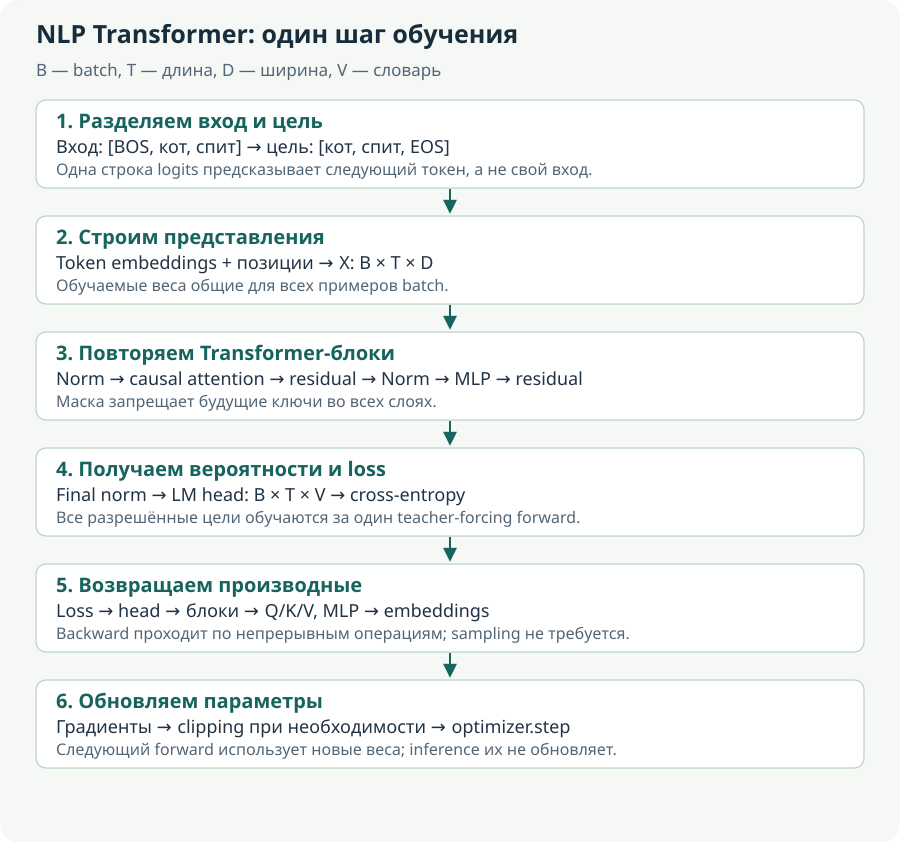
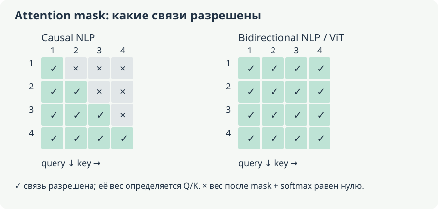

# В. Transformer: из каких узлов состоит LLM

[Оглавление](README.md). Пункт 3 плана; математический разбор attention — в следующей главе.

**Основа:** S1, страницы 4–14; S2, строки 1817–3404 и 3413–3487. Главный вопрос чата: «Что представляет из себя LLM, где attention-слои и куда мы вставляем матрицы?» **Углубление:** путь тензора через residual/normalization/MLP, различие двух масок и пример gated MLP. Формы в примерах учебные; названия модулей не универсальны для всех архитектур.

## 1. Общая схема decoder-only модели

В простом виде генеративная LLM — tokenizer, таблица embeddings, стек Transformer-блоков, финальная normalization и проекция в словарь. Tokenizer находится вне матричного стека. Позиционная информация вводится выбранным архитектурой способом. Для batch B, длины L и hidden dimension D вход стека имеет форму $B\times L\times D$.

Каждый блок получает массив векторов позиций, смешивает информацию через attention, преобразует каждый вектор через MLP и выдаёт массив той же формы. Совпадение внешних форм позволяет residual connections: складывать вход ветви с её результатом.

```text
text → tokenizer → ids B×L → embeddings B×L×D
     → block 1 → block 2 → … → block N
     → final norm → LM head → logits B×L×V
```

Слои 1 и 2 имеют однотипное устройство, но обычно разные обучаемые матрицы. «32 блока» означает 32 повторения структуры, а не 32 вызова одной общей копии весов, если weight sharing специально не предусмотрен.

Обозначение «decoder-only» исторически связано с Transformer decoder, но типичный такой блок не содержит cross-attention к отдельному encoder. Он использует causal self-attention. Название не означает, что входом обязана быть уже вычисленная encoder-последовательность.

### Как читать схему без пропущенных преобразований

Возьмём $B=2$, $L=3$, $D=4$ и два блока. После lookup у нас два прямоугольника из трёх векторов длины 4. Внутри блока первая позиция не исчезает и не превращается в одно итоговое слово: блок возвращает три обновлённых вектора. Второй блок получает именно их, а не три новых ID, выбранных первым блоком. Поэтому loss может изменить ранние представления через непрерывную цепь всех слоёв.

Выражение «стек одинаковых блоков» в исходном чате относится к архитектурной форме. Если у каждого блока своя `q_proj`, параметры первой и второй не обязаны совпадать ни до, ни после обучения. Внутри каждого блока одна и та же его проекция применяется ко всем позициям. Здесь два разных вида повторения: общий оператор по позициям и обычно разные операторы по глубине.

Входной ID не меняется в ходе прохода, а representation его позиции меняется. Токен «кот» остаётся источником позиции, но поздний вектор может кодировать сведения о глаголе и разрешённом левом контексте. Слова «модель переписала токен после attention» опасны: без уточнения они заставляют представить повторную токенизацию между слоями, которой в этой схеме нет.

Генерация одной новой позиции использует выход последней позиции prompt. Все предыдущие позиции всё равно были обработаны: из них образуются контекстные состояния и K/V для внимания. Это отвечает на естественное продолжение вопроса чата: «Если в конце нужен один токен, зачем так много векторов?» Они нужны как источники информации, к которым последняя позиция обращается через attention; последняя строка logits лишь определяет ближайший выбор.

## 2. Что именно делает один блок

Возьмём распространённую pre-norm структуру. Для массива X:

$$
\begin{aligned}U&=X+\operatorname{Attention}(\operatorname{Norm}_1(X)),\\Y&=U+\operatorname{MLP}(\operatorname{Norm}_2(U)).\end{aligned}
$$

Это схема механизма, а не универсальный точный forward каждой модели. В post-norm normalization ставится после residual-суммы; различаются также тип norm, bias, gating и dropout.

Normalization обычно работает отдельно над признаками каждого токена. LayerNorm вычитает среднее и делит на стандартное отклонение по D с epsilon, затем использует обучаемые scale/shift. RMSNorm нормирует по корню среднего квадрата, не выполняя обычного центрирования. Она не сравнивает каждую позицию со всеми остальными токенами как attention.

Attention создаёт Q/K/V через линейные проекции, вычисляет веса взаимодействий разрешённых позиций и смешивает V. После объединения heads используется output projection. Это этап обмена информацией между позициями.

MLP, напротив, обычно применяет одну и ту же функцию независимо к каждой позиции, используя уже контекстный вектор. В простом варианте:

$$
\operatorname{MLP}(h)=W_{\mathrm{down}}\,\varphi(W_{\mathrm{up}}h+b_{\mathrm{up}})+b_{\mathrm{down}}.
$$

При столбцах $h:D\times 1$, $W_{\mathrm{up}}:F\times D$, $W_{\mathrm{down}}:D\times F$. Внутренний размер F часто больше D: сначала расширяется пространство признаков, затем возвращается исходный размер.

В gated варианте, похожем на использованный в обсуждении Llama:

$$
\begin{aligned}a&=\operatorname{SiLU}(W_{\mathrm{gate}}h)\in\mathbb{R}^{F},\\b&=W_{\mathrm{up}}h\in\mathbb{R}^{F},\\\operatorname{MLP}(h)&=W_{\mathrm{down}}(a\odot b)\in\mathbb{R}^{D}.\end{aligned}
$$

`gate_proj`, `up_proj`, `down_proj` — линейные модули этих трёх операций. Gate создаёт не список разрешённых attention-связей, а поэлементно управляет ветвью MLP. `o_proj` — другая матрица, применяемая к объединённым attention outputs.

При $D=4$, $F=10$ матрицы gate/up имеют по 40 параметров, down — тоже 40. В attention MHA при общей ширине D каждая из четырёх проекций Q/K/V/O имеет 16 весов. Игнорируя biases/norm, получаем 120 MLP-весов и 64 attention-веса. Это показывает, почему адаптация только Q/V и адаптация всех linear modules имеют разный бюджет.

Residual connection прибавляет вход к изменению. Она помогает передавать информацию и градиент, но не делает внутреннюю ветвь бесполезной. Также нельзя отождествлять residual path $X+F(X)$ с LoRA branch: LoRA изменяет конкретную линейную операцию внутри F через $W_0+sBA$.

### Normalization: какие числа участвуют в одном вычислении

Для одного токена с $h=(1,2,3,4)$ LayerNorm сначала находит $\mu=2.5$ и дисперсию $\sigma^2=1.25$. При единичном scale, нулевом bias и без epsilon только для ручной арифметики результат равен приблизительно $(-1.341641,-0.447214,0.447214,1.341641)$. Среднее стало нулевым. Следующий токен нормируется по собственным четырём признакам; статистики этих двух позиций не усредняются.

RMSNorm для того же h использует $\sqrt{(1+4+9+16)/4}=\sqrt{7.5}\approx2.738613$ и даёт $(0.365148,0.730297,1.095445,1.460593)$ до обучаемого scale. Среднее не равно нулю, поэтому подмена этой операции LayerNorm меняет forward. В реальной формуле epsilon защищает от нулевого масштаба; его нельзя убирать в программе только потому, что он опущен в ручном примере. Обоснование такого нормирования — в [работе RMSNorm](https://arxiv.org/abs/1910.07467).

Почему нормирование не стирает всю информацию? Оно устраняет или ограничивает определённые изменения масштаба, но оставляет соотношения координат и обучаемые коэффициенты. Кроме того, в pre-norm блоке ненормированный residual идёт напрямую к сумме. Ветка получает нормированное представление для вычисления изменения, а исходный поток не заменяется только результатом norm.

### Residual как точная сумма и как путь градиента

Если $y=x+F(x)$, то локально $\partial y/\partial x=I+J_F(x)$. В backward вход получает прямой вклад g и вклад через ветвь $J_F(x)^\top g$. Например, при $x=(1,2)$ и $F(x)=(0.2,-0.3)$ выход равен $(1.2,1.7)$. Ветка добавляет изменение, а не обязана заново воспроизвести всё исходное состояние.

Из единичного слагаемого не следует абсолютная гарантия ненулевого градиента: другие пути могут усиливать или компенсировать сигнал. Но по сравнению с голой цепочкой преобразований появляется отдельный прямой путь. Это точнее объясняет роль residual, чем утверждение «градиент теперь никогда не исчезает».

Нужно также различать две output projections. `o_proj` переводит объединённые attention heads в ширину D внутри каждого блока. LM head в конце всей модели переводит D в размер словаря V. У них разные входы, места и назначения, даже если обе операции линейны и в разговоре обе называются «выходной матрицей».

### Полностью разобранная gated MLP

Для простой арифметики возьмём $D=2$, $F=3$, $h=(1,2)^\top$ и

$$
W_{\rm up}=\begin{bmatrix}1&0\\0&1\\1&1\end{bmatrix},\quad
W_{\rm gate}=\begin{bmatrix}0&0\\1&0\\0&1\end{bmatrix},\quad
W_{\rm down}=\begin{bmatrix}1&0&1\\0&1&-1\end{bmatrix}.
$$

Проекция up даёт $(1,2,3)^\top$, gate до активации — $(0,1,2)^\top$. Функция $\operatorname{SiLU}(a)=a/(1+e^{-a})$ превращает их в $(0,0.731059,1.761594)^\top$. Поэлементное произведение с up равно $(0,1.462117,5.284782)^\top$. Down возвращает $(5.284782,-3.822665)^\top$ ширины 2. Именно этот вектор совместим с residual; вектор ширины 3 непосредственно прибавлять к h нельзя.

Gate здесь не обязан лежать в диапазоне [0,1]: SiLU(2)≈1.761594. Поэтому аналогия с бинарным выключателем ограничена. Это обучаемое поэлементное взаимодействие двух признаковых ветвей. Оно выполняется отдельно для каждой позиции; соседние токены непосредственно не перемножаются в этом MLP. Межпозиционный обмен произошёл в attention.

Вопрос чата «куда именно вставляются LoRA-матрицы?» теперь имеет конкретный ответ: можно заменить, например, линейную gate-проекцию на $(W_{\rm gate}+sBA)h$, где A переводит 2→r, B переводит r→3. Поправка изменит gate, затем произведение с up и итог down. Если адаптировать `down_proj`, формы будут другими: A переводит 3→r, B переводит r→2. Размеры определяет конкретный linear, а не одинаковое название «LoRA».

## 3. Зачем нужны causal и padding masks

Пусть в prompt три токена. Для causal self-attention допустимость связей query-строка → key-столбец:

$$
A_{\mathrm{allowed}}=\begin{bmatrix}1&0&0\\1&1&0\\1&1&1\end{bmatrix},\qquad\text{строка — query, столбец — key}.
$$

Эта маска действует и на prompt при prefill. Ошибка из чатов, которую важно не переносить: prompt якобы свободно bidirectional, а causal начинается только после него. В обычной decoder-only схеме все позиции следуют causal правилу. Специальные prefix-LM objectives возможны, но это другая конфигурация.

Запрещённым scores добавляют $-\infty$ перед softmax, чтобы их вероятность стала нулевой. Просто обнулить score недостаточно: $\exp\left(0\right)=1$, поэтому «запрещённый» элемент всё ещё получил бы вес. На практике kernels используют эквивалентные численные операции и свои соглашения о boolean masks.

Padding mask исключает искусственные заполнители. Например, в batch `[кот, спит, PAD]` последний токен не должен стать реальным источником контекста. Пересечение padding и causal masks определяет допустимые key positions. Для padding query outputs часто просто игнорируют; внимание к полностью замаскированной строке требует аккуратной реализации, иначе возможны NaN.

### Почему causal правило сохраняется через весь стек

В первом блоке состояние позиции t зависит только от входов $1,\ldots,t$. Предположим, это верно после k блоков. В следующем attention query t обращается лишь к состояниям j≤t, каждое из которых само зависит только от входов до j. MLP и norm работают по одной позиции, residual складывает разрешённые состояния. Следовательно, после блока k+1 будущее тоже не появится. Это индуктивное объяснение causal свойства всей сети.

Если же случайно разрешить будущий токен хотя бы в одном attention-блоке, последующие корректные маски не отменят уже перенесённую информацию. Состояние t может содержать target, и обучение получит скрытую утечку. Поэтому правильность final mask не компенсирует ошибку одного раннего слоя.

На трёх позициях с одинаковыми разрешёнными scores softmax строк равен $[1,0,0]$, $[1/2,1/2,0]$, $[1/3,1/3,1/3]$. Если вместо −∞ поставить запрещённым scores нули, а остальные тоже равны нулю, каждая строка станет $[1/3,1/3,1/3]$. Первая позиция получит два будущих источника. Этот числовой пример показывает ошибку без терминов: нулевой score не означает нулевую вероятность.

Padding на левой стороне требует дополнительного внимания. У `[PAD, PAD, кот, спит]` позиция «кот» не должна читать первые два key, хотя по causal правилу они расположены раньше. Значит, доступ определяется пересечением правил, а реальные position IDs и выбор последнего настоящего токена должны соответствовать принятой схеме модели. У padding query может вообще не остаться key; её output нельзя бездумно включать в loss.

## 4. Encoder, decoder и cross-attention

Encoder для классификации или извлечения фактов часто использует bidirectional self-attention: токен видит и левый, и правый контекст всего доступного входа. При BERT-подобном MLM часть входов скрывается, и модель восстанавливает их по окружению. Это не next-token objective decoder-only модели.

Encoder-decoder, например для перевода, имеет отдельную обработку исходного текста и авторегрессивное создание целевого. Decoder использует causal self-attention по уже известной части ответа и cross-attention к encoder outputs. В cross-attention Q приходит из decoder, K/V — из encoder. Если длины источника S и ответа T, матрица связей имеет форму $T\times S$, а не обязательно квадратную $T\times T$.

Тип архитектуры выбирает допустимые пути информации. Он сам по себе не доказывает «понимание» текста и не назначает отдельной голове фиксированную грамматическую роль. Полезно мыслить через формы и зависимости, а семантические интерпретации проверять экспериментом.

### Cross-attention на конкретных формах

Пусть encoder обработал пять токенов источника в $H_{\rm enc}\in\mathbb R^{5\times4}$, а decoder имеет три текущих состояния $H_{\rm dec}\in\mathbb R^{3\times4}$. При $d_k=2$, $d_v=3$ query projection даёт Q формы 3×2, key projection от encoder — K формы 5×2, value projection — V формы 5×3. Произведение $QK^\top$ имеет форму 3×5; после row-softmax его строки содержат распределения по пяти исходным позициям. Умножение на V возвращает 3×3, а отдельная output projection 3→4 делает результат совместимым с decoder residual.

Во время создания перевода decoder может видеть весь исходный текст: source уже известен. Causal ограничение относится к ещё не созданным токенам перевода. Поэтому прямоугольная cross-attention матрица не обязана иметь обычную нижнетреугольную маску. Если источник содержит PAD, соответствующие source keys всё равно исключаются.

В encoder-only модели можно читать правый контекст входа, потому что задача, например классификация готового предложения, его разрешает. Это не «читерство» само по себе; утечка определяется постановкой. Для next-token prediction видеть собственный будущий ответ запрещено, для классификации полного текста видеть конец текста нормально. Архитектурное различие становится понятным через доступную информацию в момент решения задачи.


<!-- transformer-priority-training-v1 -->
## 5. Полный учебный цикл NLP Transformer



Схема объединяет узлы из S2 в одну вычислительную цепь. В исходном чате внимание было направлено прежде всего на расположение матриц и LoRA; здесь отдельно восстанавливается обучение базового Transformer. Это дополнение к источнику: не следует принимать учебные размеры и предложенные проверки за конфигурацию или результаты реального запуска.

### 5.1. Что именно известно модели и что ей нужно угадать

Для последовательности «BOS кот спит EOS» возьмём три входа: BOS, «кот», «спит». Целями будут «кот», «спит», EOS. Первая позиция учится предсказывать «кот» по BOS; вторая — «спит» по BOS и «кот»; третья — завершение по всему разрешённому префиксу. Эти слова выбраны как условные токены: реальный tokenizer может разбить их иначе.

Цель сдвинута на одну позицию относительно входа. Варианты реализации различаются: некоторые training API получают одинаковые `input_ids` и `labels`, а сдвиг делают внутри loss. Нельзя одновременно сдвигать данные вручную и ещё раз внутри функции. Проверка на короткой последовательности должна показать, какая строка logits сравнивается с каким ID.

Почему ответ «спит» уже присутствует в массиве входа, но это не утечка? При предсказании из позиции «кот» attention во всех слоях запрещает доступ к следующей позиции «спит». Модель параллельно вычисляет несколько разных задач по префиксам. Поздняя позиция может использовать раннюю, обратный путь запрещён. Поэтому teacher forcing совместим с авторегрессионным распределением. Без causal mask модель могла бы просто прочитать целевой токен справа, и малая training loss перестала бы доказывать обучение предсказанию продолжения.

Для длинного корпуса примеры обычно формируют из окон токенов. Нужно заранее решить, как обрабатываются границы документов: вставляется ли EOS, разрешён ли attention между документами при packing, сбрасываются ли position IDs. Простая конкатенация означает вполне определённую задачу условного предсказания, а не автоматическую изоляцию документов. Если нужна изоляция, её обеспечивает согласованная маска, а не один символ-разделитель.

### 5.2. Формы всех главных операций одного слоя

При row-vector соглашении вход имеет форму $X\in\mathbb R^{B\times T\times D}$. Для MHA с h головами и $d_h=D/h$ проекция $W_Q\in\mathbb R^{D\times D}$ даёт сначала $B\times T\times D$, затем reshape и перестановка осей дают $B\times h\times T\times d_h$. Так же строятся K и V. Это изменение представления массива, а не создание h независимых копий всего hidden vector.

Внутри головы матрица $QK^\top$ имеет форму $T\times T$. Её элемент $(i,j)$ отвечает на вопрос: насколько query позиции i совместим с key позиции j. Softmax нормирует **по j**, то есть по доступным источникам для одного запроса. Нормировать по query-оси означало бы другую операцию. Маска добавляется к scores до softmax. После умножения на V снова получаем $T\times d_h$; concat голов возвращает T×D, output projection сохраняет эту ширину.

Масштаб $1/\sqrt{d_h}$ связан с численным диапазоном dot products. Если координаты Q и K независимы, центрированы и имеют единичную дисперсию, дисперсия их скалярного произведения равна $d_h$. Деление на корень делает её равной единице в этой модели предположений. Реальные координаты не обязаны удовлетворять ей точно; это мотивация масштаба, а не утверждение, что дисперсия каждого обученного score всегда ровно 1. Слишком большие по модулю logits легко делают softmax почти дискретным, уменьшая чувствительность многих его компонент.

При $B=2,T=5,D=12,h=3$ каждая голова имеет ширину 4; scores имеют форму 2×3×5×5. Для одной query-строки сумма пяти весов равна 1, если существует хотя бы один разрешённый ключ. В causal attention первая строка распределяет всю массу на первый ключ; последняя может распределять её между пятью. Это ограничение доступности, а не требование равномерных весов.

### 5.3. От logits к функции потерь

Пусть $z_{bt}\in\mathbb R^V$ — logits позиции, $y_{bt}$ — целевой ID, а $m_{bt}\in\{0,1\}$ — признак того, что эта цель участвует в обучении. Тогда

$$
\mathcal L=\frac{1}{M}\sum_{b,t}m_{bt}\left[\log\sum_{v=1}^V e^{z_{btv}}-z_{bt,y_{bt}}\right],\qquad M=\sum_{b,t}m_{bt}.
$$

Нужно $M>0$; batch без единой обучаемой цели требует явной обработки. Для устойчивого log-sum-exp из logits вычитают максимум. В программе обычно используют функцию cross-entropy, принимающую logits: предварительный softmax и повторный log могут ухудшить устойчивость и иногда вообще меняют смысл переданного аргумента.

У attention mask и loss mask разные роли. Первая определяет, какие входные состояния доступны. Вторая определяет, за какие ответы начисляется ошибка. В SFT вопрос пользователя часто доступен как контекст, но его токены исключены из loss. Они при этом могут получать градиент через предсказание ответа: отсутствие собственной цели на позиции не означает, что все вычисления этой позиции отсоединены от графа.

Если у двух примеров 2 и 8 целевых токенов, среднее по всем десяти токенам даёт длинному примеру больший вес. Среднее двух отдельно усреднённых sequence losses даёт одинаковый вес примерам. Это разные функции потерь. При gradient accumulation также нельзя бездумно усреднить microbatch means, если числа целевых токенов различаются. Нужны согласованные суммы и знаменатели, включая распределённое обучение.

### 5.4. Как ошибка учит attention выбирать контекст

Для одной позиции производная cross-entropy по logits имеет особенно простой вид:

$$
\frac{\partial\mathcal L}{\partial z_v}=p_v-\mathbf 1[v=y]
$$

до коэффициента усреднения. При $p=(0.2,0.5,0.3)$ и правильном третьем классе градиент равен $(0.2,0.5,-0.7)$. Gradient descent стремится понизить первые два logits и повысить третий. Он не устанавливает правильный logit сразу равным единице: обновляет параметры, которые произвели все эти числа.

Если $z=hW_{\rm vocab}+b$, то градиент по h проходит через $W_{\rm vocab}^\top$, а градиент по матрице содержит внешнее произведение h и ошибки logits. Далее chain rule проходит через финальную norm, MLP и attention всех слоёв. В attention производная по V меняет передаваемое содержимое; производные по Q/K меняют scores и распределение весов. Так возникает обучаемая маршрутизация информации без отдельной ручной метки «этот токен обязан смотреть на тот».

В следующей главе уже приведён численный backward Q/K/V. Его нужно читать как внутренний участок этого полного пути. Например, loss на последнем слове может изменить embedding раннего слова, потому что его V участвовал в смеси, а его K влиял на выбранный вес. Несколько путей к одному параметру суммируются. Embedding с общими весами получает вклады от всех соответствующих употреблений; при tied LM head та же таблица дополнительно получает вклад от выходной проекции.

Sampling, argmax и beam search для обычного teacher-forcing pretraining не нужны. Поэтому недифференцируемость выбора целого ID не мешает этому обучению: сравнение с известной меткой выполняется непосредственно на распределении logits. Методы обучения по сгенерированным траекториям требуют другого разбора; их нельзя подменять стандартной cross-entropy.

### 5.5. Один шаг optimizer и различие режимов

Упрощённый шаг состоит из обнуления старых градиентов, forward, вычисления loss, backward и обновления параметров. При накоплении градиентов обнуление и обновление происходят на границах группы microbatches. Gradient clipping ограничивает норму уже вычисленного градиента; это не обрезка самих весов до заданного диапазона.

SGD обновляет $\theta\leftarrow\theta-\eta g$. Adam дополнительно хранит оценки первого и второго моментов градиента; AdamW отделяет weight decay от адаптивного масштабирования градиента. Поэтому память обучения включает не только веса и градиенты, но и optimizer states, сохранённые активации, временные буферы. Конкретные коэффициенты памяти зависят от precision, optimizer и распределения состояний; один универсальный множитель на число параметров здесь вводил бы в заблуждение.

Dropout при обучении случайно зануляет элементы с согласованным масштабированием, а при обычной оценке выключен. Отключение autograd и переключение train/eval — разные действия: первое управляет записью графа производных, второе поведением модулей. Inference делает forward с фиксированными весами. KV-cache хранит промежуточные K/V для ускорения этого forward, а optimizer states нужны для изменения весов; путать эти два вида памяти нельзя.

Warmup и последующее изменение learning rate управляют размером обновлений. Слишком большой шаг может разрушить обучение, хотя формулы attention реализованы верно. Слишком маленький шаг способен создать впечатление, что модель «ничему не учится». Loss оценивают на отложенных данных с тем же смыслом токенизации и масок. Если loss — средняя отрицательная log-probability с натуральным логарифмом, perplexity равна $e^{\mathcal L}$; сравнение разных tokenizers по одной perplexity требует осторожности.

### 5.6. Что меняется у encoder и encoder–decoder

У bidirectional encoder нельзя обучать обычное восстановление каждого входного токена без изменения постановки: идентичность уже находится в его собственном входе и доступна через residual. Masked language modeling скрывает или искажает часть входов и начисляет loss по выбранным целям. BERT использует именно отдельную процедуру подготовки входов и целей; bidirectional attention сам по себе не задаёт MLM. Подробности этой процедуры разобраны в разделе BERT. Архитектурная отправная точка — [работа BERT](https://arxiv.org/abs/1810.04805).

В переводе encoder читает исходное предложение целиком. Decoder получает сдвинутый правильный перевод, использует causal self-attention по переводу и cross-attention к encoder states. Query cross-attention приходит из decoder, K/V — из encoder; матрица весов имеет размер «длина перевода × длина оригинала». Encoder не получает правильный перевод как свой вход. Но градиент loss перевода проходит через cross-attention в encoder, поэтому обе части обучаются совместно. Это исходная постановка [Transformer для перевода](https://arxiv.org/abs/1706.03762).

Практическая самопроверка механизма: изменить будущий токен и убедиться, что logits более ранних позиций causal модели не изменились; проверить сумму весов attention по key-оси; вручную сопоставить три входа и три цели; сравнить loss по одной позиции с $-\log p_y$. Эти проверки устанавливают конкретные свойства вычисления. Они не доказывают качество языка, знание фактов или успешное обучение большого checkpoint.


<!-- transformer-positional-mechanisms-v1 -->
## 6. Порядок токенов: маска, абсолютные позиции и RoPE



### 6.1. Что сообщает маска, а чего она не сообщает

В изображённой causal матрице query 3 может обращаться к keys 1, 2, 3, а query 1 — только к key 1. Зелёная клетка не означает высокий вес: она означает, что связь допускается. Если scores трёх доступных ключей равны $(0,\log2,\log3)$, softmax даёт $(1/6,2/6,3/6)$. Четвёртый ключ после правильной causal маски получает ровно нулевой вес в математической модели, независимо от своего исходного score.

В bidirectional схеме все четыре позиции доступны каждой query. Это нормально, когда весь вход наблюдаем: например, encoder классифицирует уже полученное предложение или ViT — уже полученное изображение. Для next-token задачи доступ к будущему правильному ответу нарушил бы условие предсказания. Таким образом, выбор маски следует из задачи, а не из самого наличия attention.

Causal mask уже нарушает полную симметрию перестановки: первая и последняя позиции имеют разные наборы доступных источников. Поэтому фраза «без positional embeddings causal модель совершенно не знает порядок» слишком сильная. Но одна треугольная доступность не равнозначна явному представлению расстояний, соседства и относительных смещений. Например, без позиционных признаков attention query видит набор доступных K/V и не получает отдельной координаты «этот ключ ровно на три шага левее». Сложные эффекты границ и глубины могут частично сообщать порядок; это не причина считать mask полноценной заменой позиционного механизма.

В S2, строка 1335, смешаны два разных способа ввода позиции: к embedding действительно можно **прибавить** позиционный вектор, но стандартный RoPE **поворачивает Q и K**. Следующие подпункты разделяют эти операции. Также слова «голова учится грамматике» из чата — возможная интерпретация после анализа конкретной модели, а не обязательная заранее назначенная специализация каждой головы.

### 6.2. Абсолютный позиционный вектор меняет вход проекций

Пусть строка содержимого токена — $e_t$, его позиционный вектор — $p_t$. При аддитивном способе блок получает $x_t=e_t+p_t$. После этого $q_t=(e_t+p_t)W_Q$ и $k_t=(e_t+p_t)W_K$. Даже при одинаковом ID в двух местах Q/K могут различаться из-за разных $p_t$. При этом модель не получает два раздельных массива «содержание» и «место» в каждой операции: в данном варианте они уже сложены.

Возьмём двумерный учебный пример: у двух одинаковых токенов $e=(1,0)$, позиции $p_0=(0,0)$ и $p_1=(0,1)$, а $W_Q=W_K=I$. Тогда получаются $(1,0)$ и $(1,1)$. Ненормированные dot products равны 1 для первой пары токенов и 2 для второй позиции с самой собой. Пример показывает механизм влияния суммы на matching; он не является удачным готовым кодированием естественного языка.

Обучаемая таблица positions имеет отдельный вектор для каждого поддержанного индекса. Синусоидальное кодирование вычисляется по формуле, а не ищется в обучаемой таблице. В исходной схеме Transformer пары координат задаются так:

$$
p_{t,2r}=\sin\!\left(\frac{t}{10000^{2r/D}}\right),\qquad
p_{t,2r+1}=\cos\!\left(\frac{t}{10000^{2r/D}}\right).
$$

Разные частоты дают несколько масштабов изменения вдоль последовательности. При $D=4$ и $t=1$ получается приблизительно $(0.841471,0.540302,0.010000,0.999950)$. При t=0 это $(0,1,0,1)$. Числа синуса можно вычислить и для большего t, но сама возможность вычисления не доказывает качество модели на длинах, которых не было в обучении.

### 6.3. RoPE: вывод относительного угла


Рассмотрим одну пару координат как столбец. Матрица вращения имеет вид

$$
R(\phi)=\begin{bmatrix}\cos\phi&-\sin\phi\\\sin\phi&\cos\phi\end{bmatrix}.
$$

Для этой пары применим $\tilde q_i=R(i\theta)q_i$ и $\tilde k_j=R(j\theta)k_j$. Используя $R(a)^\top=R(-a)$ и $R(a)R(b)=R(a+b)$, получаем

$$
\tilde q_i^\top\tilde k_j=q_i^\top R((j-i)\theta)k_j.
$$

Это ключ к механизму: абсолютные номера i и j входят в позиционную часть dot product через разность. Само содержимое $q_i,k_j$ по-прежнему зависит от токенов и слоёв. Полученный score не является функцией только расстояния между позициями. В реальной голове несколько пар вращаются со своими частотами, а их вклады складываются. Конкретная раскладка пар координат должна совпадать с реализацией checkpoint. Основной принцип описан в [RoFormer](https://arxiv.org/abs/2104.09864).

Для ручной проверки возьмём $q=(1,0)^\top$, $k=(1,0)^\top$, $\theta=\pi/2$. При i=j=0 dot product равен 1; при i=0,j=1 — 0; при i=0,j=2 — −1. Если одновременно сдвинуть обе позиции на один шаг, пары (0,1) и (1,2) обе дают 0. При этом длины обоих векторов сохраняются: $R^\top R=I$. Изменение matching возникает из относительного поворота, а не из увеличения нормы.

Уже на этом примере виден предел фразы «близкие токены всегда сильнее»: при одной частоте углы периодичны. На расстоянии 4 в выбранном примере dot product снова равен 1. Несколько частот, содержательные Q/K и обучение создают более сложную картину, но RoPE сам по себе не задаёт строгого монотонного затухания с расстоянием.

В стандартной схеме RoPE применяется к Q/K после проекций; V не обязан вращаться. Поэтому итоговая смесь $\sum_j a_{ij}v_j$ меняется через веса attention, хотя значения V непосредственно не получили эти повороты. Реализации с другими правилами следует называть отдельно. Нельзя реализовать RoPE прибавлением $p_t$ к embedding и считать, что получена та же модель.

### 6.4. Что происходит в backward и KV-cache

Если частоты фиксированы, у поворота нет обучаемой матрицы, но градиент через него проходит. При $\tilde q=Rq$ получаем $\partial\mathcal L/\partial q=R^\top\partial\mathcal L/\partial\tilde q$. Далее обновляется WQ, из которой получен q. «Нет обучаемых параметров» и «операция мешает обучению» — разные утверждения. Для обычного ортогонального поворота норма этого локального градиента также сохраняется; это не гарантирует сохранение нормы во всём Transformer.

При генерации K обычно сохраняют в KV-cache в том представлении, которое ожидает используемый attention kernel, часто уже после позиционного поворота. Новая query должна использовать согласованный position ID. Удаление старых cache entries при sliding window не означает, что оставшиеся токены автоматически получают новые абсолютные позиции от нуля. Если positions или частоты переопределены, совместимость старых K с новой query нужно обосновать; одной правильной формы массива недостаточно.

При замене positional scheme нельзя ожидать, что уже обученные Q/K начнут вести себя так же: меняется функция scores, а значит, весь дальнейший forward. Методы расширения контекста рассматриваются в главе о длинном контексте; они меняют позиционные масштабы и режим адаптации. Здесь важно сначала уметь вычислить один исходный поворот, проверить знак относительного угла и объяснить, где стоит causal mask.

## 7. Вопросы с ответами

1. Где поставить LoRA для `up_proj`? **Ответ:** в линейную операцию расширения D→F: к $W_{\mathrm{up}}$ добавляется обучаемая low-rank дельта. Не после всей модели и не вместо tokenizer.
2. Может ли MLP изменить информацию о другом токене? **Ответ:** он непосредственно обрабатывает одну позицию, но её вход уже может содержать чужой контекст после attention.
3. Почему output attention проецируют обратно? **Ответ:** объединённые heads нужно смешать и привести к ширине, совместимой с residual.
4. Можно ли складывать residual $B\times L\times 4$ и ветвь $B\times L\times 10$? **Ответ:** нет; до суммы нужна проекция к совпадающей форме.

5. Почему фиксированный RoPE не мешает обучать WQ? **Ответ:** через поворот проходит производная: градиент умножается на транспонированную матрицу вращения и затем возвращается в проекцию.
6. Гарантирует ли RoPE больший вес ближайшему токену? **Ответ:** нет; есть содержательные Q/K, несколько частот и периодичность. Это позиционный механизм, а не универсальное правило монотонного убывания.
7. Как совместимы teacher forcing и неизвестное продолжение? **Ответ:** правильные токены присутствуют в общем обучающем массиве, но causal mask закрывает будущие позиции для каждой текущей query во всех слоях.
8. Исключает ли loss mask вопрос пользователя из контекста? **Ответ:** нет. Его токены могут оставаться доступными для attention и получать градиенты через предсказание ответа.

**Практика:** нарисовать на бумаге два последовательных блока для $B=2$, $L=3$, $D=4$, F=10. У каждого linear module записать вход/выход, пометить место LoRA. Затем заменить self-attention второго блока на cross-attention к пяти encoder states: показать, какая матрица становится $3\times 5$.

Архитектурная основа: [Attention Is All You Need](https://arxiv.org/abs/1706.03762). Современные варианты norm/gating нужно сверять с config выбранного checkpoint; здесь важен путь вычислений, а не зависимый от версии API.

<!-- latex-display-v1 -->
<!-- depth-revision-2026-10-17 -->
