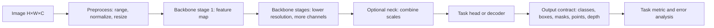

# V0. Изображение, тензоры и общий путь модели

[Оглавление](README.md) · [Сценарий модуля](../План%20—%20компьютерное%20зрение.md)

**Уровень:** общее ядро. **Предпосылки:** массивы/тензоры, умножение матриц и базовый gradient descent. **Используют:** V1–V9. **Задача главы:** проследить изображение от файла до выхода модели и научиться проверять формы данных на каждом этапе. Эта глава дополняет девять задач CV; она не предполагает знания LLM или BERT.

## 1. Изображение как массив и контракт входа

Цветное изображение можно представить тензором $X\in\mathbb{R}^{H\times W\times C}$: высота, ширина и каналы. В PyTorch типичный batch имеет NCHW-форму $[B,C,H,W]$, а некоторые библиотеки используют NHWC. Одинаковые числа с переставленными осями означают разные данные: передача NHWC туда, где ожидают NCHW, меняет смысл размеров или вызывает ошибку.

Пример: batch из 8 RGB-картинок $224\times224$ в NCHW имеет форму $[8,3,224,224]$. Число элементов равно $8\cdot3\cdot224\cdot224=1\,204\,224$. При float32 только вход занимает $1\,204\,224\cdot4=4\,816\,896$ байт, около 4.59 MiB. Это не включает активации и параметры модели.

Пиксельный диапазон и нормализация — часть контракта модели. Если файл хранит uint8 в $[0,255]$, перевод в float и деление на 255 даёт $[0,1]$. Затем поканально могут применить $x'_c=(x_c-\mu_c)/\sigma_c$. Нельзя повторно нормализовать уже нормализованные входы или применять статистики другого checkpoint: это сдвигает распределение входа.

Изменение размера требует определить, сохраняются ли пропорции. Прямое растяжение $(H,W)\to(224,224)$ меняет геометрию. Letterbox масштабирует изображение единым коэффициентом и добавляет поля; для координат предсказания потом нужно убрать padding и обратить scale. Crop сохраняет размер, но может удалить объект. Выбор преобразования связан с тем, какие примеры и аннотации считаются допустимыми.

## 2. Свёртка и формы feature maps

Свёрточный слой применяет $C_{out}$ фильтров размера $K_h\times K_w$ ко всем пространственным позициям входа. Каждый фильтр смешивает входные каналы и локальное окно. При dilation $D$, stride $S$ и padding $P$ размер выхода по высоте равен

$$
H_{out}=\left\lfloor\frac{H+2P-D(K_h-1)-1}{S}+1\right\rfloor,
$$

аналогично для ширины. Для входа $[B,3,32,32]$ и Conv2d с 16 фильтрами $3\times3$, stride 1, padding 1 получаем $[B,16,32,32]$. Без padding размер был бы $30\times30$. Если stride равен 2, при padding 1 размер будет $16\times16$.

В PyTorch вес такого слоя имеет форму $[C_{out},C_{in},K_h,K_w]$, а bias — $[C_{out}]$. Один выходной элемент — сумма произведений kernel, локального окна и каналов плюс bias. Один фильтр использует $3\cdot3\cdot3=27$ весов; 16 фильтров имеют $16\cdot27+16=448$ параметров.

Рецептивное поле говорит, какую область входа может влиять на одну позицию feature map. Для последовательных слоёв удобно вести два числа: размер поля $r$ и расстояние $j$ между соседними позициями на исходном изображении. Изначально $r_0=j_0=1$. Для слоя с kernel $k$, stride $s$, dilation $d$:

$$
r_{l}=r_{l-1}+(k-1)d\,j_{l-1},\qquad j_l=s\,j_{l-1}.
$$

Два слоя $3\times3$ со stride 1 дают поле $1\to3\to5$. Если второй слой имеет stride 2, поле всё ещё 5, а соседние выходы разнесены на 2 пикселя исходного изображения. Padding определяет, как граничные позиции дополняются; он не добавляет реальный контекст за границей картинки.

## 3. От backbone к задаче

Backbone преобразует вход в признаки. На каждом stage обычно уменьшается пространственное разрешение и меняется число каналов. Например, $[B,3,224,224]\to[B,64,112,112]\to[B,128,56,56]\to[B,256,28,28]$. Это пример форм, а не универсальный стандарт архитектуры.

Если downstream задаче полезны карты разных разрешений, neck объединяет признаки stages. Feature pyramid может передать детектору и высокое пространственное разрешение для маленьких объектов, и более крупные рецептивные поля для контекста. Head преобразует признаки в выход, соответствующий контракту задачи: class logits, координаты boxes, pixel logits, keypoints, depth или image-text scores. Для segmentation decoder часто повышает разрешение и объединяет признаки, но слово decoder в другой архитектуре может обозначать иной блок; важен поток данных и форма результата.

Схема общего пути:

На практике записывают форму и смысл выхода каждого прямоугольника. Для классификации head может свести пространственные оси pooling-операцией и вернуть $[B,K]$. Детектор возвращает набор кандидатов или queries с scores и координатами; сегментация — logits примерно $[B,K,H',W']$, которые могут быть приведены к размеру входа. Одного названия backbone недостаточно, чтобы восстановить эти интерфейсы.

## 4. Проверка на маленьком примере

Пусть вход $32\times32$ проходит три свёртки: $3\times3$, stride 1, padding 1; затем $3\times3$, stride 2, padding 1; затем $3\times3$, stride 2, padding 1. Пространственные размеры: $32\to16\to8$. Если число выходных каналов равно 8, 16 и 32, формы будут $[B,8,32,32]\to[B,16,16,16]\to[B,32,8,8]$.

Рецептивное поле последовательно: первый слой $r=3,j=1$; второй $r=5,j=2$; третий $r=9,j=4$. Поэтому соседние клетки последней карты смотрят на участки с центрами, разделёнными четырьмя пикселями; каждая клетка зависит от окна размером $9\times9$ с учётом padding. Глобальный pooling затем может получить один вектор на изображение, но локализация объектов потребует сохранить пространственную структуру или восстановить её в head/decoder.

## 5. Ограничения и самопроверка

- Перестановка каналов RGB/BGR, неверный dtype, диапазон или нормализация меняют вход даже при корректной форме.
- Resize, crop и letterbox влияют на геометрию; обратное преобразование координат является частью prediction pipeline.
- Размер рецептивного поля не доказывает, что модель использует каждый пиксель этой области или понимает объект целиком.
- Feature map не является готовым объяснением или семантической маской. Интерпретация требует отдельного метода и проверки.
- Backbone/neck/head — полезные роли в схеме, но конкретные архитектуры могут объединять их или называть иначе.

**Вопросы.** 1) Какова форма batch из 4 RGB изображений $64\times48$ в NCHW? 2) Какой выход даёт Conv2d с $k=3,s=2,p=1$ на размере 32? 3) Что нужно сделать с box после letterbox? 4) Почему один class logit не заменяет mask?

**Ответы.** 1) $[4,3,64,48]$. 2) $16$, поскольку $\lfloor(32+2-3)/2+1\rfloor=16$. 3) Вычесть поля padding и разделить координаты на коэффициент масштабирования, с учётом clipping к исходному кадру. 4) Logit классифицирует изображение или класс кандидата, но не задаёт положение метки по пикселям.

**Практика.** Для входа $[2,3,256,384]$ выпишите размеры после resize до 224×224 stretch и после aspect-preserving letterbox; укажите, какие координатные преобразования нужны. Затем вручную проследите форму через две свёртки и объясните, какой выход понадобится для классификации, detection и segmentation.
