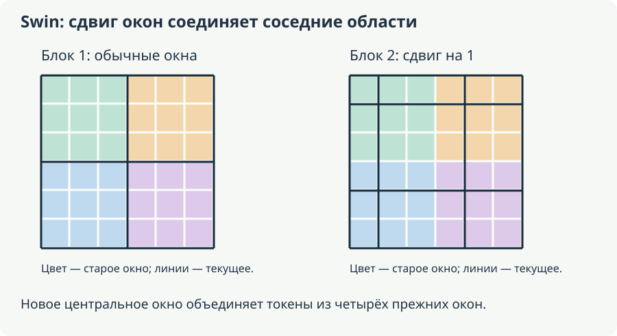
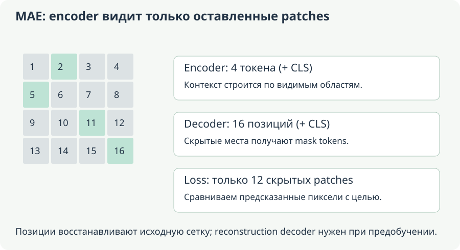
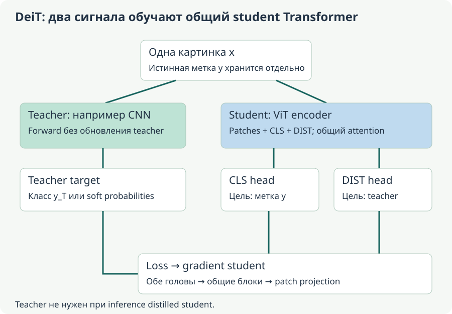

# А. Классификация изображений, backbone и ViT

[Оглавление](README.md). Пункт 1 плана; отдельное углубление из чата о patch embedding.

**Основа:** S7, строки 207–1617: классификация, вопрос «что такое backbone», просьба подробно разобрать шаг проекции патчей с математикой. Из экспорта исключены английские служебные вставки и дубли повреждённых формул. **Углубление/исправления:** единая NCHW-нотация, точная эквивалентность Conv2d, equivariance вместо ошибочного «permutation-invariant patch embedding», ограничения интуиции ResNet и ViT.

**Уровень:** общее ядро. **Предпосылки:** V0, D2/D4/D5. **Используют:** V2–V9 and clustering.

## 1. Задача до выбора архитектуры

В single-label classification изображению $X\in\mathbb{R}^{C\times H\times W}$ соответствует один класс $y\in\{1,\ldots,K\}$. Модель выдаёт K logits, softmax переводит их в probabilities. Predicted class — argmax. Выход не локализует объект: на изображении с тремя собаками может быть одна метка «собака». Если нужно несколько независимых labels, это multi-label задача с sigmoid/BCE или другим подходящим objective, а не тот же mutually exclusive softmax.

Для примера с правильным классом c cross-entropy $\mathcal{L}=-\log p_c$. При $p=\left(0.1,\,0.7,\,0.2\right)$ и c=2 loss≈0.3567. Gradient по logits $p-\operatorname{one\_hot}(c)$; он передаёт сигнал head и backbone, если их параметры обучаемы. Большая вероятность не гарантирует хорошую calibration: это проверяется на независимых данных.

Accuracy — доля правильных argmax. Top-k accuracy считает пример верным, если правильный класс входит в k наибольших scores. Top-5 при $K=3$ бессмысленна как различающая метрика: все классы и так входят в ответ. Confusion matrix зададим строками истинных классов и столбцами predicted.

Для one-vs-rest класса: $\mathrm{Precision}=\frac{\mathrm{TP}}{\mathrm{TP}+\mathrm{FP}}$, $\mathrm{Recall}=\frac{\mathrm{TP}}{\mathrm{TP}+\mathrm{FN}}$, $F_1=\frac{2\mathrm{TP}}{2\mathrm{TP}+\mathrm{FP}+\mathrm{FN}}$. Macro усредняет классы равноправно, weighted учитывает support; micro суммирует counts до вычисления. Для single-label multiclass без исключения классов micro-F1 совпадает с accuracy. Нулевые denominators обрабатываются по объявленной convention.

Пример: 90 обычных кадров и 10 с дефектом; модель всегда говорит «обычный». Accuracy 90%, recall дефекта 0. Модель не решает задачу поиска дефекта, хотя общий score выглядит высоким. Поэтому нужны class slices, confusion matrix, порог под цену ошибок и calibration.

### От вида разметки к выходу модели

Один и тот же кадр можно разметить по-разному. Если цель — отличить «есть дефект» от «дефекта нет», достаточно глобальной метки. Если нужно показать инспектору место дефекта, одной метки уже мало: требуется box или mask. Если на кадре одновременно допустимы «коррозия» и «трещина», взаимно исключающий softmax заставит два правильных ответа конкурировать. Поэтому сначала определяют смысл y, затем выбирают head и loss.

Для single-label модели обучающая выборка состоит из пар $(x_i,y_i)$, а эмпирический objective обычно усредняет $-\ln p_\theta(y_i\mid x_i)$ по примерам. Это обучает относительные scores классов для заданного корпуса. На inference softmax не обязателен, чтобы выбрать argmax: он сохраняет порядок logits. Но для порога или анализа вероятностей требуется понимать, какие преобразования к scores применены и насколько они откалиброваны.

Пример из чата с accuracy при дисбалансе можно развернуть до confusion counts. Среди 100 кадров с 10 дефектными модель пометила восемь как дефектные: шесть правильно, два обычных ошибочно. Для дефекта TP=6, FP=2, FN=4, TN=88. Accuracy=(6+88)/100=94%, precision=6/8=75%, recall=6/10=60%, F1=12/(12+2+4)=2/3. Рядом с baseline «всё обычное» accuracy выросла лишь на четыре пункта, но появились шесть найденных дефектов. Для решения о пригодности нужна цена двух ложных тревог и четырёх пропусков, а не только одно итоговое число.

Top-k отвечает на другой вопрос: можно ли дать несколько кандидатов, среди которых есть истинный класс? Это может быть удобно для справочника видов растений, где человек выбирает из пяти вариантов. Для автоматической сортировки на один конвейер требуется один выбранный класс или отдельное правило отказа. Высокая top-5 не доказывает качество top-1 в таком процессе.

## 2. Почему начинать с простого baseline

kNN по сырым pixels сравнивает развёрнутые изображения. Небольшой сдвиг объекта сильно меняет distance, фон и освещение могут доминировать. MLP на flattened $224\times 224\times 3$ входе получает 150 528 признаков. Уже hidden layer 1000 требует 150 528 000 весов до biases и следующего слоя. Пространственная близость пикселей явно не используется.

Классические HOG/SIFT-представления с classifier вводят ручную структуру; kNN или linear probe по pretrained embeddings используют выученную. Такие baselines полезны: если representations уже хорошо разделяют классы, full fine-tuning может быть не нужен. При frozen encoder embeddings можно предвычислить, но fit scaler/PCA и подбор k выполняются только по train/validation.

**Backbone** — основной feature extractor, **head** превращает его признаки в output конкретной задачи. Классификатор агрегирует spatial features в один class vector, detector сохраняет локализацию и выдаёт множество объектов, segmenter восстанавливает плотную карту. У некоторых систем есть **neck**, который объединяет features разных resolutions. Эти роли — способ описать computation, а не требование, чтобы у каждой модели были три отдельно названных Python-класса.

### Вопрос из S7: «Что такое backbone?»

Backbone определяется функцией в системе: это часть, превращающая входное изображение в признаки для последующего решения. Один и тот же набор весов ResNet можно использовать как начало классификатора, detector или segmenter. Но подключить к нему другую head — не значит автоматически получить обученную новую задачу. Нужны соответствующие данные, objective, spatial outputs и настройка совместимости.

Возьмём условные признаки после нескольких стадий CNN для входа $B\times3\times224\times224$: $B\times64\times56\times56$, затем $B\times128\times28\times28$, $B\times256\times14\times14$, $B\times512\times7\times7$. Это пример форм, не конфигурация конкретного ResNet. Ранние карты дают более подробную сетку, поздние — более крупные receptive fields и другие каналы признаков. Для классификации global average pooling последней карты превращает её в $B\times512$, а linear head — в $B\times K$.

Для detection усреднить всю карту в один вектор слишком рано: исчезнет явная spatial сетка, на которой удобно локализовать несколько объектов. Neck вроде feature pyramid может объединять карты разных масштабов: маленьким объектам полезна подробная сетка, крупным — широкий контекст. Для segmentation decoder строит плотную карту по пространственным признакам. Поэтому понятия backbone, neck и head описывают распределение вычислительных задач, а не только имена папок в коде.

При frozen backbone производные не обновляют его параметры, но head может учиться на фиксированных признаках. Если деталь, разделяющая два новых класса, в этих признаках плохо представлена, одной линейной head может быть недостаточно. Partial/full fine-tuning меняет сами признаки, но требует дополнительного контроля overfitting. В S7 это связано с SSL-проектом: сначала следует проверить, что именно умеют выученные representations, а затем выбирать дальнейшую адаптацию.

### Как читать kNN и linear probe как два разных контроля

kNN по готовым векторным признакам проверяет выбранную локальную геометрию: какие training-примеры оказались рядом с новым. Linear probe проверяет, можно ли разделить классы одной обученной линейной границей. Если kNN слабее probe, это не обязательно «плохие embeddings»: метрика и локальная плотность могут быть неудобными, хотя линейный сигнал есть. Если probe тоже слаб, это повод проверить preprocessing, pooling, качество меток и применимость pretraining.

Предвычисление признаков удобно только при действительно фиксированном encoder и согласованном preprocessing. Если при каждом training pass нужна случайная аугментация, один заранее вычисленный вектор не воспроизводит распределение всех её вариантов. Для честного сравнения не смешивают source images одного объекта между train и test: соседство почти одинаковых кадров может дать высокий kNN score через утечку.

## 3. CNN и residual learning

Свёртка использует локальное окно и общие weights для разных позиций. Для kernel $k\times k$ количество весов $C_{\mathrm{out}} C_{\mathrm{in}} k^2$ без biases не зависит от H/W. Слой выдаёт feature maps; нелинейности и следующие слои создают более сложные функции. Pooling/stride уменьшают resolution. Translation equivariance приблизительно сохраняется при подходящих условиях, но boundaries, stride и pooling её ограничивают; полной инвариантности к любому сдвигу нет.

Простой pipeline: conv → activation → pooling → несколько blocks → global average pooling → linear head. LeNet — исторический пример компактной CNN, AlexNet — более глубокого классификатора с ReLU/dropout и большим training scale. Не нужно копировать историческую архитектуру как обязательный лучший baseline сегодня.

ResNet задаёт $y=x+F(x)$, при разных shapes используется projection shortcut. Jacobian $\frac{\partial y}{\partial x}=I+\frac{\partial F}{\partial x}$ создаёт прямой путь gradient. Это помогает optimization, но не гарантирует, что любой очень глубокий стек не имеет exploding/vanishing effects. Исходная residual идея также отвечает проблеме degradation training качества при наращивании обычной глубины, а не только слову «vanishing». [ResNet](https://arxiv.org/abs/1512.03385).

YOLO classification model использует backbone и global classification head. Его не следует путать с class prediction на каждой detection candidate. Модель `*-cls` выдаёт global labels, а `*-detect` ещё и boxes. Формат task-specific head и preprocessing проверяются у конкретного checkpoint; имя YOLO не означает одну общую head для всех задач.

### Почему локальность и общие фильтры меняют задачу обучения

Полносвязный первый слой знает о соседстве пикселей только через данные. Свёртка заранее ограничивает связи локальным окном и использует одинаковый фильтр в разных местах. Например, при $C_{in}=3$, $C_{out}=64$, kernel 3×3 получается $64\cdot3\cdot9=1728$ весов без bias независимо от ширины изображения. Те же 1728 чисел применяются ко всем spatial positions. У flattened MLP каждый входной пиксель имеет свои коэффициенты для каждого hidden unit.

Один фильтр не обязан быть заранее нарисованным детектором края. Он обучается по task loss, а несколько стадий и нелинейностей создают сложные функции. Историческая лестница «края → текстуры → части → объекты» помогает интуиции, но не назначает каждому слою ровно один тип информации. CNN также может пользоваться фоном или watermark, если они позволяют снизить loss на обучающих данных.

Residual становится особенно полезен, когда добавленный блок должен почти сохранить уже хорошие признаки. При одинаковой форме можно приблизить identity, сделав остаточную ветвь малой. Когда stride уменьшает сетку или меняется число каналов, identity исходной формы уже не складывается с новой ветвью: нужен shortcut projection с согласованной формой. Это конкретное ограничение объясняет, почему не всякая дуга на схеме ResNet — буквальная передача x без преобразования.

## 4. ViT: изображение становится последовательностью

ViT делит изображение на patches, проецирует каждый в D-мерный vector, добавляет position information и обрабатывает Transformer encoder. Для обычного classification attention bidirectional по доступным image tokens. В отличие от decoder-only LLM, causal mask здесь обычно не нужна.

Пусть B — batch, C — channels, H/W — размеры, P — сторона неперекрывающегося patch. Если размеры делятся на P:

$$
\begin{gathered}N_h=\frac HP,\quad N_w=\frac WP,\quad N=N_hN_w,\quad K_{\mathrm{patch}}=CP^2,\\X\in\mathbb{R}^{B\times C\times H\times W},\quad X_{\mathrm{patches}}\in\mathbb{R}^{B\times N\times K_{\mathrm{patch}}},\\E\in\mathbb{R}^{K_{\mathrm{patch}}\times D},\quad b\in\mathbb{R}^{D},\qquad Z=X_{\mathrm{patches}}E+b\in\mathbb{R}^{B\times N\times D}.\end{gathered}
$$

Embedding width D задаётся архитектурой и не обязана равняться CP². Совпадение 768 для RGB patches $16\times 16$ и ViT-Base $D=768$ — частный выбор.

Для H=W=224,$P=16$,$C=3$ получаем сетку $14\times 14$, $N=196$, K_patch=768. Матрица проекции содержит $768\cdot 768+768=590 592$ параметра с bias. Добавление одного learned CLS token даёт длину 197; его итоговое state используют для head. Другой вариант — pooling patch states, так что CLS не обязательная математическая часть всех ViT.

Далее, для одного encoder head при row tokens:

$$
Q=ZW_Q,\quad K=ZW_K,\quad V=ZW_V,\qquad S=\operatorname{softmax}_{\mathrm{rows}}\!\left(\frac{QK^\top}{\sqrt{d_k}}\right),\quad O=SV.
$$

Multi-head outputs объединяются, проецируются, добавляются residual/norm и tokenwise MLP. Векторы patches получают глобальный контекст через attention. Подробный backward этого механизма уже разобран в [основах LLM](<../../06-llm/01-foundations/Учебные конспекты/Г — QKV, multi-head attention и точный backward.md>): смена modality не меняет chain rule.

### Почему в ViT нужен отдельный CLS и что он получает

CLS — обучаемый начальный вектор длины D, который добавляется как ещё одна позиция. В начале forward он общий для разных изображений, но после attention его состояние зависит от patches данного изображения. Он может использовать их K/V и в последующих блоках снова уточнять representation. Таким образом, общий параметр CLS и выходной state CLS — разные объекты, как token embedding и contextual state в текстовой модели.

Потеря классификации на итоговом CLS возвращает градиент к использованным patch states, далее к patch projection и пикселям вычислительного графа. Не требуется отдельная целевая метка для каждого patch, чтобы они участвовали в обучении. Альтернатива — mean-pooling patch states; выбор агрегатора должен соответствовать обучению checkpoint, а не произвольно меняться только при оценке.

MLP внутри ViT применяется к каждому токену, включая CLS, одной и той же функцией данного блока. Attention смешивает позиции, MLP преобразует признаки каждой уже контекстной строки. В обычной классификации картинки все patches известны заранее, поэтому разрешить им двусторонний обмен нормально. Causal маска LLM нужна для другой постановки — предсказания неизвестного продолжения, — и не переносится сюда только из-за общего слова Transformer.


На иллюстрации E общая для всех четырёх областей, а позиционные векторы различны. Цвет обозначает исходное место, а не класс объекта. Проекция не сокращает четыре patches до одного: она меняет число признаков каждой строки.

## 5. Полная индексация patch embedding

Зафиксируем порядок flattened patch: сначала c, затем локальные p,q. Для $i\in\{0,\ldots,N_h-1\}$, $j\in\{0,\ldots,N_w-1\}$, $p,q\in\{0,\ldots,P-1\}$:

$$
\begin{aligned}n&=iN_w+j,\qquad k=cP^2+pP+q,\\(X_{\mathrm{patches}})_{b,n,k}&=X_{b,c,iP+p,jP+q},\\Z_{b,n,d}&=\sum_k(X_{\mathrm{patches}})_{b,n,k}E_{k,d}+b_d.\end{aligned}
$$

В original export сначала объявлялся HWC, а flatten объяснялся как для CHW. Само отображение может быть задано как угодно, но соответствие memory axes надо фиксировать. Здесь всё согласовано с NCHW.

Линейная проекция всех patches эквивалентна Conv2d с `in_channels=C, out_channels=D, kernel_size=P, stride=P, padding=0`, если:

$$
(W_{\mathrm{conv}})_{d,c,p,q}=E_{cP^2+pP+q,\,d}.
$$

Действительно:

$$
\begin{aligned}Y_{b,d,i,j}&=\sum_{c,p,q}(W_{\mathrm{conv}})_{d,c,p,q}X_{b,c,iP+p,jP+q}+b_d\\&=Z_{b,\,iN_w+j,\,d}.\end{aligned}
$$

После conv output $B\times D\times N_{h}\times N_{w}$ нужно flatten spatial и transpose в $B\times N\times D$. В PyTorch `Linear.weight` имеет $D\times K_{\mathrm{patch}}$, то есть хранит Eᵀ нашей формулы. Переставить веса без этого transpose/reshape — ошибка, которая не обязательно обнаружится только по конечным shapes.

### Разделяем четыре индекса, чтобы восстановить математику исходника

Запрос пользователя в S7 был точным: «сильно подробнее расписать шаг 2», желательно с полной математикой. Чтобы эта просьба не свелась к одной формуле, отдельно проследим адрес конкретного элемента. Пусть $C=3$, $H=W=32$, $P=8$. Тогда $N_w=4$. Для patch с i=1,j=2 получаем n=6. Внутри него возьмём c=2,p=3,q=5; flattened индекс k=$2\cdot64+3\cdot8+5=157$. Этому числу соответствует пиксель $X_{b,2,11,21}$, поскольку глобальные координаты равны $(1\cdot8+3,2\cdot8+5)$.

Одна координата embedding d умножает этот пиксель на $E_{157,d}$ и складывает с аналогичными вкладами остальных 191 элементов patch. Один и тот же E используется у patch n=0, n=6 и всех остальных. Отдельной матрицы «для верхнего левого patch» нет; различие мест сообщит позиционная информация на следующем шаге.

Для всех patches одной картинки $Z=X_{patches}E+\mathbf1_N b^\top$. Запись с единичным столбцом показывает bias без неявного broadcasting: одна и та же строка $b^\top$ прибавляется N раз. Для batch повторяется та же операция независимо по B; веса не умножаются на размер batch при подсчёте параметров.

### Почему эквивалентности Conv2d недостаточно объявить на словах

Возьмём канал d выходной свёртки. Его filter содержит $CP^2$ коэффициентов, каждый для конкретных c,p,q. При stride=P и без padding filter на location i,j видит ровно patch i,j. Каждое слагаемое произведения совпадает с соответствующим членом линейной проекции, если kernel присвоен по приведённому выше индексу k. Bias совпадает тоже. Так устанавливается поэлементное равенство, а не только похожесть форм.

После conv ось d стоит второй: $B\times D\times N_h\times N_w$. Для Transformer tokens должны стоять перед каналами: spatial оси объединяются в N, после чего происходит transpose в $B\times N\times D$. Операция `reshape` без нужной перестановки может сохранить число элементов и дать желаемую форму, но перемешать содержимое токенов. Проверять нужно реальные значения на нумерованном входе, а не только shape.

В источнике заявлялся HWC, а формула flatten соответствовала CHW. Оба порядка допустимы отдельно. Если выбрать HWC, коэффициент должен следовать индексу $(pP+q)C+c$; тогда и строки E переставляются соответственно. Одинаковая E при разных flatten-порядках задаёт другую функцию. Эта поправка сохраняет все шаги исходного объяснения и устраняет его неоднозначность.

### Формы реализации без зависимого от версии training API

Для NCHW входа путь через patches можно описать последовательностью операций:

```python
# X: B, C, H, W; H и W делятся на P
patches = X.unfold(2, P, P).unfold(3, P, P)
# B, C, N_h, N_w, P, P
patches = patches.permute(0, 2, 3, 1, 4, 5)
# B, N_h, N_w, C, P, P
patches = patches.reshape(B, N_h * N_w, C * P * P)
Z = linear(patches)  # Linear.weight имеет D, C*P*P

# Эквивалентный путь при согласованных весах
Y = conv(X)          # B, D, N_h, N_w; kernel=P, stride=P
Z_conv = Y.flatten(2).transpose(1, 2)
```

Это учебное сопоставление forward, а не код полного обучения. Чтобы скопировать веса, в нашей записи нужно $W_{conv}=E^\top$, reshaped в D×C×P×P. Сравнение `Z` и `Z_conv` при одинаковом bias проверяет и соглашение об осях, и корректность извлечения patches.

### Минимальный ручной пример

Одноканальное $4\times 4$ изображение содержит числа 1…16 по строкам. При $P=2$ первый patch $\left(1,\,2,\,5,\,6\right)$, второй $\left(3,\,4,\,7,\,8\right)$, третий $\left(9,\,10,\,13,\,14\right)$, четвёртый $\left(11,\,12,\,15,\,16\right)$. Возьмём $D=2$, bias=0 и columns E:

$$
E_{:,1}=\begin{bmatrix}1\\1\\1\\1\end{bmatrix},\qquad E_{:,2}=\begin{bmatrix}1\\0\\0\\-1\end{bmatrix}.
$$

Получим $Z=\begin{bmatrix}14 & -5\\22 & -5\\46 & -5\\54 & -5\end{bmatrix}$. Два conv filters $\begin{bmatrix}1 & 1\\1 & 1\end{bmatrix}$ и $\begin{bmatrix}1 & 0\\0 & -1\end{bmatrix}$ со stride2 дадут те же четыре vectors. Первая координата суммирует patch; вторая сравнивает диагональные pixels. Это пример learned linear filters, а не обязательное значение реальных trained columns.

Gradient также прозрачен. При $G=\frac{\partial\mathcal{L}}{\partial Z}$ матрично $\frac{\partial\mathcal{L}}{\partial E}=X_{\mathrm{patches}}^\top G$, $\frac{\partial\mathcal{L}}{\partial X_{\mathrm{patches}}}=GE^\top$, а bias gradient суммирует B/N. Входной gradient раскладывается обратно по местам patches. При overlap вклады в одни pixels складываются.

### Что именно обучается в E и как читать её строки и столбцы

В соглашении E размера $CP^2\times D$ столбец $E_{:,d}$ — полный linear filter для координаты d. Строка $E_{k,:}$ описывает, как один входной элемент patch влияет на все D координат. В S7 оба объекта назывались «шаблоном»; различие полезно для проверки shapes: у фильтра одного output должно быть столько коэффициентов, сколько входных элементов, то есть CP².

Проекция с D<CP² не может быть обратимой на всём пространстве pixels: её rank не больше D, часть направлений теряется. При D≥CP² и полном столбцовом/строчном ранге в согласованной ориентации сама линейная часть может сохранять достаточно информации для восстановления, но objective классификации не требует этого. Даже квадратная E не обязана быть невырожденной. Поэтому равенство D=768 и CP²=768 не означает «без потерь» автоматически.

Backward по E суммирует вклады всех patches всех B объектов. Для одного output $Z_{b,n,d}$ производная по $E_{k,d}$ равна значению соответствующего pixel-компонента $X_{patches,b,n,k}$. Через loss этот вклад умножается на downstream gradient $G_{b,n,d}$. Поэтому один filter может обучаться на разных местах картинки одновременно. При overlap один пиксель участвует в нескольких patches, и его входные градиенты суммируются; простое присваивание последнего вклада потеряло бы часть производной.

Числа исходного примера для больших ширин также сохраняются: при P=16,C=3,D=1024 projection имеет $768\cdot1024+1024=787456$ параметров. При P=14,C=3,D=1280 — $588\cdot1280+1280=753920$ с bias. Число 752640 из S7 учитывает только матрицу. Нельзя сравнивать его с бюджетом другого варианта, где bias уже включён, без пояснения.

## 6. Зачем patches, positions и какие ограничения

Если сделать token из каждого pixel $224\times 224$, $N=50$ 176, матрица attention имеет около 2.52 млрд элементов на head. Для $N=196$ — 38 416. Отношение **числа pairwise entries** равно $256^2=65 536$ без CLS. Это не 65 536-кратный выигрыш полного training: остаются projections/MLP, другая ширина и kernels.

Уменьшение P увеличивает N и сохраняет более мелкую spatial структуру, но повышает attention cost. При doubling обеих сторон изображения N растёт вчетверо, pairwise entries — в 16 раз. Поэтому resolution влияет иначе, чем только число parameters.

Одинаковая linear projection применяется к каждому patch. Если переставить patches, выходные vectors переставятся так же: это **equivariance**, не invariance. Последовательность сама помнит порядок индексов в массиве, но без position information стандартный Transformer encoder не получает привилегированной геометрии этой сетки. Learned absolute/relative position schemes добавляют spatial relations; при новом resolution может требоваться корректная interpolation/иная схема.

Из linear embedding не следует, что semantic patches автоматически близки. Это свойство зависит от обучения всех последующих layers/objective. CNN имеет сильные locality/weight sharing priors; ViT получает часть locality через patches, но глобальное смешивание attention устроено иначе. Больше данных/pretraining часто помогает ViT, однако «ViT всегда требует гигантский dataset» слишком категорично: data-efficient training и transfer меняют условия. [ViT](https://arxiv.org/abs/2010.11929).

### Перестановка patches: точное свойство и предел интуиции

Пусть Π переставляет N строк $X_{patches}$. Тогда shared linear projection даёт

$$
(\Pi X_{patches})E+\mathbf1 b^\top=\Pi(X_{patches}E+\mathbf1 b^\top).
$$

Output меняется той же перестановкой. Это equivariance. Если затем усреднить строки без позиционной информации, получится одинаковое среднее — уже инвариантность конкретного агрегированного результата. Эти два утверждения нельзя смешивать.

Представим два изображения из одинаковых patches: небо сверху и трава снизу, затем наоборот. При отсутствии position information encoder с глобальным permutation-equivariant attention не получает привилегированной привязки patch к ячейке исходной сетки; pooling/CLS может не различить такую перестановку в идеализированных условиях. Фиксированная позиционная сетка, прибавленная к embeddings, нарушает эту симметрию: один patch получает другое сочетание content и location.

Если вместе переставить и patches, и их позиционные векторы, соответствие снова будет сохранено. Поэтому важен именно способ закрепления positional information за местами. При смене resolution число grid-позиций меняется. Для learned absolute embeddings иногда интерполируют spatial grid, обрабатывая CLS отдельно; это техника согласования формы, а не гарантия сохранения качества на любом размере.

### Когда менять patch size, а когда архитектуру

При 224×224 переход P=16→P=8 увеличивает N с 196 до 784, то есть вчетверо, а число pairwise entries с 38416 до 614656, то есть в шестнадцать раз. При P=14 N=256 и 65536 entries, примерно в 1.706 раза больше, чем при P=16. Это нагляднее формулировки «патч немного меньше»: небольшое изменение стороны может заметно увеличить attention.

При этом размер матрицы projection при фиксированном D уменьшается вместе с P². Значит, «меньше параметров patch embedding» может сочетаться с «намного больше вычислений attention». Общие FLOPs включают и Q/K/V projections, и MLP по всем N, поэтому ни parameter count, ни N² отдельно не описывают полную скорость.

Перекрывающиеся patches используют stride S<P; без padding число позиций по высоте равно $\lfloor(H-P)/S\rfloor+1$. Не следует продолжать формулу N=HW/P² для этого случая. Overlap даёт более плотное покрытие и новые связи на входе, одновременно увеличивая N. Conv stem добавляет несколько локальных нелинейных преобразований до token sequence. Иерархическая схема может уменьшать spatial grid по стадиям, а оконное внимание ограничивает взаимодействия; это разные способы контролировать стоимость и локальность.

CNN и ViT поэтому нельзя ранжировать только по словам «маленький» и «большой dataset». Pretraining, аугментации, разрешение, teacher signals и compute меняют условия. Содержательный вывод из чата сохраняется: CNN даёт более сильную встроенную локальную структуру, ViT с глобальным attention позволяет прямой обмен между удалёнными patches. Выбор проверяется в сопоставимом протоколе. Архитектурная основа patch sequence — [оригинальный ViT](https://arxiv.org/abs/2010.11929).

## 7. SSL и проверка представлений

В связи с SSL-проектом из чата полезно разделять objective и evaluation. Contrastive InfoNCE для query q, positive k+ и negatives k_j:

$$
\mathcal{L}_{\mathrm{InfoNCE}}=-\log\frac{\exp(\operatorname{sim}(q,k^+)/\tau)}{\sum_j\exp(\operatorname{sim}(q,k_j)/\tau)}.
$$

В denominator включается positive и выбранные negatives. Аугментации определяют, какие изменения считаются сохраняющими identity. Для похожих классов false negatives могут давать нежелательный сигнал. Non-contrastive methods предотвращают representation collapse другими механизмами, поэтому отсутствие явных negatives само по себе не ошибка.

Linear probe обучает только head на frozen features; full/partial fine-tuning меняет backbone. kNN — ещё один контроль геометрии. Сравнивать их на одном split, не считать высокий train score качеством representations. Collapse проявляется почти одинаковыми vectors для разных изображений; проверять variance/rank и downstream utility, а не только одну красивую проекцию.


<!-- transformer-priority-cv-training-v1 -->
## 8. Полное обучение ViT: от метки картинки до patch projection


На схеме специально показаны обе оси: число токенов 197 и ширина признаков 768. Attention смешивает токены вдоль первой оси, а MLP преобразует координаты вдоль второй. Равные численные размеры patch vector и hidden state в этом примере не делают две операции одинаковыми. Схема и следующий разбор — дополнительное объяснение механизмов к S7; учебные числа не являются отчётом о тренировке модели.

### 8.1. Почему одной метки достаточно для всех patches

Пусть изображение принадлежит классу «кошка», а head выдаёт три logits для классов «кошка», «собака», «автомобиль». Из выходного CLS получаем $z=h_{\rm CLS}W+b$. При вероятностях $(0.6,0.3,0.1)$ loss равна $-\log0.6\approx0.510826$, градиент по logits — $(-0.4,0.3,0.1)$. Этот вектор проходит через head к итоговому CLS, затем через все encoder-блоки.

В attention CLS содержит взвешенную смесь V других позиций. Поэтому градиент приходит к patch values, к keys, повлиявшим на веса, и к query CLS. Через ранние слои он достигает самой patch projection. Если один и тот же параметр E использовался для всех 196 patches, его итоговый градиент суммирует вклады всех этих применений, всех изображений batch и всех путей в графе. Не нужно назначать каждому patch класс «кошка»; такая искусственная разметка вообще неверна для patches, содержащих только фон.

Для проекции $Z=PE+b$, где строки P — распрямлённые patches, при градиенте $G=\partial\mathcal L/\partial Z$ имеем

$$
\frac{\partial\mathcal L}{\partial E}=P^\top G,\qquad
\frac{\partial\mathcal L}{\partial P}=GE^\top,\qquad
\frac{\partial\mathcal L}{\partial b}=\sum_n G_n.
$$

Сумма дополнительно охватывает batch. Первое равенство показывает обучение patch projection; второе — как сигнал можно вернуть к пикселям, например для анализа чувствительности. Обычное supervised обучение обновляет E и другие параметры, а не заменяет исходные пиксели train dataset шагом optimizer. Наличие производной по входу не означает, что вход — обучаемый параметр.

### 8.2. Чему учатся CLS и position embeddings

Начальный CLS — один параметр модели, повторённый для изображений batch. Его начальный вектор одинаков, но после первого attention результаты уже зависят от конкретных patches. Производные к исходному CLS суммируются по примерам. Этот параметр учится формировать полезный запрос и участвовать в накоплении информации, но он не содержит заранее готового класса текущей картинки.

Если $Z_0=[c;PE+b]+E_{\rm pos}$, то сложение даёт прямой градиент к position embeddings. Позиция может менять дальнейшие Q/K/V и тем самым влиять на маршруты внимания. В стандартном ViT позиционные векторы не являются неподвижными координатами пикселей: это обучаемые признаки индексов сетки. При изменении разрешения число patches меняется, поэтому таблицу нельзя просто прибавить без согласования размеров. Для learned absolute embeddings часто отдельно интерполируют пространственную сетку, сохраняя специальный CLS-вектор. Изменение порядка обхода сетки без перестановки соответствующих positions меняет смысл входа.

Внутри одного слоя все токены используют общие WQ/WK/WV и MLP. Это не набор отдельных весов для левого верхнего и правого нижнего patches. Различия возникают из содержимого токенов и position information. Между слоями параметры обычно разные. После глобального attention токен исходного patch уже может содержать сведения о всей картинке; его пространственный индекс сохраняется, но receptive field не ограничен исходным квадратом 16×16.

### 8.3. Предобучение, linear probe и полный fine-tuning

При supervised pretraining обновляют backbone и classifier на большом размеченном наборе. Затем при переносе на другой набор классов обычно заменяют head, потому что размер и смысл выходов изменились. Это не требует уничтожать ранее выученную patch projection: она уже преобразует локальное изображение в полезные признаки. Но пригодность представления проверяют на новых данных, а не выводят из самого наличия checkpoint. Роль масштабного предобучения в исходном ViT описана в [оригинальной работе](https://arxiv.org/abs/2010.11929).

Linear probe замораживает backbone и обучает линейную голову. Градиенты для головы нужны, для весов backbone — нет. Полный fine-tuning позволяет менять также attention, MLP, positions и patch projection. Частичное размораживание занимает промежуточное положение. Сравнение этих режимов показывает, достаточно ли уже готовых признаков или задаче полезна адаптация самого представления. Оно не доказывает, что один режим всегда лучше при любом размере данных.

В отличие от текстового next-token обучения, обычная классификация ViT имеет одну целевую метку на изображение и не сдвигает последовательность patches на один шаг. Все patches уже наблюдаемы. Применить causal mask только потому, что используется Transformer, означало бы изменить граф обмена информацией без требования задачи. Авторегрессионные модели изображений и masked image modeling существуют, но их цели и маски задаются отдельно.

### 8.4. Что особенно важно в тренировочном режиме

Сначала изображение приводят к формату и нормировке выбранного backbone. Случайные crop и flip меняют train input, сохраняя метку только при допустимости такой инвариантности для задачи. Например, зеркальное отражение может менять смысл символа или медицинского снимка; увеличение числа аугментаций само по себе не гарантирует полезных данных. Train и validation не должны случайно содержать почти одинаковые кадры одного объекта или видео, если нужна оценка переноса на новые объекты.

Mixup смешивает два изображения и их целевые распределения: $\tilde x=\lambda x_a+(1-\lambda)x_b$, $\tilde y=\lambda y_a+(1-\lambda)y_b$. При $\lambda=0.7$ и разных классах цель содержит массы 0.7 и 0.3, а cross-entropy использует оба класса. CutMix вставляет область другого изображения; коэффициент метки связывают с фактически вставленной площадью, которая может отличаться от предварительно выбранной после обрезания прямоугольника границами. Эти процедуры изменяют обучающую задачу и требуют поддержки мягких целей.

Оптимизация проходит через тот же chain rule, что в NLP. На каждом шаге получают logits, вычисляют loss, возвращают производные и обновляют выбранные параметры. Learning rate, weight decay, warmup, dropout и stochastic depth управляют разными аспектами обучения; они не заменяют друг друга. Stochastic depth случайно отключает residual-ветви при обучении с выбранной схемой масштабирования, а не удаляет patches из входа. При validation случайные обучающие преобразования выключают или используют явно оговорённую процедуру оценки.

### 8.5. Как читать вычислительную цену картинки

Для сетки 14×14 с CLS длина равна 197; одна голова имеет 38 809 attention scores. При 448×448 и том же patch 16 сетка становится 28×28, длина — 785, scores — 616 225. Отношение приблизительно 15.88: удвоение обеих сторон увеличило число patches вчетверо, а число пар почти в шестнадцать раз. При этом линейные проекции и tokenwise MLP по числу токенов выросли примерно в четыре раза. Поэтому нельзя назначать всей модели один квадратичный коэффициент без учёта составляющих.

Уменьшение patch size даёт более мелкую пространственную сетку, но также увеличивает длину. Полезность мелких деталей зависит от задачи, качества предобучения и вычислительного бюджета. Для segmentation или depth нужен выход по пространственным позициям: можно взять patch states, вернуть им форму сетки и применить decoder для восстановления разрешения. Один CLS для всей картинки сам по себе не является картой маски. Иерархические и оконные Transformers меняют этот компромисс; их механизмы следует рассматривать отдельно от простой глобальной схемы ViT.


<!-- transformer-swin-mae-mechanisms-v1 -->
## 9. Swin: как получать пространственную иерархию без глобального attention

В S7 Swin назван альтернативой с окнами и иерархией. Разберём эти два изменения отдельно. Простая ViT-последовательность обычно сохраняет одну сетку patches через encoder. Swin ограничивает обмен локальными окнами, чередует их границы и между стадиями уменьшает сетку. Нужные понятия уже знакомы: Q/K/V, mask и residual работают как прежде. Меняется набор доступных пар и организация пространственных масштабов. Архитектурная основа — [Swin Transformer](https://arxiv.org/abs/2103.14030).

### 9.1. Одно окно — обычный attention на маленькой последовательности

Пусть feature map имеет H×W позиций ширины C, а сторона окна равна M. В одном окне M² токенов, attention matrix имеет M²×M² элементов. Если H и W делятся на M, число окон равно HW/M². Во всех окнах вместе получается $HW M^2$ пар вместо $(HW)^2$ глобальных пар на голову. При фиксированном M это линейный рост по числу пространственных токенов. Оконная схема не означает, что каждая пара исходных пикселей картинки непосредственно сравнивается.

Например, на сетке 14×14 с окнами 7×7 имеется четыре окна по 49 токенов. Каждая голова вычисляет $4\cdot49^2=9604$ scores вместо $196^2=38416$: в четыре раза меньше. Если сетка стала 28×28, окон уже 16, scores 38 416, а глобальных — 614 656. Оконная часть выросла вчетверо, глобальная — в шестнадцать. Это сравнение числа scores при одинаковой ширине головы; реальное время также зависит от проекций, MLP, упаковки окон и kernels.

Для двух умножений attention — QKᵀ и AV — число multiply-accumulate операций порядка $2N^2C$ в глобальной схеме и $2NM^2C$ в оконной, где N=HW. Четыре Q/K/V/O проекции дают порядка $4NC^2$ в обеих схемах при обычном MHA. Поэтому ускорение всей модели не обязано совпадать с отношением числа пар. Здесь одна MAC считается одной операцией умножения с накоплением; соглашение, считающее отдельно умножение и сложение, изменит численный FLOPs-множитель.

### 9.2. Почему неподвижные окна изолируют информацию

Если последовательно применять только одинаковые непересекающиеся окна, токен из окна A не получит состояние из окна B через эти attention-ветви. Tokenwise MLP, LayerNorm и residual сами не пересылают данные между окнами. Увеличение числа таких блоков делает вычисления внутри окна глубже, но не создаёт отсутствующего ребра между окнами.



На рисунке цвет сохраняет принадлежность к старому окну, а чёрные линии задают новое. В центральном новом окне оказались токены всех четырёх прежних цветов. Теперь они могут обменяться уже накопленными представлениями. После обратной раскладки каждый токен возвращается на своё пространственное место. Сдвиг окон — изменение разрешённых взаимодействий, а не случайная аугментация картинки и не изменение её метки.

В учебной сетке 6×6 сначала четыре окна 3×3. После сдвига границ на одну клетку внутренняя область с индексами строк 1–3 и столбцов 1–3 пересекает четыре старых окна: индексы 1–2 принадлежали верхней/левой группе, индекс 3 — следующей. Это даёт конкретный путь передачи через старую границу. Не следует делать вывод, что два блока уже обеспечивают каждой позиции доступ ко всей большой картинке: распространение зависит от размера сетки, расположения окон и числа слоёв.

Эффективная реализация может циклически сдвигать массив, упаковывать одинаковые окна в batch и применять дополнительную mask. Она блокирует искусственные соседства, возникшие из-за переноса противоположного края. При обратном сдвиге исходная геометрия восстанавливается. Детали `roll`, partition, attention mask и relative position bias можно сверить с [официальной реализацией](https://github.com/microsoft/Swin-Transformer/blob/main/models/swin_transformer.py). Показанная схема иллюстрирует границы без циклической упаковки; её крайние неполные области не надо принимать за точные формы batched kernels.

### 9.3. Relative position bias и patch merging

Внутри окна score может получать добавку, зависящую от двумерного смещения query и key. Для M×M позиций разности координат лежат от −(M−1) до M−1 по каждой оси. Значит, достаточно $(2M-1)^2$ различных двумерных смещений на голову, хотя пар токенов M⁴. При M=7 это 169 смещений для 2401 пары. Многие пары используют одну и ту же запись bias, потому что имеют одинаковое взаимное расположение. Это позиционная добавка к scores, отличная и от сложения embeddings, и от RoPE.

Например, у query (2,3) и key (2,4) разность query−key равна (0,−1). Пара query (5,1), key (5,2) использует то же смещение. Знак нужно согласовать с конкретной индексацией таблицы. Сам bias не запрещает дальние пары: набор допустимых связей задаётся окном и mask, а bias меняет scores внутри него.

Patch merging группирует соседние 2×2 токена. Четыре C-мерных вектора объединяются в 4C признаков, затем преобразуются в новую ширину, обычно 2C. При сетке 56×56×96 получается 28×28×192. Число токенов упало вчетверо, ширина выросла вдвое, общее число элементов состояний сократилось вдвое. Это обучаемое преобразование соседних представлений, а не простое удаление трёх токенов из четырёх.

В учебной четырёхстадийной иерархии можно получить 56×56×96 → 28×28×192 → 14×14×384 → 7×7×768. Такие несколько масштабов удобны для heads детекции и сегментации: ранние сетки лучше сохраняют пространственную детализацию, поздние несут более широко смешанный контекст. Сам backbone ещё не предсказывает boxes или пиксельные классы: нужны соответствующие heads и losses. Swin обучается через тот же backward, а оконность меняет граф доступных путей, не заменяя функцию потерь.

## 10. MAE: чему Transformer учится без классов изображений

В S7 MAE приведён как пример self-supervised pretraining. Его задача отличается и от классификации, и от авторегрессионного продолжения текста. Обучающая цель берётся из самого изображения: скрываем часть patches и восстанавливаем их пиксели. В базовом MAE тяжёлый encoder обрабатывает только видимые patches; более лёгкий decoder получает их представления и mask tokens на скрытых местах. Это асимметрия архитектуры [Masked Autoencoders](https://arxiv.org/abs/2111.06377).



### 10.1. Маленький пример с точным восстановлением индексов

Пусть имеется 16 patches с индексами 0–15. Скрываем 75%, то есть 12, и оставляем четыре: 1, 4, 10, 15. На рисунке номера на единицу больше, чтобы привычно читать клетки 1–16. Encoder получает четыре вектора с информацией об их исходных позициях; он не должен считать, что после удаления они стали четырьмя соседними patches верхней строки.

Упаковка может хранить видимые в порядке [10,1,15,4]. Этот порядок сам по себе допустим при согласованных позиционных признаках и восстановлении индексов. Decoder должен поставить выход для patch 10 именно на его место, для patch 1 — на его, а остальные 12 мест заполнить mask tokens. Простая операция «добавить 12 одинаковых токенов в конец» без обратной перестановки потеряла бы соответствие исходной сетке. Одинаковый начальный mask token различается по местам после добавления decoder position embeddings.

Для изображения 224×224 и patch 16 имеется 196 patches. При 75% маскирования видимы 49; с CLS encoder обрабатывает 50 токенов вместо 197. Число attention pairs на голову — 2500 вместо 38 809, отношение около 15.52. Но decoder всё равно работает с восстановленной полной последовательностью, а patch projection и другие операции имеют свои затраты. Поэтому это не обещание ускорения полного обучения в 15.52 раза.

### 10.2. Loss вычисляется по скрытым целям

Пусть $\mathcal M$ — множество скрытых patch indices, а $K=CP^2$ — число пиксельных компонент patch. Простой reconstruction loss:

$$
\mathcal L_{\rm MAE}=\frac{1}{|\mathcal M|K}\sum_{n\in\mathcal M}\sum_{c=1}^{K}(\hat x_{nc}-x_{nc})^2.
$$

Здесь c обозначает компоненту распрямлённого patch, а не только RGB-канал. Возможна нормализация целевых пикселей внутри patch; тогда цель в формуле меняется соответственно. В базовой процедуре средняя ошибка учитывает скрытые patches. Если начислять основную ошибку за копирование видимых patches, можно облегчить задачу без нужного восстановления отсутствующей информации. Формы gather, обратной перестановки и маскированного MSE показаны в [коде авторов MAE](https://github.com/facebookresearch/mae/blob/main/models_mae.py).

Рассмотрим учебный случай двух скрытых patches по два числа. Цели $(1,3)$ и $(2,4)$, предсказания $(0,5)$ и $(3,3)$. Квадраты ошибок равны $(1,4)$ и $(1,1)$, среднее по четырём компонентам — 7/4=1.75. Градиенты по четырём предсказаниям равны $2(\hat x-x)/4$, то есть $(-0.5,1,0.5,-0.5)$. Ошибка на видимом patch не входит в это среднее. Но его **представление** получает градиент через decoder: видимые токены используются, чтобы восстановить скрытые.

Модель может предлагать правдоподобную, но не совпадающую с исходником деталь: одних видимых областей не всегда достаточно для однозначного восстановления. Reconstruction MSE — не вероятность класса объекта и не доказательство истинности дорисованной части. Предобучение оценивают по полезности переноса представлений, например через fine-tuning или linear probe на отложенной задаче, а не только по визуальной привлекательности реконструкций.

### 10.3. Почему это не то же самое, что BERT MLM

В обоих подходах задача строится из скрытия частей входа, но единицы и выходы различаются. В текстовом MLM предсказываются дискретные ID словаря; здесь — пиксельные компоненты patches. У базового MAE скрытые patches удалены из encoder-последовательности, а decoder возвращает места. Типичный BERT сохраняет последовательность с изменёнными входными токенами. Нельзя автоматически перенести BERT-правило подготовки MLM-входа в MAE и ожидать ту же архитектуру и цену.

Для downstream классификации reconstruction decoder обычно отбрасывают и используют encoder с новой головой. Все patches нового изображения становятся доступны encoder; случайное удаление 75% было обучающей задачей предобучения, а не обязательным способом обычной классификации. Наличие decoder в MAE не делает его авторегрессионным языковым decoder: здесь название обозначает восстановление выходов из представления, без обязательной causal маски или генерации patches по одному.


<!-- transformer-deit-training-v1 -->
## 11. DeiT: как teacher помогает обучать Vision Transformer

В S7 DeiT упомянут одной строкой как distillation для обучения ViT на ImageNet-1k. Здесь разберём механизм. Само семейство DeiT включает и модели без дополнительного distillation token; ниже рассматривается **distilled** вариант. Главная идея: student получает обычную метку изображения и дополнительный сигнал teacher через отдельную обучаемую позицию. В исходной работе teacher мог быть CNN; одинаковое внутреннее устройство teacher и student не требуется. Отправная точка — [DeiT](https://arxiv.org/abs/2012.12877).



Teacher target и истинная метка обучают разные головы student; их gradients встречаются в общих блоках.

### 11.1. Что добавляется к последовательности patches

Для картинки 224×224 с patch 16 имеется 196 patch tokens. Обычная CLS-схема даёт 197 позиций, distilled схема — 198: CLS, DIST и patches. DIST начинается как общий обучаемый вектор и получает собственный positional embedding. После прохождения encoder его состояние зависит от картинки через self-attention. CLS и DIST могут взаимодействовать и друг с другом, и с patches; треугольная causal mask для обычной классификации не нужна.

У итогового CLS своя classification head, у DIST — отдельная distillation head. Обе выдают C logits по одному и тому же набору классов. Совпадение label order обязательно: если teacher class ID 7 означает другое, чем student ID 7, supervision будет неверным при совершенно правильных shapes. Внутренние feature widths, число слоёв и тип backbone teacher могут отличаться, поскольку сравниваются ответы по классам.

В этой учебной конфигурации число attention pairs на голову меняется с $197^2=38809$ на $198^2=39204$, прирост 395, около 1.02%. Это цена дополнительной позиции в одном attention, а не полный overhead distillation training: teacher тоже делает forward. При D=768 и C=1000 отдельные DIST-вектор, дополнительный position-вектор и head с bias дают $2D+DC+C=770536$ новых параметров относительно выбранной CLS-схемы. Не все эти веса используются одинаково в другой конфигурации checkpoint.

### 11.2. Hard distillation: две цели и две головы

Пусть y — правильная метка картинки, teacher logits — t, а его выбранный класс $y_T=\arg\max_c t_c$. Упрощённый loss для одного примера:

$$
\mathcal L=(1-\alpha)\operatorname{CE}(z_{\rm CLS},y)+\alpha\operatorname{CE}(z_{\rm DIST},y_T).
$$

В base criterion могут входить soft labels после mixup или label smoothing; здесь для ясности используются обычные hard labels. Teacher output рассматривается как фиксированная цель текущего шага, без backward в teacher. Это не самообучение, где обе сети совместно свободно изменяются от одной ошибки. Детали выбора hard/soft loss есть в [коде DeiT](https://github.com/facebookresearch/deit/blob/main/losses.py).

Учебный пример: правильный первый класс, teacher выбрал второй. CLS probabilities student равны (0.6,0.3,0.1), DIST probabilities — (0.2,0.7,0.1), α=0.5. Тогда loss равна $(-\log0.6-\log0.7)/2\approx0.433750$. Градиент CLS logits равен $0.5(-0.4,0.3,0.1)$, DIST logits — $0.5(0.2,-0.3,0.1)$. Головы получают разные задачи; их градиенты далее проходят в общий encoder и складываются на общих параметрах.

Teacher может ошибаться относительно y. Наличие отдельной головы позволяет представить оба сигнала, но не гарантирует, что конфликт всегда улучшит student. Важно качество teacher, совпадение классов и соответствие данных. Distillation передаёт поведение teacher, включая его ошибки, а не предоставляет дополнительную безошибочную разметку.

### 11.3. Soft distillation: передаём распределение, а не один argmax

Вместо hard класса можно сравнивать распределения. Пусть $q_T=\operatorname{softmax}(t/\tau)$ и $p_T=\operatorname{softmax}(z_{\rm DIST}/\tau)$. Один распространённый вариант:

$$
\mathcal L_{\rm KD}=\tau^2\sum_c q_{T,c}\log\frac{q_{T,c}}{p_{T,c}}.
$$

Это KL teacher→student, то есть target distribution фиксирована, student подгоняется под неё. Для одного примера derivative по student logits равна $\tau(p_T-q_T)$ до дополнительных коэффициентов усреднения и α. Множитель τ² компенсирует часть изменения масштаба производных при softened logits; он не делает каждый training recipe полностью инвариантным к temperature.

При τ=1, q=(0.6,0.3,0.1), p=(0.4,0.4,0.2) gradient равен (−0.2,0.1,0.1). В отличие от hard target второго класса, soft target сообщает также относительную вероятность остальных классов. Это полезный вид supervision, если teacher probabilities несут нужную информацию; высокая temperature сама по себе не создаёт её.

Нормировка должна быть явной. В формуле выше для batch обычно отдельно усредняют loss по примерам. В опубликованном `losses.py` soft branch использует сумму KL, умноженную на τ² и делённую на число элементов student logits B×C; это добавляет фактор 1/C относительно среднего по batch. Поэтому нельзя переносить α из одного соглашения в другое, считая scale loss прежним. Hard branch в том же коде использует CE по teacher argmax.

### 11.4. Как loss на DIST достигает patches

DIST участвует в тех же encoder-блоках, что и patches. Его итоговое состояние содержит mixtures V, полученные по Q/K attention. Ошибка distillation head меняет эти weights и values, а через предыдущие слои — patch projection, positions и общие MLP. Не нужно помечать каждый patch teacher class отдельно. Как и при CLS loss, supervision одной позиции может обучать источники её контекста.

Teacher CNN не копирует свои convolution filters в attention student. Передаваемый в этом варианте сигнал — class logits или argmax. Student должен научиться получать подходящий ответ своими patch embeddings, attention и MLP. Отдельная feature-level distillation была бы другой процедурой, требующей согласования внутренних пространств.

Учебный input teacher должен соответствовать тому же изображению и преобразованиям, на которых считается student target. Различные требования к нормировке teacher/student можно согласовать preprocessing wrappers, сохранив смысл входа. Кроме отключения autograd важно задать нужный eval-режим teacher: иначе dropout или обновление BatchNorm statistics способны менять targets. Заморозить gradients и переключить train/eval — разные действия.

### 11.5. Что происходит при inference

Teacher нужен для обучения, но distilled student способен работать самостоятельно. В опубликованном [forward модели](https://github.com/facebookresearch/deit/blob/main/models.py) training возвращает logits двух heads, а eval — их среднее. Это **среднее logits**, хотя комментарий использует общее слово predictions. Конкретную реализацию checkpoint нужно читать точно.

Среднее logits и среднее probabilities различаются. Для двух бинарных heads с probabilities (0.9,0.1) и (0.6,0.4) арифметическое среднее probabilities равно (0.75,0.25). Если взять logits как log probabilities, усреднить их и затем применить softmax, получим нормированные $\bigl(\sqrt{0.9\cdot0.6},\sqrt{0.1\cdot0.4}\bigr)$ — другое распределение. Аддитивные общие сдвиги logits каждой головы на этот итоговый softmax не влияют.

### 11.6. Как отделить эффект distillation от остального обучения

Сравнение должно фиксировать student architecture, данные, число training updates, аугментации и evaluation. Иначе выигрыш может происходить от нового training recipe, большего compute или другого preprocessing. Дополнительно учитывается offline/training стоимость teacher; отсутствие teacher при inference не означает, что его обучение было бесплатным.

Тезисы S7 «ViT на маленьких данных проигрывает CNN» и «на больших всегда лучше масштабируется» следует читать как мотивацию сравнения inductive biases и recipes, а не универсальные законы. Предобученный ViT на маленькой downstream задаче, ViT с нуля и CNN с сильным предобучением — разные условия. DeiT показывает конкретный способ сделать обучение Transformer более эффективным по данным; он не отменяет измерения на вашей задаче.

## 11. Современный case: frozen dense features DINOv3

Результат классификации через global pooled vector не полностью описывает качество spatial features. DINOv3 — self-supervised family, чья техническая работа сообщает об улучшении dense features и downstream результатов без fine-tuning на выбранных benchmarks. Для своей задачи это гипотеза о подходящем frozen backbone, а не готовый вывод о превосходстве.

Сравните на одном split: (1) frozen features + linear probe, (2) spatial features с небольшим task head, (3) fine-tuning при сопоставимом compute budget. Для retrieval дополните top-k nearest-neighbor audit; для segmentation — spatial task metric; затем оцените отдельный domain/time slice. Проверьте preprocessing, разрешение, выходной слой/feature map и checkpoint revision: одинаковая надпись «DINOv3» не гарантирует одинаковый интерфейс.

**Источник и границы:** [DINOv3 technical report](https://arxiv.org/abs/2508.10104) от 13 августа 2025 описывает scaling, data preparation и Gram anchoring для сохранения качества dense features. Benchmark claims принадлежат авторам и относятся к указанным task/dataset/protocol. В этой главе они служат примером выбора baseline, а не доказательством, что pretrained feature всегда лучше task-specific training.

## 12. Самопроверка и практика

1. Почему D не обязательно CP²? **Ответ:** E — произвольная обучаемая rectangular projection.
2. Сколько tokens с CLS у изображения $224\times224$ при размере patch $16\times16$? **Ответ:** 197.
3. Почему patch embedding не permutation-invariant? **Ответ:** перестановка входных patches переставляет outputs, а не оставляет всю последовательность прежней.
4. Что оптимизировать при замороженном backbone? **Ответ:** только выбранную head и прочие явно разрешённые параметры. Веса backbone не обновляются; сами features могут различаться при изменении входа, аугментаций или активного dropout.

5. Зачем Swin сдвигает границы окон? **Ответ:** чтобы следующие локальные группы пересекали прежние и создавали пути обмена между ними. MLP сам по себе таких путей не создаёт.
6. Равнозначны ли patch merging и уменьшение числа attention heads? **Ответ:** нет. Первое уменьшает пространственную сетку и преобразует ширину; второе меняет организацию attention при своей ширине головы.
7. Почему видимые patches MAE получают градиент, хотя loss считается по скрытым? **Ответ:** их представления используются decoder для восстановления скрытых выходов, поэтому chain rule возвращает ошибку через эти зависимости.
8. Нужно ли при классификации после MAE всегда скрывать 75% patches? **Ответ:** нет. Это задача предобучения; обычный downstream encoder может получать все patches, а reconstruction decoder отбрасывается.

9. Копирует ли DeiT convolution filters CNN teacher в ViT student? **Ответ:** в разобранной схеме нет. Сигнал teacher — class logits/argmax; student получает его через свою distillation head и общие attention-блоки.
10. Почему teacher не нужен при inference student? **Ответ:** после обучения student сам выдаёт logits двух heads; teacher был источником targets во время training.
11. Равно ли среднее logits среднему probabilities? **Ответ:** нет. Softmax нелинеен; опубликованный distilled forward усредняет logits, что нужно сохранить при воспроизведении.
12. Почему α зависит от нормировки KD loss? **Ответ:** деление KL на B и на B×C меняет её масштаб относительно base loss, хотя название objective остаётся тем же.

**Практика:** пересчитать $4\times 4$ пример и conv correspondence. Затем при $B=2$,H=W=32,$C=3$,$P=8$,$D=24$ выписать $patches:2\times 16\times 192$, $E:192\times 24$, $Z:2\times 16\times 24$, budget $192\cdot 24+24=4632$. Для реальных данных сравнить frozen+kNN, frozen+linear и одну partial-tuning конфигурацию; анализировать false positives/negatives по источникам, масштабу и backgrounds.

<!-- latex-display-v1 -->

<!-- source-depth-S7-A -->
