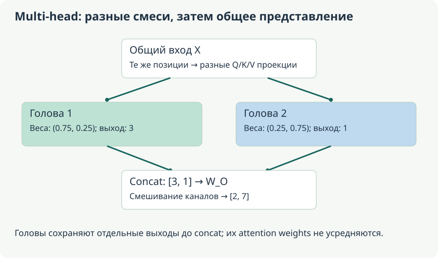
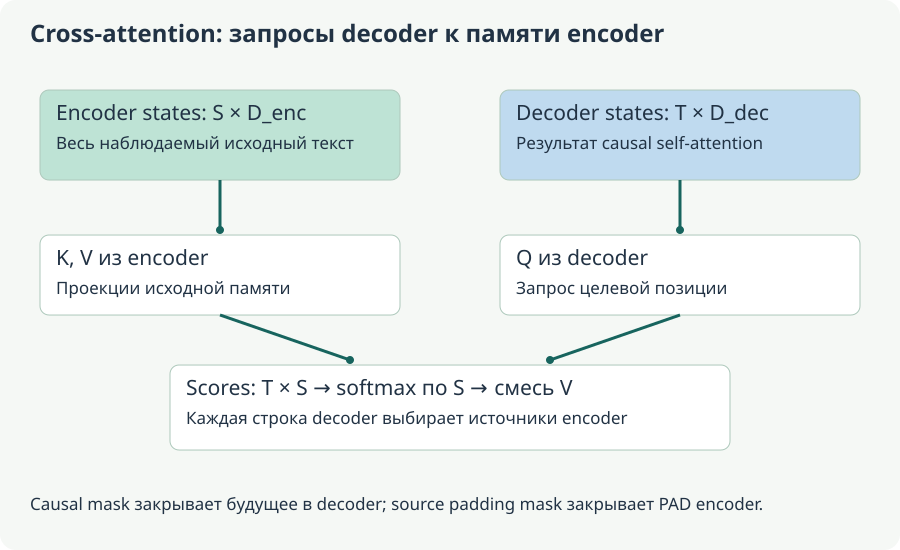

# Г. Q/K/V: полный маленький forward и backward

[Оглавление](README.md). Пункт 4 плана.

**Основа:** S1, страницы 9–13; S2, строки 1817–3404. В чатах спрашивалось, что именно представляют Q/K/V и как проходит градиент. **Исправление C02:** производная softmax связывает все координаты строки; запись только $s(1-s)$ не даёт полного backward. **Углубление:** ниже приведён согласованный числовой пример, который можно пересчитать вручную.

**Схема курса:** входные состояния $X$ → обучаемые проекции $W_Q,W_K,W_V$ → scores $QK^\top/\sqrt{d_k}$ + mask → row-softmax → взвешенная сумма $SV$ → объединение heads и $W_O$; градиент идёт от выхода назад через value-смесь, softmax и scores к Q/K/V и X.

**Уровень:** общее ядро — формы и forward; подробный backward — углубление. **Предпосылки:** A1, A3, матрицы и производные. **Используют:** объяснение attention, BERT и inference.

## 1. Проекции и их роли

Для этой главы токены — строки, batch временно опущен:

$$
\begin{gathered}X\in\mathbb{R}^{n\times D},\quad W_Q,W_K\in\mathbb{R}^{D\times d_k},\quad W_V\in\mathbb{R}^{D\times d_v},\\Q=XW_Q\in\mathbb{R}^{n\times d_k},\quad K=XW_K\in\mathbb{R}^{n\times d_k},\quad V=XW_V\in\mathbb{R}^{n\times d_v},\\Z=\frac{QK^\top}{\sqrt{d_k}}+M\in\mathbb{R}^{n\times n},\quad S=\operatorname{softmax}_{\mathrm{rows}}(Z),\quad O=SV\in\mathbb{R}^{n\times d_v}.\end{gathered}
$$

Q определяет, с чем сопоставляется данная позиция; K — как другие позиции представлены для сопоставления; V — какие значения будут смешиваться. Это функциональная аналогия matching/content. Координата Q не обязана означать «ищу существительное», а координата K — «я существительное». Такие толкования возможны лишь как проверяемые гипотезы о конкретной модели.

Одна и та же X участвует в трёх проекциях, но W различаются. Следовательно, Q, K и V могут иметь разные значения даже при одинаковом входе. Attention probabilities определяются Q/K; V определяет содержимое результата. Если изменить V при неизменных Q/K, S не изменится, а O изменится.

Зачем делить на √d_k? Если компоненты query/key независимы, имеют нулевое среднее и единичную дисперсию, дисперсия их скалярного произведения растёт как d_k. Деление сдерживает масштаб. В реальной обученной модели предположения не точны, но мотивация понятна: слишком крупные scores насыщают softmax.

### От строки X к трём разным представлениям

Удобно восстановить отсутствующий в короткой схеме шаг. Пусть

$$
X=\begin{bmatrix}1&0\\0&1\end{bmatrix},\quad
W_Q=\begin{bmatrix}1\\2\end{bmatrix},\quad
W_K=\begin{bmatrix}1\\0\end{bmatrix},\quad
W_V=\begin{bmatrix}2\\4\end{bmatrix}.
$$

Тогда $XW_Q=[1,2]^\top$, $XW_K=[1,0]^\top$, $XW_V=[2,4]^\top$: это в точности проекции следующего примера. Входные строки не являются Q сами по себе. У каждой позиции три проекции одного исходного состояния, каждая определяется своей матрицей.

Элемент scores $Z_{ij}$ строится из query строки i и key строки j. При вычислении O_i та же пара индексов определяет коэффициент перед V_j. Поэтому строка матрицы S отвечает одному получателю информации, а столбец — одному источнику. Если перепутать ось softmax, нормироваться будут входящие веса по получателям вместо распределения источников для каждого query. Форма n×n при этом останется правильной: одних проверок размеров недостаточно.

Attention weight — скаляр для пары позиций в одном head. Value — вектор; один скаляр умножает все его координаты. При $d_v=3$ результат одной строки остаётся трёхмерным: $O_i=\sum_jS_{ij}(V_{j1},V_{j2},V_{j3})$. Это не выбор одного слова и не поэлементный максимум среди V. Softmax может дать размазанную смесь, а дальнейшие слои уже переработают её.

Производная масштаба тоже понятна из формулы. Для dot product из $d_k$ независимых произведений с нулевым средним и единичной дисперсией суммарная дисперсия равна $d_k$, стандартное отклонение — $\sqrt{d_k}$. Деление на этот корень удерживает характерный масштаб scores порядка единицы в предположениях иллюстрации. Если logits становятся [20,0], softmax почти весь вес отдаёт первому элементу; изменение второго едва влияет на распределение. Масштабирование помогает избежать такого насыщения только из-за роста ширины.

## 2. Forward на двух позициях

Пусть $n=2,\qquad d_{k}=d_{v}=1$, рассматриваем уже полученные проекции:

$$
Q=\begin{bmatrix}1\\2\end{bmatrix},\qquad K=\begin{bmatrix}1\\0\end{bmatrix},\qquad V=\begin{bmatrix}2\\4\end{bmatrix}.
$$

До causal mask $QK^\top=\begin{bmatrix}1&0\\2&0\end{bmatrix}$. Первой позиции запрещена вторая, поэтому:

$$
\begin{gathered}Z=\begin{bmatrix}1&-\infty\\2&0\end{bmatrix},\qquad S=\begin{bmatrix}1&0\\a&b\end{bmatrix},\\a=\frac{e^2}{e^2+1}\approx0.880797,\qquad b=\frac{1}{e^2+1}\approx0.119203.\end{gathered}
$$

Тогда $O_{1}=2$, $O_{2}=2a+4b\approx 2.238406$. Второй результат — взвешенная смесь 2 и 4. В этом head веса неотрицательны и суммируются к единице. После output projection, residual и других операций финальный hidden state не обязан оставаться в выпуклой оболочке исходных V.

Даже если Q=K, исходная матрица dot products симметрична, а row-wise softmax в общем случае нет: нормировочные суммы строк различаются. Causal mask дополнительно нарушает симметрию. «Attention двух слов друг к другу одинаков» из скалярного произведения не следует.

### Как читать результат forward и что изменит другая ветвь

Вторая позиция отдаёт первому value около 88% и второму около 12%. Выход $2.238406$ ближе к 2, чем к 4. Если цель для этого скалярного выхода равна 3, ошибку можно уменьшить разными путями: увеличить меньший value, изменить другой value или перенести часть веса со значения 2 на значение 4. Задача обучения не задаёт отдельного универсального требования «сделать Q и K одинаковыми». Она минимизирует общий loss через все доступные параметры.

Если оставить Q/K и заменить V на $[20,40]^\top$, S сохранится, а оба O умножатся на десять. Если оставить V и поменять только второй key с 0 на 1, scores второй строки станут [2,2], её веса — [0.5,0.5], а выход — ровно 3. Это два принципиально разных способа повлиять на результат: изменить содержимое или изменить распределение доступа к нему.

Первая строка с единственным разрешённым key всегда даёт вес 1 этому key независимо от значения разрешённого score. В рамках этой строки query/key нечему «выбирать». Поэтому локальный градиент её softmax по разрешённому score нулевой. Но V первой позиции влияет на вторую строку и вполне может обучаться по её loss; отсутствие выбора источника не означает отсутствие всех градиентов.

## 3. Backward без пропущенных связей

Обозначим входной градиент $G_O=\frac{\partial\mathcal{L}}{\partial O}$. Из матричного произведения $O=SV$:

$$
G_V=S^\top G_O,\qquad G_S=G_OV^\top.
$$

Для строки $s=\operatorname{softmax}\left(z\right)$ Jacobian равен $\operatorname{diag}(s)-ss^\top$. Его диагональ действительно содержит $s_j(1-s_j)$, но вне диагонали стоят $-s_js_k$. Они нужны потому, что изменение одного logit перераспределяет нормировку остальных.

Удобная форма без создания $n\times n$ Jacobian для каждой строки:

$$
\begin{aligned}u_i&=\sum_j S_{ij}(G_S)_{ij},\\(G_Z)_{ij}&=S_{ij}\bigl((G_S)_{ij}-u_i\bigr),\\G_Q&=\frac{G_ZK}{\sqrt{d_k}},\qquad G_K=\frac{G_Z^\top Q}{\sqrt{d_k}}.\end{aligned}
$$

$u$ имеет форму $n\times 1$ и распространяется по строке. Для постоянной hard mask градиент в запрещённые связи равен нулю. Для $Q=XW_{Q}$:

$$
G_{W_Q}=X^\top G_Q,\qquad G_{X,Q}=G_QW_Q^\top.
$$

Аналогично для K/V; вклады в X складываются. Это стандартное применение chain rule, а не отдельный специальный attention-loss. В языковой модели исходная ошибка приходит от next-token CE через последующие слои.

Продолжим числовой forward: пусть loss касается только второго выхода, $\mathcal{L}=\frac12(O_2-3)^2$. Тогда $g=O_{2}-3\approx -0.761594$ и $G_{O}=\begin{bmatrix}0\\g\end{bmatrix}$. Получаем:

$$
\begin{gathered}G_V=\begin{bmatrix}ag\\bg\end{bmatrix}\approx\begin{bmatrix}-0.670810\\-0.090784\end{bmatrix},\quad (G_S)_{2,:}=\begin{bmatrix}2g&4g\end{bmatrix}\approx\begin{bmatrix}-1.523188&-3.046377\end{bmatrix},\\(G_Z)_{2,:}=\begin{bmatrix}c&-c\end{bmatrix},\quad c\approx0.159925,\quad G_Q=\begin{bmatrix}0\\c\end{bmatrix},\quad G_K=\begin{bmatrix}2c\\-2c\end{bmatrix}.\end{gathered}
$$

Первая строка scores получает нулевой gradient: её output не входит в выбранный loss, а первая query имеет только один допустимый key. Градиент K первой позиции, однако, ненулевой: её key участвует в attention второй позиции. Это важный пример различия «потери нет на позиции» и «позиция не влияет на потери других».

Проверка здравого смысла: $(G_Z)_{21}+(G_Z)_{22}=0$. Добавление одинаковой константы обоим разрешённым logits не меняет softmax, поэтому loss не должен изменяться в этом направлении. Формула только с диагональными производными этот инвариант в общем случае нарушает.

### Вывод производной softmax по двум координатам

Для $s_j=e^{z_j}/\sum_ke^{z_k}$ правило частного даёт

$$
\frac{\partial s_j}{\partial z_k}=s_j(\mathbf1[j=k]-s_k).
$$

Если $j=k$, это знакомое $s_j(1-s_j)$. Если индексы различаются, получается $-s_js_k$. Эти члены отражают общий знаменатель. Увеличение одного logit отнимает вероятность у остальных; нормировка должна оставаться равной единице.

В строке [a,b] примера Jacobian равен $ab\begin{bmatrix}1&-1\\-1&1\end{bmatrix}$. Его умножение на градиент по probabilities $[2g,4g]^\top$ даёт $[-2abg,2abg]^\top$. Так как $g<0$, первый score получает положительную производную, второй — отрицательную. Градиентный спуск уменьшит первый score относительно второго, отдавая больше веса value=4; это согласуется с целью поднять output с 2.238406 к 3.

Та же логика объясняет нулевую сумму градиента scores. Если обе координаты прибавить на 100, вероятности не изменятся. Поэтому чувствительность вдоль вектора [1,1] обязана быть нулевой. Это сильная проверка реализации, поскольку она выявляет пропущенные внедиагональные слагаемые даже при правильных shapes.

### Как градиент возвращается к исходному состоянию и весам

Пусть после backward получены G_Q, G_K, G_V. Для нашего примера с $X=I_2$ градиенты по трём матрицам проекций совпадают с соответствующими G, поскольку $X^\top G=G$. Но градиент входа складывает все ветви:

$$
G_X=G_QW_Q^\top+G_KW_K^\top+G_VW_V^\top.
$$

Одна и та же X участвовала в трёх вычислениях; каждое использование возвращает свой вклад. Если в реальном блоке есть ещё residual, к этой сумме прибавляется его прямой путь; norm перед проекциями также требует своего backward. Формулы одного attention ядра не являются полным gradient всего Transformer-блока.

Например, с $c\approx0.159925$, $G_Q=[0,c]^\top$, $G_K=[2c,-2c]^\top$ и $G_V\approx[-0.670810,-0.090784]^\top$ получаем приблизительно

$$
G_X\approx\begin{bmatrix}-1.021770&-2.683240\\-0.341494&-0.043287\end{bmatrix}.
$$

Большой вклад первой строки X проходит через V первой позиции: она служила источником для второго выхода. Это ещё один способ увидеть, почему нулевая loss mask на позиции не равна отсоединению позиции от всего графа. Для языковой модели пользовательский prompt часто не является target, но его representations участвуют в предсказании assistant-токенов.

### Почему finite differences проверяют именно производную

Заменим $Q_2=q$ и оставим K/V фиксированными. Тогда $b(q)=1/(1+e^q)$, $O_2(q)=2+2b(q)$ и $\mathcal L(q)=\tfrac12(O_2(q)-3)^2$. Разность loss при $q\pm\varepsilon$, делённая на $2\varepsilon$, приближает локальный наклон. При q=2 она должна дать около 0.159925 — G_Q второй строки.

Важно фиксировать остальные значения, не обновлять веса и отключать случайность. Если одновременно менять K, результат будет направленной производной по другому пути. Слишком большой epsilon измерит нелокальную кривизну, слишком маленький усилит rounding. Для ручной проверки double precision и шаг $10^{-5}$ подходят этому маленькому примеру; это не универсальное правило для всех tensor dtypes.

## 4. Multi-head, MQA и GQA

При H heads проекции разделяют на головы; для обычного случая $d_{k}=d_{v}=\frac{D}{H}$. Если $B=2$, $L=7$, $D=24$, $H=4$:

$$
\begin{aligned}\text{Q/K/V до reshape:}&\quad 2\times7\times24,\\\text{по головам:}&\quad2\times4\times7\times6,\\\text{scores:}&\quad2\times4\times7\times7,\\\text{выходы голов:}&\quad2\times4\times7\times6,\\\text{concat:}&\quad2\times7\times24,\qquad W_O:\;24\to24.\end{aligned}
$$

Каждая голова имеет свои каналы проекций. При реализации одной большой матрицей Q это не означает один и тот же query у всех heads: разные срезы её выхода дают разные heads. LoRA, установленная на общий `q_proj`, обычно меняет эту общую проекцию; отдельный adapter на каждую голову из этого автоматически не возникает.

В MQA несколько query heads используют один KV head; в GQA — меньше KV heads, чем query heads, объединённых в группы. Это уменьшает KV-cache, но меняет shapes K/V projections. Поэтому нельзя без проверки перенести квадратные K/V матрицы старого MHA-примера на любую LLM.

Ни orthogonality голов, ни фиксированная специализация не следуют из конструкции multi-head attention. Головы могут дублировать часть сигналов. Если нужно утверждать, что head причинно важна для синтаксиса, нужны вмешательства/ablation и контроль, а не только красивая heatmap.

### Чем head отличается от слоя и от LoRA-адаптера

Один Transformer-блок содержит несколько attention heads. В примере D=24 и H=4 каждая query разбивается на четыре вектора длины 6. Все головы получают состояния тех же семи позиций, но работают с разными обученными проекциями. Четыре attention outputs сначала конкатенируются, то есть укладываются рядом в 24 координаты. Они не складываются как четыре вектора длины 6: такая сумма потеряла бы информацию о том, из какого head пришёл канал.

После concat матрица W_O смешивает каналы, поэтому следующий блок получает общий residual stream, а не четыре независимых документа. Нельзя строго назначить голове одну фиксированную роль только по номеру: архитектура задаёт способ вычисления, а специализация — эмпирический вопрос об обученных весах.

Для GQA с восемью query heads и двумя KV heads при ширине головы 4 query projection имеет выход 32, key/value projection — по 8. Группы по четыре query heads используют соответствующий KV head. В кэше одной позиции одного слоя тогда хранятся $2\cdot2\cdot4=16$ чисел K/V вместо $2\cdot8\cdot4=64$ у MHA с теми же query heads. Это четырёхкратное уменьшение именно KV-содержимого; общий расход памяти программы может включать другие buffers и параметры.

Вопрос чата о LoRA здесь решается без метафоры «добавить голову». При адаптации общей Q-матрицы A/B меняют её выходную проекцию, а reshape по-прежнему создаёт то же число query heads. Ранг adapter и число heads — независимые параметры. Установка rank=8 не означает появление восьми новых heads, как и восемь heads не означают rank=8 у всех матриц.

<!-- transformer-heads-cross-v1 -->
### Две головы на числах: почему нельзя сначала усреднить attention

Возьмём две входные позиции $X=I_2$, ширину модели D=2 и две головы по одной координате. В текущем примере рассматриваем выход второй позиции; обе исходные позиции доступны ей и при causal mask. Для головы 1 зададим столбцы проекций $W_{Q1}=(0,\log3)^\top$, $W_{K1}=(1,0)^\top$, $W_{V1}=(2,6)^\top$. Поскольку X — единичная матрица, Q/K/V совпадут с этими столбцами.

Query второй позиции равна log3, keys равны (1,0), scores — $(\log3,0)$. Ширина головы 1, поэтому деление на её корень ничего не меняет. Softmax даёт $(3/4,1/4)$, а выход равен $\tfrac34\cdot2+\tfrac14\cdot6=3$. Эта голова сильнее использовала значение первой позиции.

Для головы 2 возьмём $W_{Q2}=(0,-\log3)^\top$, $W_{K2}=(1,0)^\top$, $W_{V2}=(10,-2)^\top$. Scores второй query теперь $(-\log3,0)$, веса — $(1/4,3/4)$, результат $\tfrac14\cdot10+\tfrac34\cdot(-2)=1$. Результаты голов не складываются в число 4: concat сохраняет два канала [3,1]. Затем

$$
[3,1]\begin{bmatrix}1&2\\-1&1\end{bmatrix}=[2,7].
$$

Это row-vector соглашение: матрица $W_O$ стоит справа. Обе координаты общего результата могут использовать выходы обеих голов. Если дальше есть residual к X второй позиции [0,1], сумма станет [2,8], до последующих norm/MLP в выбранной схеме блока.

Теперь ошибочно усредним attention weights двух голов: получится (1/2,1/2). Используя эти одинаковые веса для V обеих голов, получим [4,4], затем [0,12] после той же WO. Это другой результат. Усреднённая heatmap может быть способом визуализации, но она не воспроизводит вычисление multi-head attention. Даже совпадение форм не защищает от такой ошибки.

### Как головы обучаются совместно и почему специализация не задана

Пусть градиент общего выхода [2,7] равен $g=[g_1,g_2]$. До output projection он становится $gW_O^\top=[g_1+2g_2,-g_1+g_2]$. Первая координата возвращается в первую голову, вторая — во вторую. Поэтому разные головы получают разные сигналы ошибки даже от одной downstream loss. Затем каждая голова возвращает производные в собственные Q/K/V-каналы, а вклады в общий вход X суммируются.

В матрице общей Q-проекции отдельные головы можно получить разными столбцовыми срезами, а не разными Python-объектами. Если эти срезы обучены по-разному, они задают разные matching функции. Но архитектура не требует, чтобы первая голова занималась грамматикой, вторая фактами, третья изображениями. Это возможные наблюдения, которые надо доказывать на конкретных данных и весах. Номер головы не является её смысловой меткой.

Увеличение числа голов при фиксированной D уменьшает ширину каждой, если используется $d_h=D/H$. Количество параметров обычных Q/K/V/O проекций при этом остаётся примерно $4D^2$ без biases. Число отдельных softmax-матриц растёт с H, однако размерность dot product каждой головы падает; поэтому нельзя утверждать, что удвоение H автоматически удвоит все матричные FLOPs. Время и память также зависят от реализации. Изменение H уже обученного checkpoint — не простое переключение без изменения смысла раскладки каналов.

## 5. Cross-attention: тот же matching, разные источники Q и K/V

В self-attention все три проекции начинаются с состояний одной последовательности. В cross-attention есть два массива: состояния получателя $H_d\in\mathbb R^{T\times D_d}$ и состояния источника $H_e\in\mathbb R^{S\times D_e}$. Тогда

$$
Q=H_dW_Q,\quad K=H_eW_K,\quad V=H_eW_V,\qquad
A=\operatorname{softmax}_{\rm rows}\!\left(\frac{QK^\top}{\sqrt{d_k}}+M\right).
$$

Форма A — T×S. Dd и De не обязаны совпадать: нужные ширины дают проекции. Выход AV имеет T строк, потому что обновляется последовательность queries. Encoder не становится длины T, а decoder не превращается в массив длины S. Направление обновления определяется Q, а не тем, какой текст длиннее.

В переводе decoder сначала применяет causal self-attention к своему известному префиксу, затем может обращаться ко всему исходному предложению encoder. Это не утечка правильного продолжения перевода: исходный текст уже наблюдаем по постановке задачи. Padding encoder остаётся недопустимым источником и закрывается своей mask. Треугольник T×T из decoder self-attention не нужно механически накладывать на прямоугольник T×S. Три применения attention в исходном Transformer описаны в [оригинальной работе](https://arxiv.org/abs/1706.03762).

### Два запроса к трём источникам

Возьмём $d_k=1$, $Q=[\log2,0]^\top$, $K=[1,0,-1]^\top$ и

$$
V=\begin{bmatrix}1&0\\0&2\\3&1\end{bmatrix}.
$$

У первой query scores $(\log2,0,-\log2)$. Экспоненты (2,1,1/2) суммируются в 7/2, поэтому веса равны $(4/7,2/7,1/7)$. Итог $O_1=(1,5/7)$. У второй query все scores нулевые, веса равномерные, итог $O_2=(4/3,1)$. Одна и та же память V дала разные выходы, потому что вопросы Q различались.

Если третий источник оказался PAD, его нельзя просто заменить нулевым V и оставить в softmax. Так он всё ещё поглощал бы часть вероятности. При правильной маске первая query нормируется только по (2,1), получает веса (2/3,1/3,0) и выход (2/3,2/3). Это ещё одно различие «нулевое содержимое» и «запрещённый источник».

### Backward обучает обе стороны связи

После backward attention имеются $G_Q,G_K,G_V$. Вклад этой ветви в состояния decoder равен $G_QW_Q^\top$, в состояния encoder — $G_KW_K^\top+G_VW_V^\top$. Градиенты разных decoder queries складываются по общим источникам encoder. К ним прибавляются остальные пути соответствующих сетей. Даже если loss начисляется только за токены перевода, encoder учится, потому что его представления используются при предсказании перевода.

При генерации encoder states для фиксированного входа можно вычислить один раз. Их cross-attention K/V тоже можно переиспользовать для каждого decoder-слоя, если его веса и источник не меняются; у разных слоёв обычно свои проекции. Это отличается от growing self-attention KV-cache decoder, куда добавляются новые позиции перевода. Если заменить исходный документ, старые cross-attention K/V уже представляют другой вход и требуют пересчёта.

Та же форма механизма полезна за пределами перевода: queries могут обращаться к image features или другим наблюдаемым представлениям. Но архитектура сама по себе не определяет, чему соответствуют queries и какой loss нужен. Например, object queries в детекторе — не автоматически последовательность слов с teacher forcing. Конкретные CV головы разобраны в главах detection и segmentation.

## 6. Самопроверка

1. Почему $G_{S}$ имеет форму $n\times n$? **Ответ:** $G_{O}:n\times d_{v}$ умножается на $V^\top :d_{v}\times n$.
2. Что будет с S при замене V на 10V? **Ответ:** S прежняя, O увеличится в 10 раз при неизменных Q/K.
3. Почему first-position value получает gradient от second-position loss? **Ответ:** вторая позиция использует его во взвешенной сумме.
4. Чем опасно утверждение «градиент поворачивает Q и K до нулевого угла»? **Ответ:** оптимизируется общий loss через все пути; универсальной геометрической цели такого вида нет.

5. Можно ли заменить две головы их средней heatmap? **Ответ:** в общем случае нет: у голов разные V и отдельные выходные каналы. Числовой пример даёт [2,7] для верного forward и [0,12] после такого усреднения.
6. Какая длина у выхода cross-attention? **Ответ:** длина queries T, хотя источников K/V может быть S≠T.
7. Получает ли encoder градиент, если loss задан только на переводе? **Ответ:** да, через cross-attention K/V; вклад Q этой операции идёт в decoder.
8. Равнозначны ли нулевой V у PAD и маскирование PAD? **Ответ:** нет. Без маски PAD всё ещё может получать softmax mass и менять нормировку полезных источников.

**Практика:** проверить числовой пример центральными конечными разностями для Q_2 с шагом 10^-5: $\frac{\mathcal{L}(q+\varepsilon)-\mathcal{L}(q-\varepsilon)}{2\varepsilon}$ должен быть близок к c. Затем убрать mask и объяснить, почему теперь первая query имеет два источника. Полный блок потребует добавить backward residual, norm, output projection и MLP.

<!-- latex-display-v1 -->
<!-- depth-revision-2026-10-17 -->
