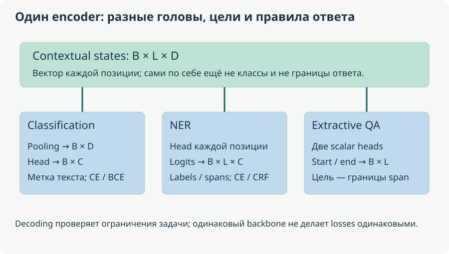

# Г. Прикладные головы encoder: семь разных постановок

[Оглавление](README.md). Модули **15–21**. **Происхождение:** новое раскрытие BERT-плана; общие structured outputs из чатов не означают обучение этих heads. Один backbone может обслуживать разные задачи, но labels, objective и decoding должны совпадать с постановкой.

Общий encoder выдаёт последовательность состояний; task head, targets и decoding определяют прикладную задачу.

**Уровень:** Основа branch by task. **Предпосылки:** B1–B3. **Используют:** B8/B9; selected app integration.

## 1. Classification: тема, intent, sentiment и moderation

Pooled vector $z$ подаётся в linear/MLP head, logits $Wz+b$ обучаются CE для mutually exclusive labels. Sentiment — оценка отношения, topic — тема, stance — позиция относительно конкретного утверждения. «В статье сказано: товар ужасный» содержит negative quotation, но позиция автора зависит от контекста. Moderation дополнительно зависит от annotation policy, адресата и цитирования.

Tiny counterfactual pairs помогают проверить смысл: «сервис понравился»/«сервис не понравился» должны различаться для sentiment; typo без смены смысла не обязан менять label. Ошибка guideline отличается от model error. Для ordinal classes стоит оценить ordinal objective/стоимость дальнего промаха, а не считать все classes unrelated.

Baseline TF-IDF+linear, frozen vectors+head и tuning сравниваются на group/time split. Macro-F1, per-class recall, confusion matrix, calibration и truncation slices дополняют accuracy. Long-text topic head не исправит отсутствие evidence, отрезанного tokenizer.

<!-- source-depth-bert-Г -->
### 1.1. Классификатор читает представление, но смысл классов задаёт разметка

Возьмём обращение «Посылку доставили, но упаковка разорвана». Topic может быть «доставка», sentiment — отрицательный, intent — «жалоба на повреждение». Три ответа относятся к одному тексту и не противоречат друг другу. Если обучающий набор смешивает эти понятия под одной меткой, encoder не сможет устранить логическое противоречие увеличением числа слоёв.

Для single-label головы pooled vector длины D преобразуется в C logits. У трёх logits (2,1,0) softmax примерно (0.665241,0.244728,0.090031). Если правильный первый класс, CE около 0.407606; если третий — 2.407606. Одна и та же уверенная модель получает разную ошибку в зависимости от правильной метки. Gradient первого случая по logits примерно (−0.334759,0.244728,0.090031), затем возвращается через head и encoder.

На inference выбирается класс или применяется правило отказа. На training обычно не нужен argmax: loss работает с logits напрямую. Обучение argmax как будто это дифференцируемый continuous output обрывает нужный сигнал. Confidence тоже не равен истинности: max softmax оценивается вместе с калибровкой, источником текста и протоколом тестирования.

Полезный контрфактический контроль меняет только один существенный элемент. «Не рекомендую товар» и «Рекомендую товар» должны различаться для соответствующего sentiment guideline. Но удаление «не» в цитате, которую автор опровергает, может не менять позицию автора. Такие пары проверяют конкретное правило понимания; набор искусственно простых отрицаний не заменяет оценку естественных случаев.

## 2. Multi-label, hierarchy и selective prediction

При независимых labels sigmoid/BCE выдаёт probability каждого события. Global threshold проще, per-label thresholds позволяют учитывать prevalence/cost, но требуют достаточно validation data. Missing labels mask-ятся, а не превращаются автоматически в negatives.

Toy truth двух examples: $(1,0,1)$ и $(0,1,0)$. Scores $(0.8,0.4,0.3)$ и $(0.2,0.6,0.1)$ при threshold 0.5 дают TP=2, FP=0, FN=1. Micro-F1=0.8, macro-F1=$2/3$: редкий третий label полностью пропущен. Threshold 0.25 только для третьего label исправляет именно этот toy set, но выбирать его по итоговому test нельзя.

Hierarchy child→parent может требовать constrained decoding, conditional probabilities или penalty на inconsistencies. Таксономия должна действительно задавать включение; «связанные labels» не всегда parent-child. Изменение taxonomy version меняет semantics output и требует migration.

Abstention откладывает решение при недостаточной надёжности. Report содержит coverage и risk на accepted subset. Система, отвечающая только на одном лёгком примере, не становится общей 100%-accurate моделью. Confidence threshold выбирается на calibration/validation и проверяется на relevant OOD cases.

### 2.1. Выбор порога отделён от обучения распределений

BCE может обучить три независимых вероятности, а threshold превращает их в набор labels. При изменении порога веса encoder не меняются. В исходном примере score третьего класса 0.3 ниже общего 0.5; отдельный порог 0.25 вернул бы нужную метку. Однако два примера не доказывают, что такой порог полезен на новых данных: у класса могут появиться ложноположительные с теми же scores.

Micro-F1 суммирует TP/FP/FN по всем labels, macro-F1 усредняет отдельные class F1. Поэтому сильные частые классы могут скрыть полностью пропущенный редкий класс. При выборе per-label thresholds нужно достаточно validation examples именно для этих labels; иначе настройка легко переобучается. Для классов без положительных примеров отдельно объявляют правило подсчёта неопределённых precision/recall/F1.

Иерархия добавляет другой тип ограничения. Если «повреждённая упаковка» действительно является подкатегорией «повреждение», предсказание child без parent нарушает таксономию. Можно замкнуть предсказания вверх по дереву, но это изменит false positives родителей. Можно обучать условную вероятность child при parent, но тогда итоговая вероятность зависит от обоих решений. Нужно оценивать весь выбранный способ, а не только независимые logits.

### 2.2. Отказ от ответа измеряют парой coverage–risk

Пусть из 10 примеров система принимает 8 и ошибается на одном принятом. Coverage=8/10=0.8, selective risk=1/8=0.125. Если повысить threshold и оставить только один простой правильный ответ, risk станет 0, но coverage — 0.1. Эти результаты нельзя сравнивать только по accuracy принятых ответов.

Порог отказа выбирают на validation/calibration, затем измеряют на новых данных. Вне распределения высокий softmax может сохраняться даже у неверных ответов. Поэтому полезны slices по источникам и типам ошибок, а не только одно число coverage. Данный пример объясняет метрики и не задаёт универсальный рабочий порог.

## 3. NER/POS/slots: word, subword и char span

Token projection даёт logits $B\times L\times C$. В BIO B-TYPE начинает entity, I-TYPE продолжает, O вне entities; BILOU отдельно обозначает single-token и boundaries. Word labels переносятся на pieces по выбранной policy: supervision first piece only либо coherent labels всех pieces. При втором варианте continuation исходного B-PER обычно становится I-PER, а не начинает новую entity.

Для «Иванова-Петрова» token strings могут быть несколькими pieces. `word_ids` и offsets связывают их с исходным text; special/padding labels ignored. Нельзя восстанавливать entities простым concat `##` strings, теряя исходные пробелы/Unicode. [Alignment guide](https://huggingface.co/docs/transformers/main/tasks/token_classification).

Entity-level strict F1 считает correct entity только при совпадении type и boundaries. Если из четырёх gold entities предсказаны четыре, но одна имеет wrong boundary, TP=3, FP=1, FN=1, F1=0.75. Token accuracy может быть высокой из-за множества O. POS обычно оценивает word labels; slot filling дополнительно требует целостности нужных slots в task.

CRF добавляет sequence score emissions+transitions:

$$
P(y\mid x)=\frac{\exp\left(\sum_t e_t(y_t)+\sum_t A_{y_{t-1},y_t}\right)}{Z(x)}.
$$

Forward algorithm считает normalizer, Viterbi — лучшую path, обычно cost порядка $LC^2$. Constraints могут запретить незаконные BIO transitions, но правильная syntax labels не гарантирует semantic entity correctness. CRF стоит добавлять по diagnosis, а не считать обязательной головой BERT.

### 3.1. Как subwords меняют число supervised решений

Пусть слово с gold B-PER разбилось на «Иван», «##ова». При first-piece supervision первый subword получает B-PER, второй — ignore. При supervision всех частей можно дать B-PER, I-PER. Это сохраняет одну сущность, в отличие от двух B-PER. Политика должна согласовываться с тем, как предсказания возвращаются к словам и spans.

Если длинная фамилия разбита на пять частей и loss усредняется по всем subwords, она даёт до пяти вкладов, а короткое имя — один. При first-piece supervision оба слова дают по одному. Можно использовать и веса частей, но это уже явно выбранная нормировка. Различие особенно заметно при сравнении языков с разной fragmentation. Alignment, loss mask и метрика должны описывать одну и ту же единицу разметки.

Верная последовательность «B-PER I-PER O» ещё не доказывает правильные границы: encoder может выделить лишний титул или пропустить часть фамилии. Strict entity evaluation сравнивает исходные char spans и types. Если модель предсказала «Иванова» вместо «Иванова-Петрова», совпавшие subwords не превращают это в полностью правильную сущность при exact-span правиле.

### 3.2. CRF: маленький пример, где локальный выбор проигрывает

Для прозрачной арифметики возьмём только два labels O и B-PER и две позиции; I-labels в этом примере не используются. Emissions первой позиции (2,1), второй (0,3). Transition O→B равен −2, остальные переходы — 0; start/end scores тоже 0. Независимые argmax выбирают O,B: emission sum=5, но после transition penalty path score=3.

Все четыре пути имеют scores: O,O — 2; O,B — 3; B,O — 1; B,B — 4. Viterbi выберет B,B с общим score 4. Два B-PER подряд здесь означают две соседние однотокенные сущности, что допустимо в этом сокращённом пространстве labels. Пример показывает влияние transitions, а не универсальную предпочтительность такого предсказания.

Нормировка training loss включает **все** пути: $\log Z=\log(e^2+e^3+e^1+e^4)$. Для gold O,B negative log-likelihood равна logZ−3. Это отличается от суммы двух независимых CE: путь оценивается совместно. Производная по emission выражается как ожидаемое число соответствующего label в позиции минус gold indicator; по transition — как ожидаемое число переходов минус gold count.

Вместо перебора C^L путей forward recursion хранит по одному значению для каждого последнего label:

$$
\alpha_t(j)=e_t(j)+\operatorname{logsumexp}_i\bigl[\alpha_{t-1}(i)+A_{ij}\bigr].
$$

Viterbi использует max вместо log-sum-exp и сохраняет backpointers, чтобы восстановить путь. Обе процедуры разобраны также в [учебном примере CRF PyTorch](https://docs.pytorch.org/tutorials/beginner/nlp/advanced_tutorial.html). Forward нужен для суммы вероятностей, Viterbi — для лучшего пути; эти цели нельзя поменять местами только потому, что обе процедуры динамические. BIO constraints, например запрет начинать с I-PER или продолжать I-PER после B-ORG, задаются отдельно. Они гарантируют допустимость labels, но не правильность распознанного имени.

## 4. Nested entities, relations, events и coreference

Flat BIO даёт один label на token и не выражает произвольные nested/overlapping spans. Span classifier рассматривает candidates $(i,j)$ и representation endpoints/pooling, затем type/NA. Всего contiguous spans $L(L+1)/2$; при maximum width $M\le L$ их $ML-M(M-1)/2$. Для $L=5,M=2$ — девять вместо пятнадцати.

Пример «Университет города Москвы» может содержать organization целиком и location внутри по guideline. Один flat sequence не кодирует оба произвольных overlapping entities одновременно. Candidate pruning уменьшает compute, но вводит recall ceiling: удалённый gold span head уже не вернёт.

Relation extraction получает pair entity representations и context; negatives включают NA и трудные похожие pairs. Gold-entity evaluation показывает head quality условно на идеальном NER; predicted-entity pipeline включает upstream losses. Фраза «Анна не работает в компании Б» не подтверждает employment relation только по совместному упоминанию.

Event extraction разделяет trigger, arguments и roles: «Компания купила завод» требует buyer/asset и event type. Coreference связывает mentions одного referent через antecedent scoring и document context; одинаковая surface string не гарантирует один entity. Staged против joint models сравниваются по total outcome и supervision budget, с split по documents/entities.

### 4.1. Что теряется при выборе candidates до головы

Для L=5 возможны 15 непрерывных spans. Ограничение width≤2 оставляет 5 однотокенных и 4 двухтокенных, всего 9. Если gold entity занимает три токена, в этом candidate set её нет. Никакие веса span classifier уже не выберут отсутствующий candidate. Поэтому pruning recall измеряют отдельно от качества классификации оставшихся spans.

Span representation может объединять состояния начала и конца, pooling внутренности и признак длины. Его score не обязан равняться произведению token-label probabilities. Для nested entities допускаются несколько spans, перекрывающих одни позиции, если guideline этого требует. Для полного pipeline дополнительно нужно решить, какие комбинации spans разрешены и как подавлять дубликаты.

Relation head получает не только названия двух сущностей, но и контекст их связи. «Анна работала в Б» и «Анна не работала в Б» имеют те же entity strings и разные отношения. Если candidate entity pairs формируются из предсказанного NER, пропуск одной сущности делает правильную relation недостижимой. Метрики с gold entities и с predicted entities отвечают на разные вопросы и должны называться явно.

Event arguments тоже зависят от ролей: в «Компания А продала завод компании Б» А — seller, Б — buyer, завод — asset. Замена порядка упоминаний не должна автоматически менять роли без изменения смысла. Coreference требует связать mentions одного referent, включая местоимения; одинаковые имена могут относиться к разным людям, а разные выражения — к одному. Эти задачи требуют своих labels и decoding, даже если underlying encoder общий.

## 5. NLI, paraphrase, STS и relevance

Pair encoding позволяет tokens двух texts взаимодействовать в attention. Premise «Анна живёт в Москве», hypothesis «Анна живёт в России» может быть entailment при заданных знаниях; reverse direction не обязательно entailment. «Анна не живёт в Москве» lexical близко, но contradiction. Общая тема без ответа query не означает relevance.

NLI three-class labels, paraphrase equivalence, STS continuous similarity и retrieval relevance различаются. Для STS выбирают scale, MSE/Huber и correlations; для duplicate detection — identity policy и errors ложного merge. Нельзя брать любой NLI classifier и без проверки называть score universal similarity.

Cross-encoder sees pair jointly, bi-encoder encodes independently и сравнивает vectors. Truncation second segment может удалить нужный passage. Сравнение проводится на same held-out queries/pairs и budget; candidate order/asymmetry учитываются.

### 5.1. Похожесть, логическое следование и полезность запроса

«Кошка спит на диване» и «Кошка не спит на диване» почти совпадают лексически. Для поиска по теме они могут быть близкими, для entailment — противоречить, для exact duplicate policy — быть разными. Нельзя требовать одной универсальной шкалы, не объявив задачу. Представление и labels должны сохранять именно те различия, которые важны для нужного решения.

NLI направлен: premise может поддерживать hypothesis, но обратное следование не обязано выполняться. Paraphrase обычно требует взаимной смысловой эквивалентности по выбранному guideline. STS задаёт градуированную похожесть, relevance относится к конкретному query и может быть асимметричной. Поэтому label «похожая тема» не заменяет judgement «документ содержит ответ».

При joint pair encoding attention читает обе строки вместе, и score зависит от их взаимодействия. При independent encoding можно кешировать документы, но сложное взаимодействие приходится выражать геометрией и функцией сравнения. Это архитектурный компромисс между переиспользованием вычислений и точностью попарного сопоставления, который проверяют на нужной задаче.

## 6. Extractive QA: start/end и ограничения

Question+context encoder получает two scalar projections:

$$
s_i=w_s^\top h_i+b_s,\qquad e_j=w_e^\top h_j+b_e,
\qquad L=\operatorname{CE}(s,i^*)+\operatorname{CE}(e,j^*).
$$

Некоторые implementations усредняют two terms; scale convention проверяют. Decoding максимизирует $s_i+e_j$ при valid context positions, $i\le j$ и maximum answer length. Mask question/SEP/padding задаётся явно. [QA offsets/windowing](https://huggingface.co/docs/transformers/main/tasks/question_answering).

Для three context tokens start $(0,5,2)$, end $(4,0,2)$ independent maxima дают invalid start=2,end=1. При max length 2 лучший valid span (2,3), score 7; span (1,1) score 4. Argmax двух heads независимо не решает constrained span task.

Char offsets half-open позволяют вернуть исходный substring. В «Анна в Москве» «Москве» занимает [7,13). Нормализация/tokenization не должна потерять mapping original characters. При overlapping windows gold answer может быть целиком только в одном; labels других windows должны соответствовать no-answer/window protocol, а не указывать обрезанный fragment как full truth.

Unanswerable handling сравнивает null score с лучшим valid span по calibrated rule. Например, null=8 против best=7 даёт difference 1; выберется null при threshold 0 в такой convention. Смена sign/threshold меняет decision. Несколько gold spans, boundary windows и cross-window score aggregation требуют explicit rules; они не решаются автоматически одним head.

Оцениваются EM/token-F1, no-answer precision/recall и source correctness. Retrieval+QA отдельно проверяется на gold и retrieved context: плохой retrieval не следует смешивать с head failure на достаточном evidence. Extractive model выбирает fragment, а не доказывает, что в corpus существовал ответ.

### 6.1. Loss по двум осям ещё не задаёт допустимый ответ

Start и end heads возвращают по одному score каждой позиции. Cross-entropy по start учит правильное начало, по end — правильный конец. Но обучение двух распределений не запрещает на inference комбинацию end раньше start. Поэтому decoding явно перебирает или эффективно ищет допустимые пары: обе позиции в context, start≤end, длина не больше M. В задачах с no-answer дополнительно предусматривается специальный null вариант.

В примере выше индексы 1–3 **однобазовые**. Пять spans длины не больше 2 имеют scores: (1,1)=4, (1,2)=0, (2,2)=5, (2,3)=7, (3,3)=4. Так видно, что лучший допустимый ответ — (2,3), хотя независимые головы предпочли начало 2 и конец 1. При нулевой нумерации соответствующая пара была бы (1,2); смешение этих соглашений с offsets даёт ошибку на один токен.

Произведение независимых start/end probabilities максимизируется тем же span, что сумма logits **внутри одного окна**, поскольку оба softmax-знаменателя общие для всех candidate pairs данного окна. Но добавление одинаковой константы к start logits и другой константы к end logits не меняет их распределения, а все raw span scores сдвигает. Поэтому непосредственное сравнение raw scores разных windows требует объявленного протокола, а не предположения об общей абсолютной шкале.

### 6.2. Окна меняют обучающие примеры, а не исходный вопрос

Длинный context может быть разбит на overlapping windows с повторённым вопросом. У каждого окна свои token offsets, но ответ возвращается в исходный документ. Если gold answer [a,b) целиком в одном окне, там можно построить правильные start/end labels. Если он пересекает границу, нельзя выдавать только видимую половину за полный ответ. Применяемое правило обработки таких окон должно совпадать с training recipe.

Окно без ответа не обязательно означает, что исходный вопрос не имеет ответа в документе: evidence могло остаться в другом окне. Это различие важно для null supervision и объединения результатов. Восстановление исходной подстроки выполняется по offsets выбранного span; специальные tokens и вопрос не должны попадать в ответ.

Для сравнения с null удобно явно объявить знак, например $\Delta=s_{\rm null}-s_{\rm best}$. Тогда в приведённом примере Δ=8−7=1, и при правиле «null, если Δ>0» выбирается отсутствие ответа. Противоположное определение margin требует противоположного знака порога. Разность span/null внутри одного окна устраняет общий аддитивный сдвиг scores, но сама по себе не гарантирует калибровку между разными окнами или документами.

### 6.3. Метрики должны различать извлечение и наличие evidence

EM требует полного совпадения ответа после оговорённой нормализации. Token-F1 допускает частичное пересечение, поэтому лишнее слово может снижать EM до нуля, сохраняя ненулевой F1. Для no-answer дополнительно важны ложные извлечения из нерелевантного context. Если retrieval не доставил нужный passage, QA head оценивают отдельно на gold context, чтобы понять, где потерян ответ.

Извлечённая фраза может буквально присутствовать в источнике и при этом не отвечать вопросу: например, относится к другому человеку или к отвергнутому утверждению. Extractive architecture ограничивает форму ответа подстрокой, но не гарантирует правильную связь question–evidence. Примеры с отрицанием, одинаковыми именами и несколькими датами проверяют именно этот механизм.

## 7. Few-shot и zero-shot

NLI zero-shot переводит candidate label в hypothesis template. Его phrasing влияет на entailment score; mutually-exclusive и multi-label decisions имеют разные normalization/threshold rules. Zero-shot относится к новой task label set, а не отсутствию pretraining/NLI supervision вообще.

MLM verbalizer сопоставляет class словам в MASK positions. Multi-token label не равна одному vocabulary logit; нужно определить aggregation и prompt calibration. Это специализированный classifier recipe, а не general chat interface.

[SetFit](https://arxiv.org/abs/2209.11055) адаптирует sentence representations по pairs и затем обучает classifier при малом количестве labels. Тысячи pairs из 16 texts не создают тысячи independent исходных examples. Нужны несколько few-shot samples/seeds, frozen baseline и ordinary tuning с comparable budget.

### 7.1. Откуда берётся supervision у zero-shot и few-shot

У NLI zero-shot уже есть модель, обученная различать entailment/neutral/contradiction. Новая задача задаётся шаблонами hypotheses, например «Это обращение о возврате». Формулировка label и шаблона входит в pipeline. Scores нескольких hypotheses могут быть независимыми или нормироваться для mutually-exclusive выбора; это отдельное решение, которое нельзя скрыть за словом zero-shot.

MLM verbalizer сопоставляет class словам в MASK-позиции. Если один label кодируется одним token, а другой — тремя, прямое сравнение одного vocabulary logit уже недостаточно. Нужны правила агрегации и сопоставимости scores. Слово с высокой частотой может иметь высокий prior вне зависимости от текста, поэтому шаблон и калибровка оцениваются на разрешённых данных.

Few-shot pairs тоже не создают новые независимые источники. Из 16 текстов можно составить $16\cdot15/2=120$ неупорядоченных пар, но все они зависят от тех же 16 текстов. Если сначала сформировать пары, а затем случайно разделить их, один текст легко попадёт на обе стороны evaluation. Сначала разделяют исходные группы, затем создают pairs внутри допустимой части. Несколько выборок few-shot примеров показывают чувствительность к тому, какие именно тексты были размечены.

## 8. Контроль и практика модулей 15–21

1. Почему high micro-F1 скрывает rare label? **Ответ:** суммарные counts доминирующих labels могут перевесить отсутствие редкого.
2. Почему strict NER F1 ниже token accuracy? **Ответ:** entity требует одновременно правильных boundaries/type, а O tokens многочисленны.
3. Что не выражается flat BIO? **Ответ:** произвольные nested/overlapping entities при одном label на token.
4. Может ли NLI entailment score заменить relevance без оценки? **Ответ:** нет; это different supervision.
5. Почему separate start/end argmax ошибочен? **Ответ:** нарушает constraints порядка/длины/context positions.

6. Равны ли forward и Viterbi у CRF? **Ответ:** нет. Первый суммирует вероятности путей для normalizer, второй ищет один максимальный путь с backpointers.
7. Вернёт ли span classifier gold entity, удалённую width pruning? **Ответ:** нет. Достигнут потолок recall candidate set ещё до классификации.
8. Сопоставимы ли raw start/end scores разных QA windows автоматически? **Ответ:** нет. Их общие аддитивные сдвиги не меняют внутривоконные probabilities, но меняют raw суммы. Нужен объявленный cross-window протокол.

**Практика:** выполните multi-label confusion counts, разметьте nested entities и relation с negation, восстановите char spans. Выберите valid QA span и null decision в примере. Для проектов classification/NER/QA определите baseline, annotation guideline, metric и один controlled intervention; различайте specification и фактический run.
