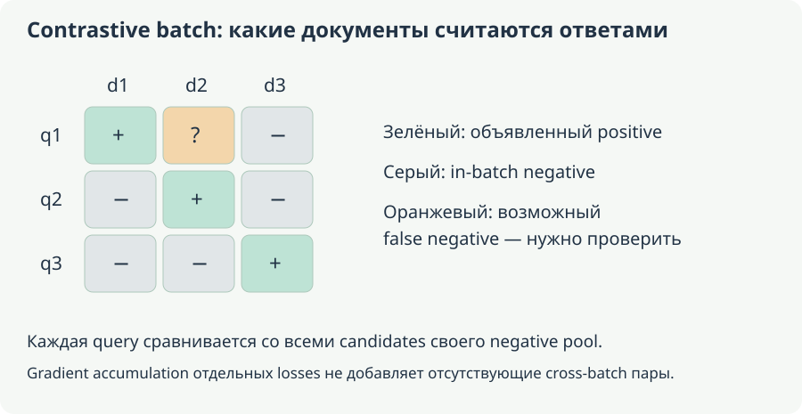

# Д. Как научить vectors выражать нужную похожесть

[Оглавление](README.md). Группа E, модули **22–25**. **Основа:** S6:182–1373 задаёт вопросы internal/retrieval embeddings; sentence representation learning здесь расширено по BERT-плану.

**Уровень:** Основа representation branch. **Предпосылки:** B1–B3; probability/geometry. **Используют:** B6/B7/B8/B9; E4 local retrieval.

## 1. Независимое encoding и learned geometry

Bi-encoder вычисляет vectors независимо: $z_x=\operatorname{pool}(f_\theta(x))$, $z_y=\operatorname{pool}(f_\theta(y))$, затем score. Shared weights образуют siamese architecture; separate query/document weights задают asymmetric model. Document vectors можно precompute, если representation не зависит от query.

[Sentence-BERT](https://aclanthology.org/D19-1410/) адаптирует encoder под sentence comparisons. Это не просто mean pooling любого MLM backbone: objective влияет на geometry. Pooling/projection/prefix/normalization сохраняются вместе с checkpoint. Cross-encoder обрабатывает pair jointly и может выучить более детальные interactions, но обычно не даёт reusable одного document vector, заменяющего всю pair computation.

Dot product учитывает norm и direction, cosine — только direction. Query $(1,0)$, documents A=(2,0), B=(0.9,0.1): dot A=2,B=0.9, cosine A=1,B около 0.9939. Если у другого document huge norm при менее точном direction, dot может предпочесть его. После L2 normalization cosine/dot совпадают, а squared Euclidean равен $2-2z_x^\top z_y$. До normalization rankings могут различаться.

<!-- source-depth-bert-Д -->
### 1.1. Вопрос S6: «Почему мы уверены, что модель поймёт наш embedding?»

В чате, строки 685–845, вы заметили, что embedding — внутреннее представление модели, и спросили, почему другая модель должна его понимать. Для обычного retrieve-then-read pipeline ответ состоит из двух разных операций. Retriever преобразует query и документы в совместимое пространство и выбирает document IDs. По IDs извлекаются **исходные тексты**. Generator получает эти тексты в своём входном формате и заново вычисляет собственные token embeddings и hidden states. Числа retrieval-вектора ему напрямую читать не требуется.

Поисковый вектор отвечает на вопрос «какие документы выбрать», а encoder states генератора — «как обработать переданный вход». Их нельзя отождествлять только потому, что оба являются массивами float. Embedding-модель может сама быть Transformer encoder или иной моделью с pooling/projection; слово embedding не задаёт отдельный универсальный тип архитектуры. Размерность также не определяет назначение: нет общего правила, что retrieval embeddings всегда лежат только в диапазоне 384–1024, а hidden states — только 4096–12288.

Фраза исходного ответа «никогда не подаются в LLM» относится лишь к разобранному простому pipeline и слишком категорична как универсальное утверждение. Существуют обученные интерфейсы для внешних представлений. Но одинаковая длина вектора не делает произвольную инъекцию корректной. Нужны согласованное пространство, обученное преобразование или архитектура, которая специально умеет его читать.

Отдельное исправление: original RAG не нужно описывать как прямую передачу DPR search embeddings в cross-attention генератора. Retriever выбирает passages; BART получает query и passage как входной текст, а decoder читает состояния своего encoder. Эти состояния отличаются от retrieval-векторов. Разделение видно в [описании RAG generator](https://arxiv.org/html/2005.11401v4#S2.SS3). CLIP также не является сам по себе генеративной LLM, читающей произвольные embeddings. Эти оговорки сохраняют смысл вашего вопроса без смешения интерфейсов.

### 1.2. Почему одинаковая размерность не означает совместимое пространство

Пусть в пространстве A query=(1,0), правильный документ d+=(1,0), неправильный d−=(0,1). Dot product выбирает правильный. Теперь новая модель B повернула **все** свои векторы на 90°: query B=(0,1), d+ B=(0,1), d− B=(−1,0). Внутри B правильный документ по-прежнему получает score 1, неправильный 0. Геометрия задачи сохранена.

Но если новый query B сравнить со старым индексом A, scores будут 0 для правильного и 1 для неправильного. Совпали размерность, формат float и смысл обучения — а смешанный index сломался из-за несогласованных координат. Это точный маленький пример необходимости переиндексации или обоснованного alignment при смене encoder.

Ортогональная матрица R сохраняет внутренние dot products: $(Rq)^\top(Rd)=q^\top d$. Но смешанный score $(Rq)^\top d$ в общем случае другой. Поэтому coordinate MSE между independently trained models может быть большим при одинаковых внутримодельных similarities. И наоборот, небольшой MSE на ограниченной выборке не гарантирует совместимость каждого нового документа.

### 1.3. Как norm меняет ранжирование

В приведённом выше примере A=(2,0) остаётся первым и по dot, и по cosine, так что он иллюстрирует формулы, но не перестановку ranking. Для явного расхождения возьмём q=(1,0), A=(1,0), B=(2,2). Dot предпочитает B: 2 против 1; cosine предпочитает A: 1 против $1/\sqrt2$. Большая norm B компенсировала менее точное направление.

Если нормировать все ненулевые векторы до единичной длины, dot и cosine совпадут. Кроме того, $\|q-d\|^2=2-2q^\top d$, поэтому максимальный dot соответствует минимальному squared L2. Без нормировки или при нулевом векторе эти выводы нельзя применять автоматически. Выбранная метрика и normalization должны совпадать при обучении, индексировании и query encoding.

Диагональные positives — лишь один способ организации batch. Если вне диагонали есть другой правильный ответ, его нельзя бездумно отталкивать как negative.

## 2. Objectives и supervision

Cosine regression подгоняет similarity к заданному continuous label; scale label должен соответствовать score. Triplet loss требует anchor, positive и negative:

$$
L_{\mathrm{triplet}}=\max\{0,m+d(a,p)-d(a,n)\}.
$$

При margin 0.2, positive distance 0.3, negative 0.4 loss равна 0.1. После достаточного separation gradient этой triplet становится нулевым; mining меняет долю информативных cases. Это другой objective, чем CE по in-batch candidates.

Для $N$ query-positive pairs InfoNCE/multiple-negatives form:

$$
S_{ij}=\frac{\operatorname{sim}(q_i,d_j)}\tau,
\qquad
L_i=-\log\frac{e^{S_{ii}}}{\sum_j e^{S_{ij}}},
\qquad L=\frac1N\sum_iL_i.
$$

First row logits $(2,1,0)$ даёт probabilities примерно $(0.665241,0.244728,0.090031)$ и loss $0.407606$. Gradient строки по logits — $(-0.334759,0.244728,0.090031)$; при общем mean по N он делится на N. По unscaled similarity добавляется factor $1/\tau$. Маленькая temperature делает softmax sharper и меняет gradient scale; это не inference sampling temperature causal LM.

Symmetric loss добавляет обратное direction document→query по выбранному protocol. Оно уместно не для любой asymmetric relevance task. Несколько positives требуют mask/multi-positive objective: второй релевантный document не должен автоматически считаться negative.

### 2.1. Как InfoNCE учит геометрию, а не выдаёт координаты вручную

В строке i query сравнивается с несколькими candidate documents. Loss требует выделить positive среди этих candidates. Для dot similarity без дополнительной нормировки производная по query имеет вид

$$
\frac{\partial L_i}{\partial q_i}=\frac1\tau\left(\sum_jp_{ij}d_j-d_i\right).
$$

Gradient descent сдвигает q в сторону positive относительно текущей вероятностной смеси всех candidates. Это точнее, чем правило из чата «похожие всегда cosine≈1, разные≈0». Objective зависит от сравнительных scores и состава negatives; он не обязывает каждому unrelated тексту иметь ровно нулевой cosine. При cosine similarity дополнительный backward проходит через normalization vectors, поэтому формула непосредственно относится к dot по тем переменным, которые подаются в score.

Для q=(1,0), positive d1=(1,0), negative d2=(0,1), τ=1 logits равны (1,0). Вероятности примерно (0.731059,0.268941), loss около 0.313262, gradient query=(−0.268941,0.268941). Малый шаг gradient descent усиливает первый компонент и ослабляет второй. Document gradients одновременно меняют сами candidate representations; при shared encoder все эти пути складываются в одни weights.

Полный batch loss добавляет contributions нескольких queries. Один document может быть positive собственной query и negative других. Поэтому batching и наличие альтернативных релевантных документов влияют на то, чему учится геометрия. Если d2 тоже правильный ответ q1, объявление его negative создаёт конфликт, а не полезную трудность.

### 2.2. Несколько positives задают несколько разных objectives

Для query с множеством positives P можно использовать loss $-\log\sum_{j\in P}p_j$: достаточно высокой суммарной массы positive set. Другой вариант — усреднить $-\log p_j$ по positives; он требует распределять вероятность между ними по другой цели. Это не тождественные функции.

Например, $p=(0.5,0.3,0.2)$, первые два candidates релевантны. Set-mass loss равна $-\log0.8\approx0.223144$. Среднее двух positive CE равно $-(\log0.5+\log0.3)/2\approx0.948560$. Они по-разному оценивают ситуацию, когда почти вся positive mass сосредоточена на одном из двух документов. Нужно выбрать правило под supervision и метрику, а не просто пометить дополнительный positive и оставить прежний denominator/labels без проверки.

### 2.3. Temperature меняет распределение ошибки

Для logits (1,0) при τ=1 positive probability около 0.731059; при τ=0.5 scores становятся (2,0), probability около 0.880797. При этом градиент по **исходным similarities** дополнительно делится на τ. Поэтому меньшая temperature не означает, что каждый gradient всегда меньше: его величина зависит и от трудности примера, и от насыщения softmax.

Это training scale задачи сопоставления candidates. Он отличается по назначению от temperature при sampling следующего токена. Совпадение математической операции «делить logits» не делает два pipeline одинаковыми. Для нормированных vectors τ особенно заметно меняет мягкость выбора, поскольку cosine ограничен диапазоном [−1,1].

## 3. Hard negatives, batch и SimCSE

Random negatives часто просты; mined lexical/semantic negatives учат различать близкие irrelevant candidates. Но near-duplicate/alternative relevant passages становятся false negatives, и off-diagonal gradient тогда отталкивает полезный document. Teacher ranking не безошибочен; judgement provenance и review важны.

В [SimCSE](https://arxiv.org/abs/2104.08821) unsupervised positive views получают разные dropout masks одного text; supervised variant использует NLI information. Два deterministic identical passes задают другой training signal. Это не утверждение, что любая dropout perturbation сохраняет всё нужное meaning.

Contrastive negative pool отличается от optimization batch. Accumulation нескольких independent losses не создаёт cross-microbatch terms. Distributed all-gather/cached losses могут расширять pool, но имеют requirements gradient correctness, stale representations и memory. [Loss implementations и data formats](https://sbert.net/docs/package_reference/sentence_transformer/losses.html) сверяются с installed version.

Mining проводится без final held-out labels; cross-validation включает encoder training. Иначе supervision test попадёт в representation до оценки downstream classifier/clustering.

### 3.1. Отрицательный пример — суждение о задаче, а не просто другой текст

Для запроса «как сбросить пароль» документы «смена пароля в профиле» и «восстановление доступа без старого пароля» могут оба быть полезными, но отвечать разным сценариям. Документ о смене имени пользователя лексически похож и может быть трудным negative. Разметка должна учитывать вопрос, а не только совпадение ключевого слова «профиль».

В in-batch loss чужой positive часто автоматически становится negative текущей query. Если две query описывают одну задачу или документы дублируются, такая автоматизация ошибочна. Deduplication, positive masks и review mined negatives исправляют supervision, а не просто очищают косметический шум. Очень трудный false negative способен давать большой градиент именно потому, что модель правильно считает его релевантным.

Hard-negative mining должен использовать разрешённые train данные. Если взять ошибки на финальном test и дообучить на них encoder, независимость оценки потеряется. При обновлении encoder полезно пересматривать mined candidates: трудность зависит от текущего пространства, а старые negatives могут стать слишком простыми. Это дополнительная стоимость training pipeline.

### 3.2. SimCSE и два разных смысла batch

Два stochastic forward одного текста с разными dropout masks дают две близкие по входу views. Contrastive objective учит сохранять нужное представление при этих возмущениях. Это использует randomness модели, а не создаёт новый независимый документ. Одинаковые deterministic views дают другое распределение обучения; точные рецепты unsupervised и supervised вариантов различаются в [SimCSE](https://arxiv.org/abs/2104.08821).

Optimization batch определяет, после скольких contributions обновятся weights. Negative pool определяет, какие candidates присутствуют в denominator каждого query. Два microbatches по две пары при независимых losses дают каждому query два candidates; объединённый batch из четырёх пар — четыре. Gradient accumulation сам по себе не создаёт отсутствующие similarity terms между microbatches.

Если negatives всего одна пара и denominator содержит только собственный positive, softmax probability равна 1 и эта loss равна 0 независимо от качества embedding. Добавить accumulation по нескольким таким одиночным losses недостаточно: сумма нулей не создаст контрастивного различения. Нужен реальный negative pool или другой training objective.

## 4. Distillation и размерность

Для teacher column $t\in\mathbb R^{768}$ и student $s\in\mathbb R^{256}$ coordinate matching требует общего space, например fixed/обоснованного projection $P\in\mathbb R^{256\times768}$:

$$
L_{\mathrm{coord}}=\|s-Pt\|_2^2.
$$

Если обе стороны/проекция свободно обучаются без других constraints, collapse может сделать loss малым. Поэтому target, detach и normalization задаются явно. Alternative — pairwise score MSE либо KL между teacher/student candidate distributions. Score matching сохраняет выбранные relationships без требования одинаковых coordinates, но ограниченный набор pairs не определяет всю geometry.

Teacher language coverage, data и capacity student влияют независимо от loss. Прямое copy coordinates разных independently trained spaces не имеет смысла без alignment: rotations могут сохранить similarities и изменить coordinates. Teacher encoding cost включается в training budget.

### 4.1. Почему loss только на координатах может схлопнуть обе стороны

В формуле $\|s-Pt\|^2$ фиксированный teacher задаёт цель, а обучаемые части student должны её воспроизвести. Если позволить и s, и t, и P свободно двигаться только ради этой ошибки, решение s=0 и Pt=0 даст loss 0 без полезного различения текстов. Даже при фиксированном t свободный P=0 и s=0 создаёт такую проблему, если нет ограничений и других задач. Поэтому trainable set и дополнительные objectives нужно объявить явно.

Можно сопоставлять pairwise scores вместо coordinates. Если teacher даёт распределение (0.7,0.2,0.1) по трём candidates, student обучают похожему распределению через выбранную KL или CE. Это передаёт отношения внутри candidate set, не требуя одинаковой размерности vectors. Но по трём candidates нельзя доказать сохранение ranking по всему corpus: нужны покрытие training pairs и отдельная evaluation.

Размерность — лишь одна ресурсная ось. Для миллиона vectors float32 ширины 768 сырой массив занимает 3 072 000 000 bytes; ширины 256 — 1 024 000 000 bytes, в три раза меньше. Индекс, IDs, metadata и тексты добавляют собственные затраты. Сжатие координат само по себе не обещает трёхкратного уменьшения всей БД или latency.

## 5. Matryoshka и geometry diagnostics

Matryoshka Representation Learning обучает несколько prefixes одного vector:

$$
L=\sum_{d\in\mathcal D}\alpha_d\,
L_d\!\left(\operatorname{normalize}(z_{1:d})\right).
$$

Конкретные task losses/weights зависят от recipe. Prefix ordinary embedding без такого обучения не имеет гарантированной полезности. После truncation нужна согласованная renormalization/similarity и новый index contract. [Matryoshka](https://arxiv.org/abs/2205.13147).

Anisotropy — concentration vectors в ограниченных направлениях; hubness — некоторые points часто становятся neighbours многим queries. Norm drift влияет на dot-product ranking. Collapse делает vectors почти одинаковыми и уничтожает discriminative information. Проверять нужно variance, norms, neighbour quality и target task, а не только projection plot. Whitening/centering fit на разрешённой training части и сами меняют geometry.

### 5.1. Prefix truncation меняет направление и требует своего обучения

Возьмём q=(1,1), d1=(1,0), d2=(0,1). В полном двумерном cosine оба документа одинаково близки q. Если оставить только первую координату, d2 станет нулевым вектором, для которого обычный cosine не определён. Техническое обрезание возможно, но полезность нового пространства из этого не следует.

Matryoshka training включает losses для нескольких первых d координат, чтобы они сами содержали полезный сигнал. После выбора d нужна соответствующая normalization; нормировать полный вектор и затем просто отрезать хвост — не то же самое, что нормировать выбранный prefix. Метрика и index строятся для фактически используемого представления.

### 5.2. Что отличает anisotropy, hubness и collapse

Если все vectors имеют большой общий компонент (10,ε), разные тексты могут показывать высокий cosine даже при слабом различении во второй координате. Это иллюстрирует концентрацию направлений. Если один документ часто входит в top-k несвязанных запросов, наблюдается hubness; причина может быть в геометрии, norm или общих формулировках. Если все vectors почти одинаковы, ranking теряет полезную информацию — collapse.

Эти симптомы не определяются одной красивой двумерной проекцией. Смотрят распределения norms/similarities, variance, частоту соседства и примеры ошибок на целевой задаче. Centering или whitening может менять ranking; параметры преобразования оценивают на допустимой train части и сохраняют в inference pipeline. Улучшение геометрического proxy не гарантирует улучшение retrieval или классификации.

## 6. STS, duplicates, clustering, anomalies и рекомендации

STS оценивает graded similarity, duplicate detection — identity по policy, retrieval — полезность ответа query. A≈B и B≈C не доказывают, что A duplicate C: transitive closure threshold graph может слить разные records цепочкой. Оценивать следует pair precision и ошибки resulting groups.

Clustering требует stability/semantics из отдельного курса. Необычный text не автоматически harmful/anomalous outcome. Item-text vectors могут помочь cold-start recommendations, но textual closeness не равна user preference; нужны behavioural labels с учётом exposure/popularity и temporal split.

Одна STS correlation не доказывает полезность всех приложений. Сравнивайте lexical baseline, frozen sentence-trained checkpoint и task adaptation на независимых cases с числами/отрицаниями/rare terms. Reindexing cost и compatibility версий учитываются при смене representation.

### 6.1. Почему один threshold может слить разные сущности цепочкой

Расположим три unit vectors под углами 0°,40°,80°. Соседние cosine равны примерно 0.766044, а крайние — 0.173648. При пороге 0.7 пары A–B и B–C проходят, A–C — нет. Если взять connected components threshold graph, все три попадут в одну группу. Значит, pair threshold и политика построения групп — разные части duplicate pipeline.

Для deduplication ошибка объединения двух разных записей может быть гораздо важнее пропущенной похожей пары; это определяется задачей. Для semantic clustering, напротив, цепочка тематических связей может быть допустима. Нельзя переносить duplicate threshold на clustering только потому, что vectors те же.

Item-text embeddings помогают сравнить описание нового объекта с существующими без истории взаимодействий. Но сходство текстов не равно предпочтению конкретного пользователя: поведенческие labels, показанные candidates и время наблюдения задают другую цель. Для anomaly detection необычное направление векторов тоже не является автоматически нежелательным событием. Каждое приложение должно назвать свой target и независимый тест.

## 7. Контроль и практика модулей 22–25

1. Что делает false negative в InfoNCE? **Ответ:** off-diagonal pressure уменьшает similarity релевантного candidate, противореча задаче.
2. Гарантирует ли coordinate MSE одинаковый ranking всюду? **Ответ:** нет; зависит от coverage/normalization/projection и fit error.
3. Можно ли обрезать любой vector как Matryoshka? **Ответ:** технически да, но полезность prefixes без обучения/validation не гарантируется.
4. Равна ли document similarity предпочтению пользователя? **Ответ:** нет; recommendation supervision — отдельный target.

5. Должен ли generator понимать retrieval-вектор в обычном retrieve-then-read RAG? **Ответ:** нет. Retriever выбирает IDs, затем generator получает тексты и строит собственные представления.
6. Совместимы ли два embedding spaces одинаковой ширины? **Ответ:** это не гарантировано. Даже общий поворот сохраняет внутримодельную геометрию, но ломает смешанное query/index сравнение.
7. Почему InfoNCE с единственным собственным positive не различает документы? **Ответ:** denominator содержит только numerator, probability всегда 1, loss и соответствующий gradient равны нулю.
8. Делает ли threshold similarity отношение duplicate транзитивным? **Ответ:** нет. Цепочка A–B–C может объединить A и C, хотя их pair score ниже порога.

**Практика:** вычислите строку InfoNCE и gradient, затем объявите второй document тоже positive и объясните конфликт. Сравните dot/cosine разных norms. Спроектируйте teacher/student dimension mapping и две задачи с разным понятием similarity; укажите отдельные metrics и source splits.
