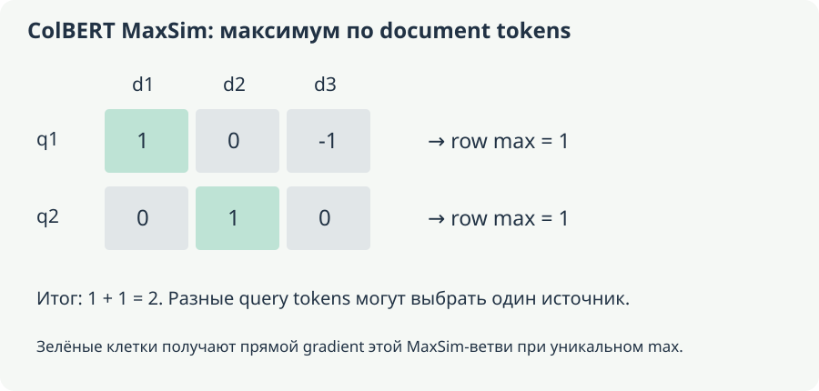

# Е. Четыре способа оценить релевантность query–document

[Оглавление](README.md). Группа F, модули **26–29**. **Основа:** S6:182–1373 подробно обсуждает RAG/BM25/multi-vector storage; здесь добавлены encoder training, sparse expansion и точный MaxSim. Общий RAG pipeline находится в [приложениях LLM](../../06-llm/04-applications/Учебные%20конспекты/README.md).

**Уровень:** Основа retrieval branch. **Предпосылки:** B1/B5; D2 data contract. **Используют:** B8/B9; E4 can use trained/frozen retriever.

## 1. Dense retrieval: reusable document vectors

Query encoder и document encoder обучаются так, чтобы relevant pair имела высокий score. Shared weights возможны, но tasks asymmetric: короткий вопрос и длинный passage имеют разные distributions. Prefixes `query:`/`passage:` или инструкции берутся из конкретной model card/revision; нельзя считать их universal syntax всех encoders. [Multilingual E5](https://huggingface.co/intfloat/multilingual-e5-base) — пример task-trained retrieval checkpoint.

Offline pipeline: source documents → permitted chunks/metadata → encoder → vectors → index. Online: query preprocessing → vector → filtered search → document aggregation. IDs, namespaces, versions и access filters должны сопровождать vectors, а не восстанавливаться по порядку строк случайно.

Exact vector search сравнивает со всеми candidates выбранного corpus; ANN приближает этот поиск. ANN recall@k — overlap с exact vector top-k, semantic relevance recall@k — найденные judged relevant docs относительно qrels. ANN может идеально воспроизвести semantic плохой vector ranking. Поэтому обе проверки нужны отдельно.

Chunk→document aggregation тоже меняет ranking: max score предпочитает один сильный passage, mean — average evidence и penalizes long docs с множеством irrelevant chunks. Count multiple hits без контроля duplicates может завышать длинный документ. Cutoffs и aggregation fit на validation.

<!-- source-depth-bert-Е -->
### 1.1. Какая работа переносится offline

Для N документов bi-encoder заранее вычисляет document vectors и сохраняет связь «vector row → document/chunk ID → исходный текст». Новый query кодируется отдельно, затем сравнивается с индексом. Если encoder document не зависит от query, один вектор можно использовать для многих запросов. Это переиспользование отличает retrieval от полного совместного кодирования каждой пары.

Prefix или instruction также часть функции encoding. Если checkpoint обучен различать query и passage через специальные инструкции, их удаление меняет распределение входов. Но это не универсальное правило всех моделей: произвольное добавление `query:` к модели, которая так не обучалась, не создаёт нужной асимметрии автоматически. Сохраняют точный pipeline вместе с revision tokenizer и encoder.

Документ может иметь несколько chunks. Пусть scores документа A равны (0.9,0.1,0.1), B — (0.7,0.7). Max предпочитает A, mean — B. Оба решения имеют понятный смысл: один сильный passage против более равномерного покрытия. При выборе parent document по child hits нужно также удалить дубликаты и учитывать, сколько исходного evidence попало в итоговый context. Сумма scores без контроля может вознаграждать число chunks, а не качество ответа.

### 1.2. Две проверки recall отвечают на разные вопросы

Пусть exact vector top-3 — {A,B,C}, approximate top-3 — {A,B,D}. ANN overlap recall относительно exact top-3 равна 2/3. Пусть judged relevant documents для query — {C,E}. Тогда semantic recall@3 exact поиска — 1/2, approximate — 0. Даже полный overlap ANN с exact не исправит ошибочную геометрию самого encoder.

Нужны отдельные сравнения: exact search по тем же vectors для качества approximation; qrels для качества смысла; проверка corpus/filters для доступности нужного документа. Если relevant passage отсутствует в корпусе или закрыт выбранным фильтром, изменение ANN-параметров не вернёт его в candidate set. Неполные qrels требуют аккуратной трактовки unjudged documents, а не автоматического объявления их negatives.

### 1.3. Вопрос S6: «Откуда берутся keywords в BM25?»

В чате вы просили подробно объяснить происхождение keywords. Для базового BM25 отдельный нейронный извлекатель keywords не требуется: query проходит analyzer, и его terms сопоставляются с postings документов. Analyzer может включать normalization, разбиение, stemming или другие операции. Важно согласовать document/query analysis; простой BERT WordPiece tokenizer и lexical analyzer индекса не обязаны быть одним инструментом.

У term t есть частота в данном документе f(t,d) и document frequency n(t), число документов, где term встречается хотя бы раз. Это разные величины: сто повторений в одном документе увеличивают f, но добавляют только один документ к n. Один распространённый вариант формулы:

$$
\operatorname{BM25}(q,d)=\sum_{t\in q}\log\!\left(1+\frac{N-n(t)+0.5}{n(t)+0.5}\right)
\frac{f(t,d)(k_1+1)}{f(t,d)+k_1\left(1-b+b\frac{|d|}{\operatorname{avgdl}}\right)}.
$$

Повторения terms самого query, stopwords и детали IDF зависят от variant/analyzer. Это объявленный учебный вариант, а не точное поведение любой поисковой библиотеки. При положительном нормирующем коэффициенте TF-вклад насыщается: при f→∞ дробь стремится к k1+1, а не растёт неограниченно. При b=0 отключена указанная коррекция длины, при b=1 она полностью зависит от отношения |d|/avgdl.

Восстановим числа S6: N=1000, avgdl=200, |d|=300, query «квантизация GPTQ». Для первого term f=4,n=30; для второго f=2,n=5; k1=1.2,b=0.75. Length factor равен 1.375, поэтому k1×factor=1.65. IDF равны примерно 3.491028 и 5.204007. TF-дроби — 8.8/5.65≈1.557522 и 4.4/3.65≈1.205479. Итоговый score≈11.710677.

В чате получилось около 11.73 из-за раннего округления; здесь сохранены промежуточные значения до финального шага. Это score выбранной формулы, не вероятность релевантности. Редкое слово может быть ошибкой или случайным кодом, поэтому высокий IDF сам по себе не доказывает, что документ отвечает запросу.

## 2. Cross-encoder reranking

Cross-encoder кодирует query+candidate jointly и возвращает relevance score. Внутреннее attention даёт token interactions до head, а не только сравнение готовых vectors. Такой model обычно применяется к ограниченному candidate set: он не вернёт missing document из-за первого этапа.

Pointwise BCE обучает relevance каждого pair. Pairwise logistic loss усиливает positive относительно negative:

$$
L_{\mathrm{pair}}=\log\left(1+e^{-(s(q,d^+)-s(q,d^-))}\right).
$$

При scores 2 и 1 margin 1, loss около 0.313262. Если negative на деле тоже relevant, loss создаёт ложное ordering pressure. Listwise objective сравнивает весь list одного query, например CE по normalized target grades/teacher distribution; grading convention и incomplete judgements важны. [CrossEncoder training](https://sbert.net/docs/cross_encoder/training_overview.html).

Score может быть ranking logit, а не calibrated relevance probability across queries. Если threshold должен означать «ответ отсутствует», нужна отдельная calibration на representative queries, включая no-answer. Кандидаты k=100 дают примерно в пять раз больше pair encodings, чем k=20, при одинаковой длине; actual latency зависит от batching/padding/queue.

Evaluation фиксирует first-stage candidates и проверяет incremental ranking gain, candidate recall ceiling, total latency и truncation. Split по queries/documents/groups, а не случайным pair rows одного query.

### 2.1. Где появляется детальное взаимодействие query и документа

Cross-encoder получает общую последовательность query+document и читает её bidirectional attention. Состояние слова документа может зависеть от вопроса ещё до final head. У bi-encoder такое взаимодействие должно быть выражено независимо вычисленными vectors и выбранным score. У cross-encoder doc states нельзя заранее закешировать как один query-independent ответ для любой пары.

В упрощённом сравнении без special tokens query length=20, document length=100. Совместный dense attention имеет 120²=14400 пар, два независимых массива — 20²+100²=10400. Разница 4000 — cross-segment взаимодействия. Полная цена также включает ширину, слои, MLP и переиспользование document encoding. Этот подсчёт показывает механизм, но не является измерением latency.

Обычно reranker применяется к небольшому pool после retrieval. Если из пяти relevant документов first stage вернул только три, максимальный recall по этим пяти остаётся 3/5 даже у идеального reranker. Он может поднять все три на первые места и улучшить precision/ranking, но два отсутствующих документа ему недоступны. Поэтому сначала измеряют candidate recall, затем качество перестановки внутри pool.

### 2.2. Pairwise loss учит относительный margin

При Δ=s+−s− pairwise loss равна softplus(−Δ), derivative по Δ — $-\sigma(-\Delta)$. Для Δ=1 это примерно −0.268941. Derivative по positive score отрицательная, по negative — положительная; gradient descent увеличивает margin. Если оба документа релевантны и их порядок не задан supervision, такой gradient может навязывать ненужное различие.

Добавление одной константы к обоим scores не меняет Δ. Поэтому pairwise ranking loss сам по себе не задаёт абсолютной шкалы вероятности «документ релевантен». Pointwise BCE и listwise objectives дают другие constraints. Если downstream нужно выбрать no-answer по порогу, калибровку проводят отдельно на representative queries, включая случаи без ответа.

Кандидаты training должны отражать нужную трудность: только случайные документы могут сделать задачу слишком простой, а ошибочно размеченные hard negatives — противоречивой. Для teacher-student distillation candidate distributions и нормировки сохраняются явно. При evaluation фиксируют одинаковый first-stage pool, чтобы gain нельзя было объяснить незаметной заменой candidates.

## 3. Learned sparse: vocabulary weights

SPLADE-like representations используют vocabulary-space signals encoder и нелинейное pooling. Один распространённый вариант:

$$
v_j=\max_t\log(1+\operatorname{ReLU}(\ell_{t,j})),
\qquad
s(q,d)=\sum_j v_j^{(q)}v_j^{(d)}.
$$

Token logits превращаются в nonnegative term weights, включая learned expansion terms. Это не merely dense vector, в котором случайно много zeros: vocabulary coordinates имеют lexical interpretation и используются inverted index. Variant pooling/query architecture/regularization различаются. [SPLADE](https://arxiv.org/abs/2107.05720).

Toy two-position logits rows $(1,-1,0)$ и $(0,2,-2)$ дают $v=(\log2,\log3,0)$. Query weights $(1,0,2)$ дают dot score $\log2$. Extra expansion coordinate может добавить полезный match или noise; unseen synonym semantics зависит от training, а не от algebra pooling alone.

L1 и FLOPS-style penalties регулируют sparsity/частоту postings. Слишком много common expansion terms делает inverted lists длинными и ухудшает latency. Низкое число nonzeros не гарантирует лучший index, если все documents используют одни и те же frequent coordinates.

Hybrid combine BM25/dense/sparse scores либо rankings. Raw scales могут различаться; weighted sums требуют normalization/tuning. Reciprocal Rank Fusion использует ranks:

$$
\operatorname{RRF}(d)=\sum_{m}\frac1{k_0+r_m(d)}
$$

по объявленным retrieved lists и missing-document convention. Это ranking heuristic; $k_0$ и cutoffs выбираются без test tuning. Нельзя объединить разные corpora/filters и приписать gain только fusion formula.

### 3.1. От MLM logits к разреженному словарному представлению

Для каждой входной позиции MLM head может выдать V logits, по одному на vocabulary coordinate. Нелинейность log(1+ReLU(ℓ)) зануляет отрицательные значения и сдерживает рост положительных. После pooling по позициям получается один vocabulary-sized vector. Его координаты не обязаны соответствовать буквально присутствовавшим terms: ranking training может обучить expansion на другие словарные tokens.

Это не vocabulary softmax: веса не обязаны суммироваться в 1 и не интерпретируются как распределение одного следующего слова. При запросе важны совпадения активных координат query/document, а inverted index хранит postings для них. Learned expansion может связать «автомобиль» и «машина», но неверное expansion тоже возможно; формула pooling не создаёт правильные synonyms без обучения.

Уточнение variant: исходный SPLADE использовал sum aggregation; max pooling относится к SPLADE v2 и последующим вариантам. В текущем основном примере главы выбран max вариант. Различия описаны в [SPLADE v2](https://arxiv.org/abs/2109.10086) и [коде pooling](https://github.com/naver/splade/blob/main/splade/models/transformer_rep.py). Нельзя считать sum и max взаимозаменяемыми при том же checkpoint.

Для logits двух позиций (1,−1,0) и (3,2,−2) после log/ReLU rows равны (log2,0,0) и (log4,log3,0). Max pooling даёт (log4,log3,0); sum pooling — (log8,log3,0). Первую координату усилило повторное evidence только при sum. В прежнем примере главы каждая координата положительна лишь в одной позиции, поэтому оба pooling случайно совпадали.

### 3.2. Backward и цена postings

При ℓ>0 derivative log(1+ℓ) равна 1/(1+ℓ); при ℓ<0 ReLU закрывает этот путь. Для max по позициям gradient координаты идёт через выбранную максимальную позицию, а для sum — через все её contributing positions. В ties и в точке ReLU=0 используются соглашения конкретной реализации. Эти свойства меняют способ обучения, а не только представление output.

Ranking loss дополняют sparsity penalties. Один FLOPS-style surrogate можно записать как сумму квадратов средних activation каждой координаты по batch: $\sum_j(\frac1B\sum_bv_{b,j})^2$. Он не равен измеренному числу процессорных инструкций, а ограничивает частые активные terms, влияющие на postings. Его коэффициент меняет quality/efficiency trade-off.

Например, два documents с weights (1,0),(1,0) имеют всего два nonzeros; penalty равна 1. Для (1,0),(0,1) nonzeros тоже два, penalty равна 0.5. Различие связано с концентрацией активности в одной общей координате. Один только средний nnz на документ не описывает длины postings и распределение query terms.

### 3.3. Hybrid fusion: почему rank и raw score — разные данные

BM25 score около 11.7 и cosine около 0.8 нельзя складывать как две одинаковые вероятности. Их шкалы сформированы разными механизмами. Для weighted score sum нужна выбранная normalization и validation; для RRF используются ranks, что устраняет прямую зависимость от численного масштаба scores, но теряет часть информации об их расстояниях.

При k0=60 документ A с ranks 1 и 100 получает $1/61+1/160\approx0.022643$. Документ B с ranks 10 и 10 получает $2/70\approx0.028571$ и выигрывает за согласованность двух списков. Это поведение самой формулы, а не доказательство большей семантической релевантности B. Cutoffs, missing-document convention и tie handling сохраняются вместе с протоколом.

## 4. Late interaction и MaxSim

ColBERT хранит document token vectors $D\in\mathbb R^{L_d\times d_e}$; query vectors $Q\in\mathbb R^{L_q\times d_e}$ взаимодействуют позже:

$$
s(q,d)=\sum_{i=1}^{L_q}\max_{j\in\mathcal V_d}Q_i^\top D_j.
$$

Valid tokens, projection, normalization, query augmentation/padding и punctuation policy задаёт implementation. Document encoding reusable, в отличие от full cross-encoder; matching детальнее single-vector pooling. [ColBERTv2](https://arxiv.org/abs/2112.01488) также исследует compression и denoised supervision.

Пусть query vectors $(1,0),(0,1)$. Document A содержит $(1,0),(0,1),(-1,0)$; B — $(0,1),(0,1),(0,-1)$. Все vectors unit norm. Mean обоих documents одинаков $(0,1/3)$, так что single mean representation их не различит. MaxSim A=$1+1=2$, B=$0+1=1$: отдельный match первой query component сохранился только у A.

Это иллюстрирует information trade-off, а не доказывает universal superiority MaxSim. Max independently для каждого query token может сопоставить разные, семантически несовместимые части document. Training/negative sampling и aggregation остаются существенными.

Каждая query-строка выбирает лучший document token; выбранные значения суммируются.

### 4.1. Что сохраняется после независимого encoding

Single-vector encoder сворачивает document в одну точку. ColBERT сохраняет несколько contextual token vectors и сравнивает каждый query vector с набором document vectors позже. Это позволяет оставить более детальное evidence до matching, сохраняя возможность заранее кодировать документы. Общий механизм — [contextualized late interaction](https://arxiv.org/abs/2004.12832).

На исходном примере A/B в главе матрица dot products для A имеет строки (1,0,−1) и (0,1,0). Row maxima равны 1 и 1, сумма 2. Для B строки (0,0,0) и (1,1,−1), maxima 0 и 1, сумма 1. Mean vectors A и B совпадают: положительный и отрицательный first-axis content у A взаимно сократились, но late matching сохранил отдельный полезный token.

MaxSim не требует взаимно однозначного matching. Два query tokens могут выбрать один и тот же document token. Для двух одинаковых queries (1,0) и единственного document vector (1,0) score равна 2. Это не Hungarian assignment и не global alignment последовательностей. Контекстность vectors и ranking training важны, потому что независимые локальные matches могут не гарантировать правильную общую связь слов в тексте.

### 4.2. Как gradient проходит через выбранные matches

Если у query i есть единственный максимальный source $j_i$, то derivative score по $Q_i$ равна $D_{j_i}$. По document vector $D_j$ суммируются Q_i тех queries, которые выбрали j. Затем derivative ranking loss умножает эти вклады, а projection/normalization и encoder получают свой chain rule. При ties max недифференцируем в обычном смысле, и implementation выбирает допустимый subgradient.

В примере A первый query выбирает первый document token, второй — второй. Производная score по Q равна [[1,0],[0,1]], по D — [[1,0],[0,1],[0,0]] до внешнего ranking gradient. Третий token не выиграл ни один max и не получает прямого вклада этой MaxSim-ветви. Но его раннее состояние могло участвовать в self-attention других document tokens, поэтому отсутствие такого прямого вклада не отсоединяет весь токен от обучения encoder.

Добавление document token не может уменьшить exact MaxSim при неизменных остальных Q/D и допустимых masks: максимум по расширенному множеству не уменьшается. Это математическое свойство matching, не гарантия, что более длинные документы всегда лучше. После нового encoding другие contextual vectors могут измениться; training, masks и длины также задают реальные условия поиска.

## 5. Storage и полный budget

Raw single-vector storage $N d_e b$ bytes. Multi-vector — примерно $N\overline L_d d_e b$ до compression/metadata/index. При $N=100\,000,d_e=128,b=2$ single vectors занимают 25.6 MB decimal; при $\overline L_d=128$ — 3.2768 GB, в 128 раз больше raw vectors. Реальные системы compress, prune и используют сложные candidate indexes; только этот multiplication не описывает весь service.

[BGE-M3](https://arxiv.org/abs/2402.03216) — пример dense/sparse/multi-vector modes в одном опубликованном семействе. Их coexistence не доказывает равные quality/cost на вашем corpus. Compare one corpus, qrels, filters, query groups и total offline/online budget.

First-stage retrieval, reranker и generator оцениваются раздельно. Стоимость включает offline encoding/reindex, index footprint, query latency и tail latency pairs. New embedding revision обычно требует coordinated re-encoding; vectors разных spaces нельзя считать совместимыми лишь из-за одинаковой dimension.

### 5.1. Два разных смысла multi-vector из чата

В S6 вы спрашивали, насколько разрастается БД, если хранить text/summary/keywords/table vectors. Это несколько **представлений документа**. У ColBERT обычно сохраняется множество **token representations**. Четыре views на документ и 128 token vectors имеют разные свойства matching и storage; одно название multi-vector не делает их одной архитектурой.

Числа S6 для 10 000 документов ширины 384 в float32: один vector на документ — 15 360 000 bytes, то есть 15.36 MB decimal; четыре views — 61.44 MB. Для 100 000 документов — 153.6 и 614.4 MB. Эти отношения описывают только raw vector payload. Если текст/metadata хранятся один раз и views ссылаются на общий parent ID, суммарная БД растёт меньше чем в четыре раза по этой части; конкретный индекс добавляет свои затраты.

Приведённые в чате HNSW размеры, latency×1.5–2, пороги 50k/500k документов и приросты recall не обоснованы конфигурацией или измерениями. Их нельзя переносить как универсальные benchmarks. Четыре encoding views могут обрабатываться batch; число API requests не обязано совпадать с числом текстов, а цена определяется фактическими единицами сервиса. Это отдельно от числа stored vectors.

Один поиск query vector по объединённым views корректен лишь при совместимом пространстве и понятной aggregation. Если text/table vectors созданы несогласованными encoders, одинаковая ширина и metadata filter не исправят matching. Для нескольких query views нужно отдельно определить поиск и объединение. «Вместо четырёх запросов один» может изменить математическую задачу, а не только ускорить её.

### 5.2. Parent retrieval и честный полный budget

Parent document retrieval может индексировать только маленькие child chunks, а большие parent texts хранить для выдачи context. Индексировать оба размера vectors обязательно не требуется; поэтому удвоение storage не является свойством самой идеи. Выбор parent увеличивает переданный context и может добавить нерелевантные участки, что тоже оценивается.

Для сравнения фиксируют корпус, qrels, фильтры, query groups и требуемый output. Затем измеряют first-stage recall, final ranking, offline encoding/reindex, raw vectors и index size, query/reranking latency и tail latency. Сначала single/dense или lexical baseline, затем контролируемое добавление views, hybrid и reranking. Само число документов не отвечает на вопрос «стоит ли оно того»: нужны измеренный gain и цена нужного режима на ваших данных.

## 6. Контроль и практика модулей 26–29

1. Чем ANN recall отличается от relevance recall? **Ответ:** первое — approximation exact vector ranking, второе — найденное semantic evidence по qrels.
2. Может ли reranker исправить отсутствующего candidate? **Ответ:** нет; его choices ограничены first-stage pool.
3. Почему SPLADE не просто arbitrary sparse dense embedding? **Ответ:** coordinates связаны с vocabulary и learned lexical expansion/indexing.
4. Что потеряно при mean в toy MaxSim example? **Ответ:** отдельный exact match query direction, компенсированный другими token vectors.

5. Откуда берутся keywords базового BM25? **Ответ:** из terms обработанного query, сопоставляемых с индексом; отдельный обученный keyword extractor не требуется.
6. Равны ли четыре document views и token vectors ColBERT? **Ответ:** нет. Это разные способы представления и matching, с разным числом vectors и storage budget.
7. Нужно ли parent retrieval индексировать и малые, и большие chunks? **Ответ:** нет. Можно индексировать child vectors, а parent texts хранить для выдачи контекста.
8. Почему max SPLADE pooling нельзя молча заменить sum? **Ответ:** меняются values, длина/повторяемость evidence и путь gradient; checkpoint обучался с определённой агрегацией.

**Практика:** вычислите pairwise loss, sparse weights и MaxSim вручную. Для одного fixed query set спроектируйте BM25→dense/hybrid→reranker ablation и optional late interaction. Запишите quality, candidate ceiling, storage и latency отдельно; числа своих models добавляйте после запуска.
